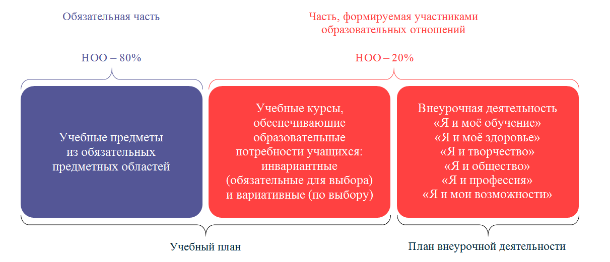
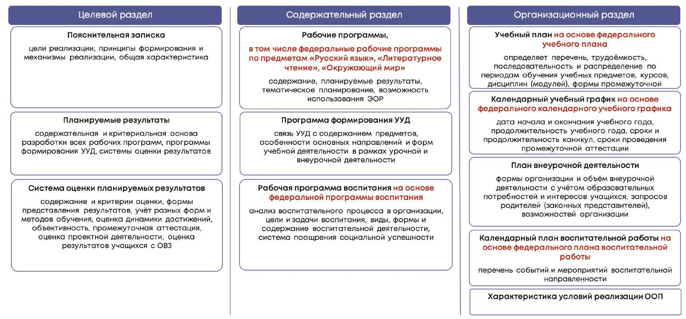

# ПОЯСНИТЕЛЬНАЯ ЗАПИСКА

> Основная образовательная программа начального общего образования ГБОУ Школа № 1366. ФГОС 3.0. Страницы PDF: 6–13.

Данная образовательная программа составлена на основе требований ФГОС НОО и федеральной образовательной программы начального общего образования с учётом образовательного потенциала города Москвы.

## Цель основной образовательной программы

Целью основной образовательной программы является

- обеспечение реализации конституционного права каждого гражданина Российской Федерации на получение качественного образования, включающего обучение, развитие и воспитание каждого обучающегося;
- организация учебного процесса с учётом целей, содержания и планируемых результатов начального общего образования, отражённых в ФГОС НОО;
- создание условий для свободного развития каждого обучающегося с учётом его потребностей, возможностей и стремления к самореализации;
- организация деятельности педагогического коллектива по созданию индивидуальных программ и учебных планов для одарённых, успешных обучающихся и (или) для детей социальных групп, нуждающихся в особом внимании и поддержке.

## Принципы построения образовательной программы

1. Принцип учёта ФГОС НОО: ФОП НОО базируется на требованиях, предъявляемых ФГОС НОО к целям, содержанию, планируемым результатам и условиям обучения в начальной школе;

2. Принцип учёта языка обучения: с учётом условий функционирования образовательной организации ФОП НОО характеризует право получения образования на родном языке из числа языков народов Российской Федерации и отражает механизмы реализации данного принципа в учебных планах, планах внеурочной деятельности;

3. Принцип учёта ведущей деятельности обучающегося: программа обеспечивает конструирование учебного процесса в структуре учебной деятельности, предусматривает механизмы формирования всех компонентов учебной деятельности (мотив, цель, учебная задача, учебные операции, контроль и самоконтроль);

4. Доступность образования — создание условий для обеспечения доступа каждому учащемуся к качественному образованию;

5. Вариативность — создание условий выбора учащимися программ разной направленности и уровня сложности в соответствии с образовательными интересами, потребностями и способностями;

6. Принцип преемственности и перспективности: программа обеспечивает связь и динамику в формировании знаний, умений и способов деятельности между этапами начального общего образования, а также успешную адаптацию обучающихся к обучению по образовательным программам основного общего образования, единые подходы между их обучением и развитием на уровнях начального общего и основного общего образования;

7. Принцип индивидуализации обучения: программа предусматривает возможность и механизмы разработки индивидуальных программ и учебных планов для обучения детей с особыми способностями, потребностями и интересами с учетом мнения родителей (законных представителей) обучающегося;

8. Единство учебной и воспитательной деятельности — организация учебного процесса на достижение личностных результатов освоения образовательной программы через урочную и внеурочную деятельность;

9. Деятельностный подход — организация активной познавательной деятельности с ориентацией на универсальные учебные действия;

10. Сотрудничество — организация взаимодействия с внешними организациями (социальными, культурными, научными, образовательными) с целью обогащения содержания образовательных программ и ресурсов (кадровых, материально-технических);
11. Принцип здоровьесбережения: при организации образовательной деятельности не допускается использование технологий, которые могут нанести вред физическому и (или) психическому здоровью обучающихся, приоритет использования здоровьесберегающих педагогических технологий. Объём учебной нагрузки, организация учебных и внеурочных мероприятий должны соответствовать требованиям, предусмотренным санитарными правилами и нормами1.
12. Здоровьесбережение — использование здоровьесберегающих педагогических технологий, приведение объёма учебной нагрузки в

1 Срок получения начального общего образования составляет не более четырех лет. Для лиц, обучающихся по индивидуальным учебным планам, срок получения начального общего образования может быть сокращен. При реализации трехгодичного срока обучения на уровне начального общего образования необходимо равномерно распределять образовательную нагрузку на три года обучения, корректировать общий объем аудиторной нагрузки обучающихся по индивидуальным учебным планам в соответствии с санитарными правилами и нормами СанПиН 1.2.3685-21 "Гигиенические нормативы и требования к обеспечению безопасности и (или) безвредности для человека факторов среды обитания", утвержденными постановлением Главного государственного санитарного врача Российской Федерации от 28 января 2021 г. N 2 (зарегистрировано Министерством юстиции Российской Федерации 29 января 2021 г., регистрационный N 62296), с изменениями, внесенными постановлениями Главного государственного санитарного врача Российской Федерации от 30 декабря 2022 г. N 24 (зарегистрировано Министерством юстиции Российской Федерации 9 марта 2023 г., регистрационный N 72558), от 17 марта 2025 г. N 2 (зарегистрировано Министерством юстиции Российской Федерации 19 мая 2025 г., регистрационный N 82236), действующим до 1 марта 2027 г. (далее - Гигиенические нормативы), и санитарными правилами СП 2.4.3648-20 "Санитарно-эпидемиологические требования к организациям воспитания и обучения, отдыха и оздоровления детей и молодежи", утвержденными постановлением Главного государственного санитарного врача Российской Федерации от 28 сентября 2020 г. N 28 (зарегистрировано Министерством юстиции Российской Федерации 18 декабря 2020 г., регистрационный N 61573), с изменениями, внесенными постановлением Главного государственного санитарного врача Российской Федерации от 30 августа 2024 г. N 10 (зарегистрировано Министерством юстиции Российской Федерации 17 сентября 2024 г., регистрационный N 79493), действующим до 1 января 2027 г. (далее - Санитарно-эпидемиологические требования).

соответствие требованиям действующих санитарных правил и нормативов, формирование культуры здорового образа жизни у учащихся в условиях мегаполиса;

13. Принцип интеграции обучения и воспитания: программа предусматривает связь урочной и внеурочной деятельности, разработку мероприятий, направленных на обогащение знаний, воспитание чувств и познавательных интересов обучающихся, нравственно-ценностного отношения к действительности. Интеграция с городской средой — использование образовательных ресурсов района, города при реализации рабочих программ учебных предметов, учебных курсов, курсов внеурочной деятельности.

14. Академическая надёжность (объективность оценивания) ориентация на качественное фундаментальное образование и объективную оценку качества образовательных результатов.
15. Академическая мобильность – возможность изменения учащимися форм обучения, направления обучения.
16. Профессиональная требовательность — использование современных технологий при подборе кадров, учёт показателей эффективности в организации кадровой политики при распределении учебной нагрузки, формировании системы оплаты труда, организации обучения сотрудников и повышения их квалификации;
17. Цифровая открытость — цифровизация механизмов реализации образовательной программы в целях предоставления доступа учащимся и их родителям (законным представителям), педагогическому коллективу к информации о содержании образовательного процесса, результатах обучения, персональных достижениях с помощью функциональных возможностей платформы «Московская электронная школа».

Основная образовательная программа ГБОУ Школа № 1366 учитывает возможности городского пространства московского образования (рис. 1), включающего в себя:

- образовательную среду города как совокупность образовательных, культурных, научно-технических организаций города, городских событий, расширяющих возможности для достижения высоких образовательных результатов;
- открытую цифровую среду, которая предоставляет возможности для эффективного решения образовательных, коммуникативных и управленческих задач;
- учреждения, осуществляющие сопровождение и поддержку образовательных организаций. Организации-партнеры: МИСиС, ВШЭ, МГПУ, МГТУ им. Н.Э.Баумана, колледж 26 КАДР, Политехнический колледж № 8 имени И.Ф. Павлова Центры дополнительного образования: МЦРПО Технопарки: Заповедное посольство парка «Зарядье»

## Механизмы реализации основной образовательной программы

Основная образовательная программа состоит из обязательной части и части, формируемой участниками образовательных отношений в соотношении 80% и 20% соответственно.

Схема 1. Части основной образовательной программы

Обязательная часть представляет собой совокупность учебных предметов из обязательных предметных областей. Формируемая часть представляет собой инвариантные (обязательные для выбора) и вариативные (по выбору) курсы учебного плана и курсы внеурочной деятельности (схема 1). Курсы внеурочной деятельности направлены на поддержку различных интересов, потребностей учащихся.

Рабочие программы обязательных учебных предметов, инвариантных курсов, курсов по выбору, в том числе внеурочной деятельности, представлены в разделе 2.

ООП НОО учитывает возрастные и психологические особенности обучающихся. Возможные сроки освоения ООП НОО: четыре года и три года (ускоренное обучение). Общий объём аудиторной работы обучающихся за четыре учебных года не может составлять менее 2966 академических часов и более 3305 академических часов в соответствии с требованиями к организации образовательного процесса к учебной нагрузке при 5-дневной учебной неделе, предусмотренными Гигиеническими нормативами и Санитарно-эпидемиологическими требованиями.

## Особенности образовательной программы ГБОУ Школа № 1366

Программа ГБОУ Школа № 1366 предполагает реализацию следующих образовательных решений:

1. «Эффективная начальная школа» – ускоренное обучение, предполагающее освоение образовательной программы начального общего образования за 3 года

Таблица 1. Особенности программы по годам обучения

| | | Учебные предметы, | Курсы формируемой | части, поддерживающие особенности программы |
| --- | --- | --- | --- | --- |
| Класс | Особенности программы | поддерживающие особенности программы | Учебный план | деятельность2 Внеурочная |
| 1 | Общеобразовательный класс | | | Разговоры о важном Читательская грамотность Моя Москва, горжусь тобой! Орлята России Занимательная математика юного москвича Занимательная математика (ступ. режим) Занимательный русский язык (ступ. режим) Мир вокруг нас (ступ. режим) Занимательный английский язык (для классов (1-3) |
| 2 | Общеобразовательный класс | | Методы познания окружающего мира в рамках урока | Разговоры о важном Орлята России Занимательная математика юного москвича Русский язык для школьной программы |
| 3 | Общеобразовательный класс | | Математический практикум Введение в информатику Методы познания окружающего мира в рамках урока | Разговоры о важном Орлята России Занимательная математика юного москвича Консультация по русскому языку Консультация по математике Русский язык для школьной программы |

2 В данной представлены только курсы внеурочной деятельности, поддерживающие особенности программы. Полный перечень курсов внеурочной деятельности представлен в разделе 2 в подразделе «План внеурочной деятельности»

Общеобразовательный класс

Методы познания окружающего мира в рамках урока

Разговоры о важном Орлята России Занимательная математика юного москвича Консультация по русскому языку Консультация по математике Практикум по информатике Русский язык для школьной программы Преемственность с образовательными программами дошкольного образования и ООО заключается

- в учёте образовательных результатов выпускников начальной школы при проектировании формируемой части образовательной программы основной школы;
- в наличии образовательных решений в начальной школе, позволяющих сделать выбор направления программы обучения в основной школе и помогающих оценить готовность к этому выбору;

Возможные формы получения образования и механизмы их реализации:

- очное обучение;
- очно-заочное обучение;
- заочное обучение;
- семейное обучение. Очное обучение — форма обучения, реализуемая в образовательной организации, которая предполагает проведение занятий с учителем в режиме реального времени (в классе, в группе, индивидуально, в том числе с применением дистанционных технологий).

Очно-заочная форма обучения — форма обучения, реализуемая в образовательной организации, которая предполагает сочетание занятий с учителем (в классе, в группе, индивидуально, в том числе с применением дистанционных технологий) и самостоятельное освоение учащимися образовательной программы. Рекомендованное минимальное количество часов занятий с учителем – 25% от учебных часов, предусмотренных учебным планом и планом внеурочной деятельности.

Обучение по очно-заочной и заочной формам осуществляется по индивидуальным учебным планам в соответствии с требованиями ФГОС и санитарными нормами и правилами. Обязательным является и составление плана внеурочной деятельности. При формировании индивидуального учебного плана и плана внеурочной деятельности проверяется соотношение объёма обязательной и формируемой части в соответствии с требованиями ФГОС НОО 80% и 20% соответственно.

При очно-заочной форме обучения учащийся может выбрать для самостоятельного изучения учебный предмет (курс) учебного плана, курс внеурочной деятельности полностью или его часть. При этом в индивидуальном учебном плане указывается объём часов очного и заочного обучения по каждому из учебных предметов (курсов).

Занятия с учителем могут проводиться вместе с классом или индивидуально, в том числе с применением дистанционных технологий, в соответствии с возможностями образовательной организации.

Особенности заочного обучения — форма обучения, реализуемая в образовательной организации, которая предполагает самостоятельное освоение учащимися основной образовательной программы с прохождением текущего контроля успеваемости, промежуточной и итоговой аттестации в образовательной организации. Заочная форма обучения отличается от семейной формы получения образования и самообразования тем, что учащийся входит в контингент образовательной организации, которая совместно с родителями (законными представителями) несёт ответственность за освоение учащимся её образовательной программы.

При заочной форме обучения учащийся осваивает все учебные предметы (курсы) учебного плана и курсы внеурочной деятельности самостоятельно. Консультирование учителя организуется для проведения текущего контроля успеваемости и промежуточной аттестации, в том числе с применением дистанционных образовательных технологий.

Для всех форм обучения реализуются единые рабочие программы по предметам (курсам, в том числе внеурочной деятельности), предусмотренные образовательной программой.

Порядок организации разных форм обучения и порядок зачисления и перевода представлены в локальном акте образовательной организации о формах обучения.

Семейное обучение — это форма получения образования вне школы. Осуществляется с правом последующего прохождения промежуточной и государственной итоговой аттестации в организациях, осуществляющих образовательную деятельность. Для организации обучения в семейной форме необходимо заключение договора с образовательной организацией.

## Общая характеристика программы

