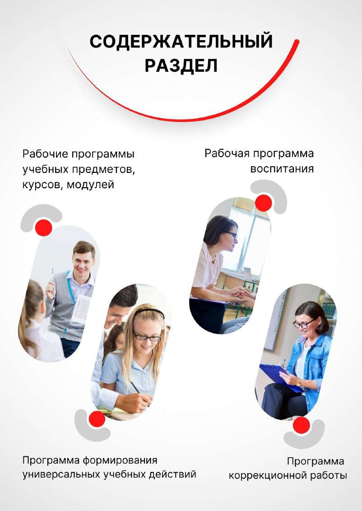

# СИСТЕМА ОЦЕНКИ ДОСТИЖЕНИЯ ПЛАНИРУЕМЫХ РЕЗУЛЬТАТОВ

> Основная образовательная программа начального общего образования ГБОУ Школа № 1366. ФГОС 3.0. Страницы PDF: 18–73.

Цель системы оценки образовательных результатов — установление соответствия образования требованиям ФГОС, получение объективной информации о состоянии качества образования, тенденциях, его изменениях и причинах, влияющих на его уровень, своевременное принятие педагогических и управленческих решений.

Основными направлениями и целями оценочной деятельности в образовательной организации являются: оценка образовательных достижений обучающихся на различных этапах обучения как основа их промежуточной и итоговой аттестации, а также основа процедур внутреннего мониторинга образовательной организации, мониторинговых исследований муниципального, регионального и федерального уровней;

оценка результатов деятельности педагогических работников как основа аттестационных процедур; оценка результатов деятельности образовательной организации как основа аккредитационных процедур. Основным объектом системы оценки, её содержательной и критериальной базой выступают требования ФГОС НОО, которые конкретизируются в планируемых результатах освоения обучающимися ФОП НОО.

Система оценки включает процедуры внутренней и внешней оценки. Внутренняя оценка включает:

- стартовую диагностику;
- текущую и тематическую оценку;
- итоговую оценку;
- промежуточную аттестацию;
- портфолио;
- психолого-педагогическое наблюдение;
- внутренний мониторинг образовательных достижений обучающихся. Внешняя оценка включает:
- независимую оценку качества образования;
- мониторинговые исследования муниципального, регионального и федерального уровней;
- итоговую аттестацию.

## Система оценки образовательных результатов реализует системно-деятельностный, уровневый и комплексный подходы к оценке

образовательных достижений.

Системно-деятельностный подход подход к оценке образовательных достижений обучающихся проявляется в оценке способности обучающихся к решению учебно-познавательных и учебно-практических задач, а также в оценке уровня функциональной грамотности обучающихся. Он обеспечивается содержанием и критериями оценки, в качестве которых выступают планируемые результаты обучения, выраженные в деятельностной форме.

Уровневый подход служит важнейшей основой для организации индивидуальной работы с учащимися. Он реализуется за счёт фиксации различных типов планируемых результатов: начального (репродуктивного), повышенного (продуктивного) и высокого (рефлексивного). Уровневый подход к оценке образовательных достижений обучающихся служит важнейшей основой для организации индивидуальной работы с обучающимися. Он реализуется как по отношению к содержанию оценки, так и к представлению и интерпретации результатов измерений.

Уровневый подход к оценке образовательных достижений обучающихся реализуется за счёт фиксации различных уровней достижения обучающимися планируемых результатов базового уровня и уровней выше и ниже базового. Достижение базового уровня свидетельствует о способности обучающихся решать типовые учебные задачи, целенаправленно отрабатываемые со всеми обучающимися в ходе учебного процесса. Овладение базовым уровнем является границей, отделяющей знание от незнания, выступает достаточным для продолжения обучения и усвоения последующего учебного материала.

Комплексный подход к оценке образовательных достижений реализуется через: оценку предметных и метапредметных результатов; использование комплекса оценочных процедур как основы для оценки динамики индивидуальных образовательных достижений обучающихся и для итоговой оценки; использование контекстной информации (об особенностях обучающихся, условиях и процессе обучения и другое) для интерпретации полученных результатов в целях управления качеством образования;

использование разнообразных методов и форм оценки, взаимно дополняющих друг друга: стандартизированных устных и письменных работ, проектов, практических (в том числе исследовательских) и творческих работ;

использование форм работы, обеспечивающих возможность включения обучающихся в самостоятельную оценочную деятельность (самоанализ, самооценка, взаимооценка);

использование мониторинга динамических показателей освоения умений и знаний, в том числе формируемых с использованием информационно-коммуникационных (цифровых) технологий.

Оценка достижения планируемых результатов осуществляется в рамках внутренней системы оценки качества образования. Внутренняя система оценки качества образования (ВСОКО) — совокупность организационных структур, норм и правил, диагностических и оценочных процедур, обеспечивающих на единой концептуально-методологической основе оценку образовательных достижений учащихся, оценку эффективности деятельности образовательной организации.

ВСОКО включает в себя внутришкольный контроль, внутренний мониторинг качества образования, независимую оценку качества образования.

Внутришкольный контроль — процесс получения и переработки информации о ходе и результатах образовательного процесса с целью принятия на этой основе управленческих решений.

Внутренний мониторинг качества образования — проведение наблюдений, обследований по соблюдению всеми участниками учебно-воспитательного процесса законодательных и иных нормативных актов, касающихся качества образования, требований к порядку и условиям реализации программы.

Независимая оценка качества образования — проведение внешних оценочных процедур, которые осуществляются в отношении деятельности образовательной организации по реализации образовательных программ в целях определения соответствия образовательных результатов требованиям ФГОС.

Типы оценочных процедур

Применяемые в образовательном процессе оценочные процедуры определяются целями оценивания и сопровождаются своевременными решениями по его результату (таблица 2).

Таблица 2. Соответствие оценочных процедур целям оценивания и решения по их результату

| Цели оценивания | Оценочные процедуры | Периодичность | Решения |
| --- | --- | --- | --- |
| | | Внутришкольный контроль | |
| Оценка готовности учащихся к изучению отдельных предметов, курсов, модулей, разделов (тем) | Стартовая диагностика | По необходимости, в зависимости от сложности темы, её приоритета, связи образовательных результатов с другими предметами (перечень стартовых диагностик определяется ежегодно педагогическим коллективом) | Отбор содержания, методов и технологий для организации учебной деятельности, соответствующих стартовому уровню готовности учащихся, в том с учётом дифференцированного подхода |
| Определение уровня достижения учащимися результатов, предусмотренных | Текущее оценивание | Определяется образовательной организации самостоятельно в соответствии с локальным актом «Положение о формах, периодичности и порядке текущего контроля успеваемости и промежуточной аттестации обучающихся ГБОУ Школа № 1366» https://clck.ru/3Dwcfe | Своевременная корректировка календарно-тематического планирования, отбор форм, методов и средств организации деятельности |
| образовательной программой | | | для ликвидации образовательных дефицитов учащихся |
| Определение уровня достижения планируемых результатов, которые осваиваются в рамках изучения темы учебного предмета, курса, модуля. Понимание учащимися динамики учебных результатов внутри темы. Выявление тем, вызывающих учебные затруднения | Тематическое оценивание | Оценка по каждой теме рабочей программы (определяется как средневзвешенная отметка всех оценочных процедур по теме) | Своевременная корректировка рабочей программы и учебного процесса |
| Оценка освоения образовательной программы, в том числе отдельной части или всего объёма учебного предмета, курса, дисциплины (модуля) образовательной программы | Промежуточная аттестация | Периодичность проведения по каждому учебному предмету, учебному курсу (в том числе, внеурочной деятельности) определяются образовательной организации самостоятельно локальным актом («Положение о формах, периодичности и порядке текущего контроля успеваемости и промежуточной аттестации обучающихся ГБОУ Школа № 1366» https://clck.ru/3Dwcfe) Промежуточная аттестация проводится с целью определения качества освоения обучающимися образовательных программ внеурочной деятельности, дополнительных общеразвивающих программ: полноты, прочности, осознанности и системности освоения содержания программ по годам обучения. | Основание для перевода учащегося в следующий класс. Составление плана ликвидации академической задолженности, перевод на обучение по адаптированным образовательным программам, в соответствии с рекомендациями психолого-медико- педагогической комиссии |
| | | Оценить результаты освоения программ внеурочных курсов можно, если использовать технологию портфолио в сочетании с индивидуальным учетом образовательных достижений учащихся. форма промежуточной аттестации по внеурочной деятельности могут являться: интеллектуальный конкурс тестирование презентация проекта (мини-проекта) сдача нормативов ГТО творческая работа конкурс творческих работ интеллектуальная игра постановка и показ театральных миниатюр презентация разработанных правил поведения другие испытания (по решению педагогического совета). | либо на обучение по индивидуальному учебному плану, повторное обучение по усмотрению родителей (законных представителей) |
| Оценка степени и уровня освоения учащимися рабочей программы по предмету. Определение соответствия результатов освоения учащимися основных образовательных программ требованиям ФГОС | Итоговая оценка | По итогам освоения рабочей программы по предмету на основе среднего балла (с учетом веса балла) за весь учебный год (определяется как средневзвешенная отметка всех оценочных процедур по курсу) | Перевод учащихся на следующий уровень образования. Составление плана индивидуальных занятий в случае получения неудовлетворительных результатов |
| Выявление особенностей и развития, анализ освоения образовательной программы, проектирование мер индивидуальной поддержки | Психолого- педагогическое наблюдение | Постоянно. Целенаправленное наблюдение - по мере необходимости, по запросу родителей и педагогов | Корректировка поурочного планирования, подходов к обучению, плана воспитательной работы, планирование индивидуальных консультаций, занятий, встреч с родителями, направление учащихся на медико-психолого- педагогическую комиссию |
| | | Независимая оценка качества образования | |
| Оценка качества подготовки учащихся, основанная на единых для всех школ Москвы контрольных измерительных материалах, единой технологии проведения, интерпретации и обработки результатов | Независимая диагностика: тематические, метапредметные, диагностики функциональной грамотности | В соответствии с планом обязательных диагностик, а также по результатам внутришкольного контроля качества образования и в соответствии с потребностью | Оценка уровня объективности внутренней системы оценки качества, принятие кадровых решений и решений по корректировке ВСОКО. Внесение изменений в учебные планы и рабочие программы. Обеспечение индивидуальной работы учителей с учащимися |

Для оценки образовательных результатов используются следующие формы контроля:

- анализ музыкальных произведений – форма контроля, позволяющая оценить умение учащегося характеризовать музыкальное произведение, опираясь на знание основ музыкального искусства и собственное впечатление;
- анкета/формуляр – форма контроля, позволяющая оценить умение учащегося работать с опросным листом для внесения данных или формой для ответов на определенные вопросы для получения определенной информации;
- аудирование – форма контроля, позволяющая оценить умение учащегося воспринимать и понимать содержание звучащих текстов;
- ведение тетради – форма контроля, позволяющая оценить умение учащегося соблюдать единый орфографический режим, правильность выполнения письменных работ, соответствие их объёма и содержания требованиям;
- виртуальный практикум – форма контроля, позволяющая оценить умение учащегося применять теоретические знания путём имитационного проведения экспериментов;
- вокально-хоровая работа – форма контроля музыкальной деятельности, позволяющая оценить певческие навыки (качество звуковедения и чистоту интонации (хоровой строй), артикуляцию и дикцию, атаку звука, дыхание) учащегося и его умение раскрыть образное содержание, интонационные, жанровые, стилистические особенности произведения, передать его характер в сольном или хоровом исполнении;
- выразительное чтение – форма контроля, позволяющая оценить умение учащегося выразительно читать (в том числе наизусть) с соблюдением норм литературного произношения, передавая идейно-образное содержание текста;
- географический диктант – форма контроля, позволяющая оценить комплексные географические знания учащегося;
- грамматическое задание – форма контроля, позволяющая оценить результаты усвоения учащимся изучаемых грамматических явлений, умение производить простейший языковой анализ слов и предложений;
- графический диктант – форма контроля, позволяющая оценить умения учащегося представлять решение задачи в условно-графической форме;
- демонстрация техники упражнений – форма контроля, позволяющая оценить навык учащегося в демонстрации упражнения наиболее рациональным и эффективным способом, близким к эталонному;
- диалог/полилог – форма контроля, позволяющая оценить качество диалогического/полилогического общения участников, состоящего из непосредственного обмена высказываниями между двумя или несколькими лицами на основе равенства их позиций;
- диктант – форма контроля, позволяющая оценить орфографические и пунктуационные навыки учащегося;
- дневник самоконтроля – форма контроля, позволяющая оценить умение вести специально разработанную тетрадь, предназначенную для мониторинга состояния своего физического развития и самочувствия, до, в процессе и после физических занятий;
- доклад – форма контроля, позволяющая оценить навыки публичного развёрнутого выступления учащегося по определённому вопросу, основанного на самостоятельно привлечённой, структурированной и обобщённой им информации, в том числе в виде презентации;
- домашнее задание – форма контроля, при которой проверяется и оценивается умение учащегося самостоятельно выполнить задания на закрепление и углубление знаний, речевых навыков и умений, полученных на уроке;
- зачёт – форма контроля, позволяющая оценить уровень достижения образовательных результатов учащегося посредством индивидуального или группового собеседования или выполнения практической работы;
- изложение – форма контроля, позволяющая оценить умение учащегося излагать содержание прочитанного или услышанного текста. Основными критериями при этом являются полнота изложения, фактическая правильность, грамотность, последовательность, логичность;
- инструментальное музицирование – форма контроля музыкальной деятельности, позволяющая оценить умение учащегося исполнять

музыку на элементарных (детских) музыкальных инструментах, отражая характер произведения, его стилистические и жанровые особенности, раскрывая образное содержание, демонстрируя ритмическую и интонационную точность, ансамблевость исполнения;

- исследовательская работа – форма контроля, позволяющая оценить умение учащегося проводить исследование для получения новых знаний, проверки гипотез, установления закономерностей, обобщения и обоснования информации;
- комбинированная работа – форма контроля, позволяющая оценить предметные знания, умения и навыки учащегося посредством выполнения практических и теоретических заданий разного типа;
- конкурс – форма контроля, позволяющая оценить умение учащегося представлять результаты творческой работы, художественное исполнение, решение научно-познавательной задачи в условиях конкурсных испытаний;
- конспект – форма контроля, позволяющая оценить умение учащегося вести связное, сжатое и последовательное письменное изложение содержания усваиваемого материала (статьи, доклада, книги, лекции и др.);
- конференция – форма контроля, позволяющая оценить умение учащегося публично представлять свои проектные или исследовательские работы, отвечать на вопросы, участвовать в дискуссии;
- краткосрочный письменный опрос – форма контроля, позволяющая за короткий период времени (до 10 минут) оперативно проверить уровень освоения содержания изучаемого материала с целью внесения коррекции в технологическую карту урока.
- лабораторная работа – форма контроля, позволяющая оценить умения учащегося проводить изучение и исследование характеристик заданного объекта экспериментальным методом с применением лабораторного оборудования;
- лабораторный опыт – форма контроля, позволяющая оценить практические умения учащегося в изучении количественных или качественных характеристик изучаемого объекта, процесса или явления в ходе непродолжительного по времени одноактового исследования с применением лабораторного оборудования;
- личное письмо/открытка – форма контроля, позволяющая оценить умение учащегося составлять письменное обращение близкому человеку, например другу по переписке, оформленное в соответствии с определёнными правилами;
- математический диктант – форма контроля, позволяющая оценить способность учащегося к восприятию задания на слух, поиску решения и письменной фиксации решения или ответа;
- монолог – форма контроля, позволяющая оценить умение учащегося излагать информацию устно;
- музыкальная викторина – форма контроля, позволяющая оценить умение учащегося на слух распознавать и определять жанровую или авторскую принадлежность музыкальных произведений, их форму, характер или образное содержание, имя, тип или состав исполнителей;
- музыкальный дневник – форма контроля, позволяющая оценить умение учащегося фиксировать собственные впечатления, возникшие при прослушивании (разучивании) музыкального произведения, посещении концерта или музыкального спектакля, и/или выражать их в творческой форме (например, в виде рассказа, эссе, стихотворения, рисунка);
- олимпиада – форма контроля, позволяющая оценить способности учащегося к решению творческих задач;
- опрос – форма контроля, позволяющая оценить уровень знаний, умений и навыков учащегося посредством устных и/или письменных вопросов;
- осложнённое списывание – форма контроля, позволяющая оценить орфографические и пунктуационные навыки учащегося посредством списывания текста, содержащего орфографические и пунктуационные изменения, а также выполнения заданий по данному тексту;
- пересказ – форма контроля, позволяющая оценить умение учащегося устно излагать прочитанный/прослушанный текст (правильность передачи основного содержания текста, последовательность и полнота развития сюжета, выразительность при характеристике образов);
- письменный ответ – форма контроля, позволяющая оценить умение учащегося построить развёрнутое письменное высказывание по предложенному вопросу/на заданную тему. Основными критериями оценки при этом являются полнота, аргументированность, связность и последовательность изложения;
- проект – форма контроля, позволяющая оценить способность учащегося осуществлять деятельность, направленную на создание продукта;
- работа с картой – форма контроля, позволяющая оценить умения учащегося распознавать объекты на карте, извлекать из карты необходимую информацию;
- реферат – форма контроля, позволяющая оценить навыки поиска и анализа информации у учащегося, а также его способности представления ключевых идей и формулирования выводов на их основе, выполненного по определенным правилам оформления;
- решение задач – форма контроля, позволяющая оценить умение учащегося самостоятельно (индивидуально или в группе, в классе или дома) найти решение поставленной задачи;
- словарный ассоциативный ряд – форма контроля, позволяющая оценить умение учащегося приводить ассоциативные ряды, возникающие с определенной лексической единицей;
- словарный диктант – форма контроля, позволяющая оценить знание учащимся слов с непроверяемыми написаниями и владение навыками их правописания;
- смысловое чтение – форма контроля, позволяющая оценить способность учащегося понимать смысловое содержание текста;
- соревнование – форма контроля, предполагающая состязание (матч) среди учащихся или команд учащихся по различным видам спорта (спортивным дисциплинам) в целях выявления лучшего участника состязания (матча), проводимое по утверждённому положению (регламенту) ;
- сочинение – форма контроля, позволяющая оценить умение учащегося создавать связный текст с учётом языковых норм;
- списывание – форма контроля, позволяющая оценить каллиграфические, орфографические и пунктуационные навыки учащегося при копировании печатного текста;
- творческая работа – форма контроля, позволяющая оценить продукт творческой деятельности учащегося;
- терминологический диктант – форма контроля, позволяющая оценить уровень владения учащимся терминологическим аппаратом

предмета;

- тест – форма контроля, позволяющая оценить уровень знаний, умений и навыков учащегося через систему тестовых заданий/вопросов;
- тестирование физических качеств – форма контроля, предполагающая измерение или испытание, стандартное задание, проводимое для определения и оценки уровня физического состояния, физической подготовленности и двигательных способностей на основе комплекса разнообразных упражнений;
- техника чтения – форма контроля, позволяющая оценить умение учащегося читать и понимать прочитанное. Основными критериями оценки при этом являются способ чтения, правильность, осознанность;
- устный ответ – форма контроля, позволяющая оценить индивидуальные особенности усвоения учащимся учебного материала и проверить умение строить связное, логически последовательное сообщение на заданную тему или поставленный вопрос;
- устный счёт – форма контроля, позволяющая оценить умение выполнения учащимся вычислений без помощи дополнительных устройств и приспособлений;
- учебная работа – форма контроля, позволяющая оценить умение учащегося создавать завершённую художественную работу по предложенному образцу;
- учебное задание – форма контроля, позволяющая оценить умение учащегося выполнять действия, направленные на достижение цели, заданной в рамках проблемной ситуации;
- учебное упражнение – форма контроля, позволяющая оценить умение учащегося самостоятельно выполнять задания на отработку конкретных предметных умений и навыков;
- читательский дневник – форма контроля, позволяющая оценить умение учащегося вести записи и формулировать впечатления о прочитанных книгах;
- чтение – форма контроля, позволяющая оценить умение учащегося воспринимать и понимать содержание графически зафиксированных текстов;
- цифровое домашнее задание – форма контроля в ЭЖД МЭШ, позволяющего оценить умение обучающегося выполнять действия в цифровой среде;
- экспериментальная работа – форма контроля, позволяющая оценить умения учащегося при выполнении опытно-поисковой работы и/или эксперимента;
- эссе – форма контроля, позволяющая оценить умения учащегося создавать небольшой прозаический текст, выражая собственную точку зрения о каком-либо предмете, теме, проблеме.

Формы контроля, используемые в отдельных учебных предметах, учебных курсах (в том числе, внеурочной деятельности), отражены в рабочих программах.

Контрольная работа является одним из видов контроля и нацелена на оценку достижения каждым учащимся или группой учащихся требований к предметным и/или метапредметным результатам обучения в соответствии с ФГОС при освоении образовательной программы, в том числе отдельной части или всего объёма учебного предмета, курса, модуля образовательной программы.

Распределение контрольных работ по предметам и годам обучения представлено в таблице 3.

Таблица 3. Распределение контрольных работ по предметам и годам обучения

| Предмет Параллель | 1 | 2 | 3 | 4 |
| --- | --- | --- | --- | --- |
| Изобразительное искусство | 0 | 0 | 0 | 0 |
| Иностранный язык | - | 0 | 2 | 2 |
| Литературное чтение | 0 | 1 | 1 | 1 |
| Математика | 0 | 5 | 6 | 6 |
| Музыка | 0 | 0 | 0 | 0 |
| Окружающий мир | 0 | 3 | 3 | 3 |
| ОРКСЭ | - | - | - | 0 |
| Русский язык | 0 | 4 | 4 | 5 |
| Технология | 0 | 0 | 0 | 0 |
| Физическая культура | 0 | 0 | 0 | 0 |

| сентябрь | октябрь | ноябрь | декабрь | январь | февраль | март | апрель | май |
| --- | --- | --- | --- | --- | --- | --- | --- | --- |
| | | | 2 неделя- контрольная работа по русскому языку (ЭНШ) | | | | 2-3 неделя – контрольная работа по окружающему миру | 2 неделя – проект по технологии |
| | | | 3-4 неделя- контрольная работа по математике | | | | 3-4 неделя- контрольная работа по русскому | 2-3 неделя – творческая работа по ИЗО, музыке |
| | | | (ЭНШ) | | | | языку | |
| | | | 3-4 неделя- контрольная работа по литературному чтению (ЭНШ) | | | | 3-4 неделя- контрольная работа по математике | |
| | | | | | | | 3-4 неделя- контрольная работа по литературному чтению | |

## 2 класс

| сентябрь | октябрь | ноябрь | декабрь | январь | февраль | март | апрель | май |
| --- | --- | --- | --- | --- | --- | --- | --- | --- |
| | | | 1-2 неделя – контрольная работа по окружающему миру | | | | 3-4 неделя- контрольная работа по литературному чтению | 2 неделя – проект по технологии |
| | | | 2 -3 неделя – контрольная работа по математике | | | | 3-4 неделя- контрольная работа по русскому языку | 2-3 неделя – творческая работа по ИЗО, музыке |
| | | | 3-4 неделя- | | | | 3-4 неделя – контрольная | |

сентябрь октябрь ноябрь декабрь январь февраль март апрель май 1-2 неделя – контрольная работа по окружающему миру

| | | | контрольная работа по русскому языку | | | | работа по окружающему миру | |
| --- | --- | --- | --- | --- | --- | --- | --- | --- |
| | | | | | | | 3-4 неделя- контрольная работа по математике | |
| | | | | | | | 3-4 неделя- контрольная работа по английскому языку | |

| сентябрь | октябрь | ноябрь | декабрь | январь | февраль | март | апрель | май |
| --- | --- | --- | --- | --- | --- | --- | --- | --- |
| | | | 1-2 неделя – контрольная работа по окружающему миру | | | | 3-4 неделя – контрольная работа по окружающему миру | 2 неделя – проект по технологии |
| | | | 3 - 4 неделя- контрольная работа по русскому языку | | | | 3-4 неделя- контрольная работа по математике | 2-3 неделя – творческая работа по ИЗО, музыке |
| | | | 3-4 неделя – контрольная работа по математике | | | | 3-4 неделя- контрольная работа по литературному чтению | |

3-4 неделя-контрольная работа по русскому языку

3-4 неделя-контрольная работа по английскому языку

| сентябрь | октябрь | ноябрь | декабрь | январь | февраль | март | апрель | май |
| --- | --- | --- | --- | --- | --- | --- | --- | --- |
| | | 2-3 неделя – контрольная работа по окружающему миру | 1-2 неделя – контрольная работа по математике | 3-4 неделя – контрольная работа по окружающему миру | | 2-3 неделя – контрольная работа по окружающему миру | | 2 неделя – проект по технологии |
| | | | 2-3 неделя – контрольная работа по окружающему миру | | | 2-3 неделя- контрольная работа по математике | | 2-3 неделя – творческая работа по ИЗО, музыке |
| | | | 2-3 неделя- контрольная работа по русскому языку | | | 3-4 неделя- контрольная работа по литературному чтению | | |
| | | | | | | 3-4 неделя – контрольная работа по | | |

русскому языку 3-4 неделя-контрольная работа по английскому языку

Используемые шкалы оценивания В образовательной организации используются следующие шкалы оценивания: безотметочная описательная (для 1 класса), зачетная («зачтено» - «не зачтено»), пятибалльная. Соответствие: «5» - «отлично», высокий уровень, «4» - «хорошо», повышенный уровень, «3» - «удовлетворительно», базовый уровень «2» - «неудовлетворительно», пониженный уровень, «1» - «плохо», низкий уровень.

Критерии выставления отметок по разным предметам

в зависимости от формы контроля

Единые критерии выставления отметок по разным предметам в зависимости от формы контроля (за что выставляется та или иная отметка) определяются локальным актом образовательной организации и требованиями критериального оценивания для различных форм контроля: см. «Положение о формах, периодичности и порядке текущего контроля успеваемости и промежуточной аттестации обучающихся ГБОУ Школа № 1366» Особенности оценки достижения личностных результатов Целью оценки личностных достижений обучающихся является получение общего представления о воспитательной деятельности образовательной организации и ее влиянии на коллектив обучающихся.

При оценке личностных результатов необходимо соблюдение этических норм и правил взаимодействия с обучающимся с учетом его индивидуально-психологических особенностей развития.

Личностные достижения обучающихся, освоивших ФОП НОО, включают две группы результатов:

- основы российской гражданской идентичности, ценностные установки и социально значимые качества личности;
- готовность обучающихся к саморазвитию, мотивация к познанию и обучению, активное участие в социально значимой деятельности. Учитывая особенности групп личностных результатов, педагогический работник может осуществлять только оценку следующих качеств:
- наличие и характеристика мотива познания и учения;
- наличие умений принимать и удерживать учебную задачу, планировать учебные действия;
- способность осуществлять самоконтроль и самооценку. Диагностические задания, устанавливающие уровень этих качеств, интегрируются с заданиями по оценке метапредметных регулятивных универсальных учебных действий.

Учитывая особенности групп личностных результатов, учитель может осуществлять оценку только следующих качеств:

- наличие и характеристика мотива познания и учения;
- наличие умений принимать и удерживать учебную задачу, планировать учебные действия;
- способность осуществлять самоконтроль и самооценку. Диагностические задания, устанавливающие уровень этих качеств, целесообразно интегрировать с заданиями по оценке метапредметных регулятивных универсальных учебных действий.

Особенности оценки достижения метапредметных результатов

Оценка метапредметных результатов осуществляется через оценку достижения планируемых результатов освоения ФОП НОО, которые отражают совокупность познавательных, коммуникативных и регулятивных универсальных учебных действий.

Формирование метапредметных результатов обеспечивается комплексом освоения программ учебных предметов и внеурочной деятельности.

Оценка метапредметных результатов проводится с целью определения сформированности:

- познавательных универсальных учебных действий;
- коммуникативных универсальных учебных действий;
- регулятивных универсальных учебных действий. Овладение познавательными универсальными учебными действиями предполагает формирование и оценку у обучающихся базовых логических действий, базовых исследовательских действий, умения работать с информацией.

Овладение базовыми логическими действиями обеспечивает формирование у обучающихся следующих умений:

- сравнивать объекты, устанавливать основания для сравнения, устанавливать аналогии;
- объединять части объекта (объекты) по определённому признаку;
- определять существенный признак для классификации, классифицировать предложенные объекты;
- находить закономерности и противоречия в рассматриваемых фактах, данных и наблюдениях на основе предложенного педагогическим работником алгоритма;
- выявлять недостаток информации для решения учебной (практической) задачи на основе предложенного алгоритма;
- устанавливать причинно-следственные связи в ситуациях, поддающихся непосредственному наблюдению или знакомых по опыту, делать выводы.

Овладение базовыми исследовательскими действиями обеспечивает формирование у обучающихся следующих умений:

- определять разрыв между реальным и желательным состоянием объекта (ситуации) на основе предложенных педагогическим работником вопросов;
- с помощью педагогического работника формулировать цель, планировать изменения объекта, ситуации;
- сравнивать несколько вариантов решения задачи, выбирать наиболее подходящий (на основе предложенных критериев);
- проводить по предложенному плану опыт, несложное исследование по установлению особенностей объекта изучения и связей между объектами (часть - целое, причина - следствие);
- формулировать выводы и подкреплять их доказательствами на основе результатов проведённого наблюдения (опыта, измерения, классификации, сравнения, исследования);
- прогнозировать возможное развитие процессов, событий и их последствия в аналогичных или сходных ситуациях; Работа с информацией как одно из познавательных универсальных учебных действий обеспечивает сформированность у обучающихся следующих умений:
- выбирать источник получения информации;
- согласно заданному алгоритму находить в предложенном источнике информацию, представленную в явном виде;
- распознавать достоверную и недостоверную информацию самостоятельно или на основании предложенного педагогическим работником способа её проверки;
- соблюдать с помощью взрослых (педагогических работников, родителей (законных представителей) несовершеннолетних обучающихся) правила информационной безопасности при поиске информации в информационно-телекоммуникационной сети «Интернет»;
- анализировать и создавать текстовую, видео-, графическую, звуковую информацию в соответствии с учебной задачей;
- самостоятельно создавать схемы, таблицы для представления информации. Овладение универсальными учебными коммуникативными действиями предполагает формирование и оценку у обучающихся таких групп умений, как общение и совместная деятельность.

Общение как одно из коммуникативных универсальных учебных действий обеспечивает сформированность у обучающихся следующих умений:

- воспринимать и формулировать суждения, выражать эмоции в соответствии с целями и условиями общения в знакомой среде;
- проявлять уважительное отношение к собеседнику, соблюдать правила ведения диалога и дискуссии; признавать возможность существования разных точек зрения;
- корректно и аргументированно высказывать своё мнение;
- строить речевое высказывание в соответствии с поставленной задачей;
- создавать устные и письменные тексты (описание, рассуждение, повествование);
- готовить небольшие публичные выступления;
- подбирать иллюстративный материал (рисунки, фото, плакаты) к тексту выступления; Совместная деятельность как одно из коммуникативных универсальных учебных действий обеспечивает сформированность у обучающихся следующих умений:
- формулировать краткосрочные и долгосрочные цели (индивидуальные с учётом участия в коллективных задачах) в стандартной (типовой) ситуации на основе предложенного формата планирования, распределения промежуточных шагов и сроков;
- принимать цель совместной деятельности, коллективно строить действия по её достижению: распределять роли, договариваться, обсуждать процесс и результат совместной работы; проявлять готовность руководить, выполнять поручения, подчиняться;
- ответственно выполнять свою часть работы;
- оценивать свой вклад в общий результат;
- выполнять совместные проектные задания с опорой на предложенные образцы.

Овладение регулятивными универсальными учебными действиями согласно ФГОС НОО предполагает формирование и оценку у обучающихся умений самоорганизации (планировать действия по решению учебной задачи для получения результата, выстраивать последовательность выбранных действий) и самоконтроля (устанавливать причины успеха (неудач) в учебной деятельности, корректировать свои учебные действия для преодоления ошибок).

Оценка достижения метапредметных результатов осуществляется как педагогическим работником в ходе текущей и промежуточной оценки по предмету, так и администрацией образовательной организации в ходе мониторинга. В текущем учебном процессе отслеживается способность обучающихся разрешать учебные ситуации и выполнять учебные задачи, требующие владения познавательными, коммуникативными и регулятивными действиями, реализуемыми в предметном преподавании.

В ходе мониторинга проводится оценка сформированности универсальных учебных действий. Содержание и периодичность мониторинга устанавливаются решением педагогического совета образовательной организации. Инструментарий для оценка сформированности универсальных учебных действий строится на межпредметной основе и может включать диагностические материалы по оценке функциональной грамотности, сформированности регулятивных, коммуникативных и познавательных учебных действий.Оценка метапредметных результатов представляет собой оценку достижения уровня сформированности универсальных учебных действий: познавательных, коммуникативных, регулятивных. Формирование метапредметных результатов обеспечивается совокупностью всех учебных предметов, учебных курсов и внеурочной деятельности. Оценка достижения метапредметных результатов осуществляется в ходе внутреннего мониторинга качества образования и независимой оценки качества образования.

Формами контроля достижения метапредметных результатов в рамках независимой оценки качества образования являются:

- диагностическая работа по читательской грамотности для учащихся 3-х классов,
- диагностическая работа «Метапредметные умения МГЧ» в 4-х классах. Одной из значимых форм контроля достижения метапредметных результатов является проект. Данная форма контроля позволяет оценить достижение предметных и метапредметных результатов учащихся.

Критерии оценки проектной работы разрабатываются с учётом целей и задач проектной деятельности на данном этапе образования. Проектная деятельность оценивается по следующим критериям (таблица 4):

Таблица 4. Критерии и показатели оценки проекта

| Критерии оценки проекта | Показатели |
| --- | --- |
| Сформированность предметных знаний и способов действий | Умение раскрыть содержание работы, использовать имеющиеся знания и способы действий |
| Сформированность познавательных действий | Умение сформулировать поставленную вместе с учителем проблему, выбрать способы её решения, осуществлять отбор и поиск информации, делать выводы |
| Сформированность регулятивных действий | Умение самостоятельно планировать и управлять своей познавательной деятельностью |
| Сформированность коммуникативных действий | Умение ясно изложить выполненную работу, представить её результаты, ответить на вопросы |

Критерии для оценки проектных работ

| 1. Оцениваем замысел: соответствие темы, цели, задач - содержанию | Балл |
| --- | --- |
| Цель и задачи не согласованы, проблема обозначена нечетко, цель и задачи не соответствуют тематике работы | 0 |
| Цель и задачи в целом согласованы, проблема обозначена, содержание не в полной мере отвечает тематике и поставленным задачам работы | 1 |
| Цель определена, явно описана, четко определены задачи, проблема обозначена, тематика работы, цель, задачи и содержание полностью согласованы. | 2 |
| 2. Оцениваем замысел: оригинальность и познавательная ценность | |
| Не ясна ценность проекта. Работа шаблонная. | 0 |
| Проект имеет определенную познавательную и развивающую ценность. Есть оригинальные решения. | 1 |
| Проект имеет высокую познавательную и развивающую ценность. Работа отличается творческим подходом. | 2 |
| 3. Оцениваем работу над проектом: планирование и ресурсное обеспечение (время, материалы, люди,...) | |
| Нет плана работы. Нет понимания, какими средствами будет реализован проект. Нет понимания, для кого важна реализация проекта | 0 |
| Присутствует одно из: 1)План работы, с описанием основных этапов и промежуточных результатов, отражающий реальный ход работ 2)Описание использованных ресурсов 3)Понимание, кто заинтересован в реализации | 1 |
| Присутствует подробный план, описание необходимых ресурсов, участнику понятно, кто заинтересован в реализации и почему | 2 |
| 4. Оцениваем уровень реализации проекта: качество результата | |
| Проект на уровне замысла, нет описания достигнутого результат. Нет подтверждений (фото, видео) полученного результата | 0 |
| Представлено описание достигнутого результата, есть подтверждение полученного результата (фото, видео, модель, макет). Испытания не проводились или результаты испытаний не воспроизводимы. | 1 |
| Проектный замысел реализован полностью, дано подробное описание достигнутого результата, есть подтверждение полученного результата (фото, видео, модель, макет). Испытания проведены, результат воспроизводимы, подтверждают практическую значимость. | 2 |
| 5. Представление работы: оцениваем самостоятельность и вовлеченность | |
| Участник не готов описать ход работы над проектом, низкий уровень осведомленности в области проектирования, отвечает на вопросы шаблонно, не готов к обсуждению по сути | 0 |
| Участник готов описать ход работы над проектом, на вопросы отвечает разумно, но односложно, уровень осведомлённости не достаточен для свободной дискуссии, нет особой заинтересованности в своём результате. | 1 |
| Участник готов обсуждать особенности работы над проектом, на вопросы отвечает развёрнуто, уровень осведомлённости достаточен для дискуссии, высокая заинтересованность в своём результате | 2 |
| 6. Качество оформления работы | |
| Письменная часть проекта отсутствует или является плагиатом | 0 |
| Письменная часть работы оформлена не в соответствии с установленными правилами, нарушена структура работы | 1 |
| Работа отличается четким и грамотным оформлением в точном соответствии с установленными правилами | 2 |
| 7. Качество проведения презентации | |
| Презентация не проведена | 0 |
| Выступление не соответствует требованиям проведения презентации | 1 |
| Выступление соответствуют требованиям проведения презентации, но оно вышло за рамки регламента | 2 |
| Выступление соответствуют требованиям проведения презентации, оно не вышло за рамки регламента, но автор не владеет культурой общения с аудиторией (умение отвечать на вопросы, доказывать точку зрения) | 3 |
| Выступление соответствуют требованиям проведения презентации, оно не вышло за рамки регламента, автор владеет культурой общения с аудиторией, но сама презентация не достаточно хорошо подготовлена | 4 |
| Выступление соответствуют требованиям проведения презентации, оно не вышло за рамки регламента, автор владеет культурой общения с аудиторией, презентация хорошо подготовлена, автору удалось заинтересовать аудиторию | 5 |

Оценка динамики учебной и творческой активности учащегося, направленности, широты или избирательности интересов, выраженности проявлений творческой инициативы, а также уровня высших достижений, демонстрируемых учащимися, осуществляется при помощи «Портфолио учащегося» в МЭШ, состоящего из нескольких разделов:

- «Учёба»,
- «Наука»,
- «Спорт»,
- «Творчество»,
- «Культура»,
- «Гражданская активность».

Во всех разделах в структурированном виде представлена информация о достижениях школьника, сохранённая в системе МЭШ и других подведомственных системах Департамента образования и науки города.

Результаты, представленные в портфолио, используются при выработке рекомендаций по выбору индивидуальной образовательной траектории на уровне среднего общего образования.

Особенности оценки достижения предметных результатов

Предметные результаты освоения ООП НОО с учетом специфики содержания предметных областей, включающих конкретные учебные предметы, ориентированы на применение знаний, умений и навыков обучающимися в учебных ситуациях и реальных жизненных условиях, а также на успешное обучение.

Оценка предметных результатов освоения ООП НОО осуществляется через оценку достижения обучающимися планируемых результатов по отдельным учебным предметам.

Основным предметом оценки результатов освоения ООП НОО в соответствии с требованиями ФГОС НОО является способность к решению учебно-познавательных и учебно-практических задач, основанных на изучаемом учебном материале и способах действий, в том числе метапредметных (познавательных, регулятивных, коммуникативных) действий.

Для оценки предметных результатов освоения ООП НОО используются критерии: знание и понимание, применение, функциональность. Обобщённый критерий «знание и понимание» включает знание и понимание роли изучаемой области знания или вида деятельности в различных контекстах, знание и понимание терминологии, понятий и идей, а также процедурных знаний или алгоритмов.

Обобщённый критерий «применение» включает: использование изучаемого материала при решении учебных задач, различающихся сложностью предметного содержания, сочетанием универсальных познавательных действий и операций, степенью проработанности в учебном процессе;

использование специфических для предмета способов действий и видов деятельности по получению нового знания, его интерпретации, применению и преобразованию при решении учебных задач (проблем), в том числе в ходе поисковой деятельности, учебно-исследовательской и учебно-проектной деятельности.

Обобщённый критерий «функциональность» включает осознанное использование приобретённых знаний и способов действий при решении внеучебных проблем, различающихся сложностью предметного содержания, читательских умений, контекста, а также сочетанием когнитивных операций.

Оценка предметных результатов освоения ООП НОО осуществляется педагогическим работником в ходе процедур текущего, тематического, промежуточного и итогового контроля.

Особенности оценки предметных результатов по отдельному учебному предмету фиксируются в приложении к ООП НОО. Описание оценки предметных результатов по отдельному учебному предмету включает:

список итоговых планируемых результатов с указанием этапов их формирования и способов оценки (например, текущая (тематическая); устно (письменно), практика); график контрольных мероприятий; требования к выставлению отметок за промежуточную аттестацию (при необходимости - с учётом степени значимости отметок за отдельные оценочные процедуры см. в локальном акте образовательной организации и требованиями критериального оценивания для различных форм: «Положение о формах, периодичности и порядке текущего контроля успеваемости и промежуточной аттестации обучающихся ГБОУ Школа № 1366» Формами контроля достижения предметных результатов в рамках независимой оценки качества образования являются:

- Проверочная работа по математике для обучающихся 4 класса,
- Проверочная работа по русскому языку для обучающихся 4 класса,
- Проверочная работа по литературному чтению для обучающихся 4 класса. Формами контроля достижения предметных результатов в рамках независимой оценки качества образования проекта «Эффективная началка» («Московская началка») являются:
- стартовая проверочная работа по русскому языку для обучающихся 2 класса,
- стартовая проверочная работа по математике для обучающихся 2 класса,
- стартовая проверочная работа по литературному чтению для обучающихся 2 класса,
- диагностическая работа по итогам ускоренного освоения образовательной программы 2 класса по русскому языку,
- диагностическая работа по итогам ускоренного освоения образовательной программы 2 класса по математике,
- диагностическая работа по итогам ускоренного освоения образовательной программы 2 класса по литературному чтению,
- диагностическая работа по итогам ускоренного освоения образовательной программы 3 класса по русскому языку,
- диагностическая работа по итогам ускоренного освоения образовательной программы 3 класса по математике,
- диагностическая работа по итогам ускоренного освоения образовательной программы 3 класса по литературному чтению,
- диагностическая работа по итогам ускоренного освоения образовательной программы 4 класса по русскому языку,
- диагностическая работа по итогам ускоренного освоения образовательной программы 4 класса по математике,
- диагностическая работа по итогам ускоренного освоения образовательной программы 4 класса по литературному чтению.

1 класс. Математика

## Планируемые результаты на конец учебного года

Этапы формирования Способы оценки

Оценка степени и уровня освоения учащимися предметного содержания и метапредметных умений в соответствии с требованиями ФГОС

Апрель ЭНШ - декабрь

Комбинированная контрольная работа

1 класс. Русский язык

| Планируемые результаты на конец учебного года | Этапы формирования | Способы оценки |
| --- | --- | --- |
| Писать аккуратным разборчивым почерком без искажений прописные и строчные буквы, соединения букв, слова. Правильно списывать (без пропусков и искажений букв) слова и предложения, тексты объемом не более 25 слов | март (3 неделя) ЭНШ - декабрь | списывание текста |
| Оценка степени и уровня освоения учащимися предметного содержания и метапредметных умений в соответствии с требованиями ФГОС | Апрель ЭНШ - декабрь | Комбинированная контрольная работа |

1 класс. Литературное чтение

| Планируемые результаты на конец учебного года | Этапы формирования | Способы оценки |
| --- | --- | --- |
| Оценка степени и уровня освоения учащимися предметного содержания и метапредметных умений в соответствии с требованиями ФГОС | Апрель ЭНШ - декабрь | Комбинированная контрольная работа |

1 класс. Окружающий мир

| Планируемые результаты на конец учебного года | Этапы формирования | Способы оценки |
| --- | --- | --- |
| Оценка степени и уровня освоения учащимися предметного содержания и метапредметных умений в соответствии с требованиями ФГОС | Апрель ЭНШ - декабрь | Комбинированная контрольная работа |

1 класс. Изобразительное искусство

## Планируемые результаты на конец учебного года

Этапы формирования Способы оценки

Оценка степени и уровня освоения учащимися предметного содержания и метапредметных умений в соответствии с требованиями ФГОС

Май ЭНШ - декабрь

Творческая работа

1 класс. Музыка

| Планируемые результаты на конец учебного года | Этапы формирования | Способы оценки |
| --- | --- | --- |
| Оценка степени и уровня освоения учащимися предметного содержания и метапредметных умений в соответствии с требованиями ФГОС | Май ЭНШ - декабрь | Творческая работа |

1 класс. Труд (технология)

| Планируемые результаты на конец учебного года | Этапы формирования | Способы оценки |
| --- | --- | --- |
| Оценка степени и уровня освоения учащимися предметного содержания и метапредметных умений в соответствии с требованиями ФГОС | Май ЭНШ - декабрь | Проект |

2 класс. Математика

| Планируемые результаты на конец учебного года | Этапы формирования | Способы оценки |
| --- | --- | --- |
| Выполнять арифметические действия: сложение и вычитание в пределах 100. Решать текстовые задачи в одно-два действия на применение смысла арифметического действия (сложение, вычитание): моделировать задачу (используя предметную модель, рисунок), представлять задачу графически (краткая запись, схема, таблица), планировать ход решения, оформлять его в виде действий, записывать и проверять ответ | ноябрь (2 неделя) ЭНШ - март | Контрольная работа |
| Решать задачи на применение смысла арифметического действия (умножение, деление), в том числе отношений (больше/меньше в), на сравнение (кратное): представлять текст задачи, планировать ход | март (2 неделя) ЭНШ – март (4 неделя) | Контрольная работа |
| решения, записывать решение и ответ; решать задачи с пропорциональными величинами | | |
| Оценка степени и уровня освоения учащимися предметного содержания и метапредметных умений в соответствии с требованиями ФГОС | апрель ЭНШ – май | Комбинированная контрольная работа |

2 класс. Русский язык

| Планируемые результаты на конец учебного года | Этапы формирования | Способы оценки |
| --- | --- | --- |
| Находить место орфограммы в слове и между словами на изученные правила: -проверяемые безударные гласные в корне слова; -парные звонкие и глухие согласные в корне слова; Находить и исправлять ошибки на изученные правила, описки. Писать под диктовку тексты объёмом не более 45 слов с учётом изученных правил правописания. | ноябрь (3 неделя) ЭНШ - март | Контрольная работа |
| Находить место орфограммы в слове и между словами на изученные правила: - проверяемые безударные гласные в корне слова; - парные звонкие и глухие согласные в корне слова; - непроверяемые гласные и согласные. Находить и исправлять ошибки на изученные правила, описки. Писать под диктовку тексты объёмом не более 45 слов с учётом изученных правил правописания. | февраль (3 неделя) ЭНШ - апрель | Контрольная работа |
| Писать аккуратным разборчивым почерком без искажений прописные и строчные буквы, соединения букв, слова; правильно списывать (без пропусков и искажений букв) слова и предложения, тексты объемом не более 50 слов | март (3 неделя) ЭНШ - май | Cписывание текста |
| Оценка степени и уровня освоения учащимися предметного содержания и метапредметных умений в соответствии с требованиями ФГОС | Апрель ЭНШ - май | Комбинированная контрольная работа |

2 класс. Литературное чтение

| Планируемые результаты на конец учебного года | Этапы формирования | Способы оценки |
| --- | --- | --- |
| Оценка степени и уровня освоения учащимися предметного содержания и метапредметных умений в соответствии с требованиями ФГОС | Апрель ЭНШ - май | Комбинированная контрольная работа |

2 класс. Окружающий мир

| Планируемые результаты на конец учебного года | Этапы формирования | Способы оценки |
| --- | --- | --- |
| Распознавать изученные объекты окружающего мира по их описанию, рисункам; естественные природные объекты и искусственные, сделанные руками человека (изделия). Характеризовать на основе предложенного плана или опорных слов изученные природные объекты и явления. Группировать изученные объекты живой и неживой природы по предложенным признакам. Приводить примеры, иллюстрирующие связи в природе между живой и неживой природой, природой и человеком | ноябрь (2 неделя) ЭНШ - март | Контрольная работа |
| Объяснять строение вещества по опорным рисункам, схемам. Называть признаки вещества, какими свойствами они обладают. Распознавать вещества в твердом, жидком и газообразном состоянии с опорой на рисунки. Приводить примеры веществ, твердых тел. Объяснять, почему у предметов различные свойства, от чего зависят их свойства | март (2 неделя) ЭНШ - апрель | Контрольная работа |
| Оценка степени и уровня освоения учащимися предметного содержания и метапредметных умений в соответствии с требованиями ФГОС | Апрель ЭНШ - май | Комбинированная контрольная работа |

2 класс. Английский язык

| Планируемые результаты на конец учебного года | Этапы формирования | Способы оценки |
| --- | --- | --- |
| Чтение - читать вслух адаптированные аутентичные тексты, построенные на изученном языковом материале, с соблюдением правил чтения и соответствующей интонации, демонстрируя понимание прочитанного, соблюдая нормы произношения; | Апрель ЭНШ - май | Устный зачет |

- использовать при чтении языковую догадку,
- распознавать в речи интернациональные слова. Объём текста/текстов для чтения вслух — до 60 слов.

2 класс. Изобразительное искусство

| Планируемые результаты на конец учебного года | Этапы формирования | Способы оценки |
| --- | --- | --- |
| Оценка степени и уровня освоения учащимися предметного содержания и метапредметных умений в соответствии с требованиями ФГОС | май | Творческая работа |

2 класс. Музыка

| Планируемые результаты на конец учебного года | Этапы формирования | Способы оценки |
| --- | --- | --- |
| Оценка степени и уровня освоения учащимися предметного содержания и метапредметных умений в соответствии с требованиями ФГОС | май | Творческая работа |

2 класс. Труд (технология)

| Планируемые результаты на конец учебного года | Этапы формирования | Способы оценки |
| --- | --- | --- |
| Оценка степени и уровня освоения учащимися предметного содержания и метапредметных умений в соответствии с требованиями ФГОС | май | Проект |

3 класс. Математика

| Планируемые результаты на конец учебного года | Этапы формирования | Способы оценки |
| --- | --- | --- |
| Умножение и деление в пределах 100 — устно и письменно на однозначное число. Находить неизвестный компонент арифметического действия. Выполнять проверку результата вычислений. | ноябрь (2 неделя) | Контрольная работа |
| Решать задачи на применение смысла арифметического действия; на сравнение (разностное) в пределах 1000. Решать задачи в одно-два действия: моделировать и представлять задачу графически, планировать ход решения, записывать решение по действиям и с помощью числового выражения, анализировать решение (искать другой способ решения), записывать и оценивать ответ (устанавливать его реалистичность, проверять вычисления) | февраль (2 неделя) | Контрольная работа |
| Оценка степени и уровня освоения учащимися предметного содержания и метапредметных умений в соответствии с требованиями ФГОС | апрель | Комбинированная контрольная работа |

3 класс. Русский язык

| Планируемые результаты на конец учебного года | Этапы формирования | Способы оценки |
| --- | --- | --- |
| Различать однокоренные слова и формы одного и того же слова; находить в словах с однозначно выделяемыми морфемами окончание, корень, приставку, суффикс; находить и исправлять ошибки на изученные правила, описки. Писать под диктовку тексты объёмом не более 65 слов с учётом изученных правил правописания | ноябрь (3 неделя) | Контрольная работа |
| Находить в словах с однозначно выделяемыми морфемами окончание, корень, приставку, суффикс; производить разбор слова по составу | февраль (3 неделя) | Контрольная работа |
| Писать аккуратным разборчивым почерком без искажений прописные и строчные буквы, соединения букв, слова; правильно списывать (без пропусков и искажений букв) слова и предложения, тексты объемом не более 70 слов | март (3 неделя) | Cписывание текста |

Оценка степени и уровня освоения учащимися предметного содержания и метапредметных умений в соответствии с требованиями ФГОС

апрель Комбинированная контрольная работа

3 класс. Литературное чтение

| Планируемые результаты на конец учебного года | Этапы формирования | Способы оценки |
| --- | --- | --- |
| Оценка степени и уровня освоения учащимися предметного содержания и метапредметных умений в соответствии с требованиями ФГОС | апрель | Комбинированная контрольная работа |

3 класс. Окружающий мир

| Планируемые результаты на конец учебного года | Этапы формирования | Способы оценки |
| --- | --- | --- |
| Называть органы систем организма человека с опорой на схему строения тела человека. Объяснять, какую работу (функции) выполняют системы органов человека. Объяснять, что такое температура тела человека и каким прибором ее измеряют. Характеризовать (описывать) условия сохранения здоровья, а также действия, мероприятия, направленные на поддержание чистоты, здоровья | декабрь (1 неделя) | Контрольная работа |
| Объяснять строение вещества по опорным рисункам, схемам. Объяснять три состояния воды в природе по описанию, рисункам и фотографиям. Распознавать изученные горные породы и минералы по их описанию, рисункам и фотографиям. Объяснять смысл понятия "полезные ископаемые". Распознавать условные обозначения полезных ископаемых на карте | март (1неделя) | Контрольная работа |
| Оценка степени и уровня освоения учащимися предметного содержания и метапредметных умений в соответствии с требованиями ФГОС | апрель (2 неделя) | Комбинированная контрольная работа |

3 класс. Английский язык

## Планируемые результаты на конец учебного года

Этапы формирования Способы оценки

Аудирование Воспринимать на слух и понимать речь учителя (вопросы), построенную на изученном языковом материале. Чтение

апрель Устный зачет

- читать вслух учебные тексты, построенные на изученном языковом материале, с соблюдением правил чтения и соответствующей интонацией, демонстрируя понимание прочитанного;
- использовать при чтении языковую догадку;
- распознавать в речи интернациональные слова;
- читать слова согласно основным правилам чтения английского языка;
- распознавать знаки английской транскрипции; знать отличие их от букв английского алфавита;
- фонетически корректное озвучивать знаки транскрипции Объём текста/текстов для чтения вслух — до 70 слов. Говорение

Создавать устные связные монологические высказывания (повествование/сообщение), соблюдая нормы произношения и интонацию. Лексико-грамматические навыки Владеть лексико-грамматическими навыками употребления лексики и грамматики английского языка в коммуникативно-значимом контексте.

3 класс. Изобразительное искусство

| Планируемые результаты на конец учебного года | Этапы формирования | Способы оценки |
| --- | --- | --- |
| Оценка степени и уровня освоения учащимися предметного содержания и метапредметных умений в соответствии с требованиями ФГОС | май | Творческая работа |

3 класс. Музыка

## Планируемые результаты на конец учебного года

Этапы формирования Способы оценки

Оценка степени и уровня освоения учащимися предметного содержания и метапредметных умений в соответствии с требованиями ФГОС

май Творческая работа

3 класс. Труд (технология)

| Планируемые результаты на конец учебного года | Этапы формирования | Способы оценки |
| --- | --- | --- |
| Оценка степени и уровня освоения учащимися предметного содержания и метапредметных умений в соответствии с требованиями ФГОС | май | Проект |

4 класс. Математика

| Планируемые результаты на конец учебного года | Этапы формирования | Способы оценки |
| --- | --- | --- |
| Решать текстовые задачи в несколько действий, выполнять преобразование заданных величин, выбирать при решении подходящие способы вычисления, сочетая устные и письменные вычисления и используя при необходимости вычислительные устройства, оценивать полученный результат по критериям: достоверность/реальность, соответствие условию. Решать практические задачи, связанные с повседневной жизнью, в том числе с избыточными данными, находить недостающую информацию (например, из таблиц, схем), находить и оценивать различные способы решения, использовать подходящие способы проверки | ноябрь (2 неделя) | Контрольная работа |
| Выполнять умножение и деление многозначного числа на однозначное число. Выполнять прикидку результата вычислений; осуществлять проверку полученного результата по критериям: достоверность (реальность), соответствие правилу/алгоритму Решать текстовые задачи в несколько действий; выбирать при решении подходящие способы вычисления, сочетая устные и письменные | февраль (2 неделя) | Контрольная работа |
| вычисления и используя при необходимости вычислительные устройства; оценивать полученный результат по критериям достоверности/реальности, соответствия условию. | | |
| Оценка степени и уровня освоения учащимися предметного содержания и метапредметных умений в соответствии с требованиями ФГОС | апрель | Комбинированная контрольная работа |

4 класс. Русский язык

| Планируемые результаты на конец учебного года | Этапы формирования | Способы оценки |
| --- | --- | --- |
| Различать предложение, текст. Различать главные и второстепенные члены предложения. Производить синтаксический разбор простого предложения. Находить и исправлять пунктуационные ошибки на изученные правила Выделять части текста (корректировать порядок предложений и частей текста). Писать под диктовку тексты объёмом не более 75 слов с учётом изученных правил правописания. | ноябрь (3 неделя) | Контрольная работа |
| Создавать небольшие устные и письменные тексты для конкретной ситуации письменного общения (письма, поздравительные открытки, объявления и др.) Соотносить состав слова с представленной схемой его строения. Составлять схему строения слова. Производить разбор слова по составу с однозначно выделяемыми морфемами. Подбирать к предложенным словам синонимы, антонимы | февраль (3 неделя) | Контрольная работа |
| Писать аккуратным разборчивым почерком без искажений прописные и строчные буквы, соединения букв, слова; правильно списывать (без пропусков и искажений букв) слова и предложения, тексты объемом не более 80 слов | март (3 неделя) | списывание текста |
| Оценка степени и уровня освоения учащимися предметного содержания и метапредметных умений в соответствии с требованиями ФГОС | апрель | Комбинированная контрольная работа |

4 класс. Литературное чтение

| Планируемые результаты на конец учебного года | Этапы формирования | Способы оценки |
| --- | --- | --- |
| Оценка степени и уровня освоения учащимися предметного содержания и метапредметных умений в соответствии с требованиями ФГОС | апрель | Комбинированная контрольная работа |

4 класс. Окружающий мир

| Планируемые результаты на конец учебного года | Этапы формирования | Способы оценки |
| --- | --- | --- |
| Объяснять, что такое общество, государство. Знать государственную символику Российской Федерации (гимн, герб, флаг) и своего региона; различать символы РФ; знать названия некоторых народов, населяющих Россию. | ноябрь (2 неделя) | Контрольная работа |
| Объяснять строение вещества по опорным рисункам, схемам. Объяснять три состояния воды в природе по описанию, рисункам и фотографиям. Распознавать изученные горные породы и минералы по их описанию, рисункам и фотографиям. Объяснять смысл понятия "полезные ископаемые". Распознавать условные обозначения полезных ископаемых на карте | март (1неделя) | Контрольная работа |
| Оценка степени и уровня освоения учащимися предметного содержания и метапредметных умений в соответствии с требованиями ФГОС | апрель | Комбинированная контрольная работа |

4 класс. Английский язык

| Планируемые результаты на конец учебного года | Этапы формирования | Способы оценки |
| --- | --- | --- |
| Аудирование Воспринимать на слух и понимать речь учителя (вопросы), построенную на изученном языковом материале. Чтение Читать вслух учебные тексты, построенные на изученном языковом материале, с соблюдением правил чтения и соответствующей интонацией, | январь | Устный зачет |
| демонстрируя понимание прочитанного. Объём текста/текстов для чтения вслух —до 70 слов. Говорение Создавать устные связные монологические высказывания (повествование/сообщение), соблюдая нормы произношения и интонацию. Лексико-грамматические навыки Владеть лексико-грамматическими навыками употребления лексики и грамматики английского языка в коммуникативно-значимом контексте. | | |
| Аудирование - понимать основное содержание прослушанного текста разных жанров; - понимать запрашиваемую информацию фактического характера со зрительной опорой и с использованием языковой, в том числе контекстуальной, догадки. Время звучания текста/текстов для аудирования — до 1 минуты; - игнорировать информацию, не являющуюся необходимой для понимания основного содержания прослушанного текста или для нахождения в тексте запрашиваемой информации. Чтение - понимать основное содержание прочитанного текста, с пониманием запрашиваемой информации, со зрительной опорой и без опоры, с использованием языковой, в том числе контекстуальной, догадки. Объём текста/текстов для чтения - до 160 слов; - прогнозировать содержание текста на основе заголовка; - читать про себя не сплошные тексты (таблицы, диаграммы и т. д.) и понимать представленную в них информацию; - игнорировать информацию, не являющуюся необходимой для понимания основного содержания прочитанного текста или для нахождения в тексте запрашиваемой информации. Письмо - заполнять анкеты и формуляры с указанием личной информации: имя, фамилия, возраст, место жительства (страна проживания, город), любимые занятия и т. д.; - писать с опорой на образец электронное сообщение личного характера. | апрель | Контрольная работа |

Объём сообщения — до 50 слов. Лексико-грамматические навыки Владеть грамматическими навыками употребления нужной морфологической формы данного слова в коммуникативно-значимом контексте.

4 класс. Изобразительное искусство

| Планируемые результаты на конец учебного года | Этапы формирования | Способы оценки |
| --- | --- | --- |
| Оценка степени и уровня освоения учащимися предметного содержания и метапредметных умений в соответствии с требованиями ФГОС | май | Творческая работа |

4 класс. Музыка

| Планируемые результаты на конец учебного года | Этапы формирования | Способы оценки |
| --- | --- | --- |
| Оценка степени и уровня освоения учащимися предметного содержания и метапредметных умений в соответствии с требованиями ФГОС | май | Творческая работа |

4 класс. Труд (технология)

| Планируемые результаты на конец учебного года | Этапы формирования | Способы оценки |
| --- | --- | --- |
| Оценка степени и уровня освоения учащимися предметного содержания и метапредметных умений в соответствии с требованиями ФГОС | май | Проект |

## КРИТЕРИИ И НОРМЫ ОЦЕНИВАНИЯ ОБУЧАЮЩИХСЯ

Нормы оценивания учебного предмета «Русский язык» Оценка устных ответов учащихся Устный опрос является одним из основных способов учета знаний учащихся по русскому языку. Отметка «5» ставится, если ученик:

- полно излагает изученный материал, дает правильные определения языковых понятий;

- обнаруживает понимание материала, может обосновать свои суждения, применить знания на практике, привести необходимые примеры не только по учебнику, но и самостоятельно составленные;

- излагает материал последовательно и правильно с точки зрения норм литературного языка. Отметка «4» ставится, если ученик дает ответ, удовлетворяющий тем же требованиям, что и для отметки «5», но допускает 1—2 ошибки, которые сам же исправляет, и 1—2 недочета в последовательности и языковом оформлении излагаемого.

Отметка «3» ставится, если ученик обнаруживает знание и понимание основных положений данной темы, но:

- излагает материал неполно и допускает неточности в определении понятий или формулировке правил;

- не умеет достаточно глубоко и доказательно обосновать свои суждения и привести свои примеры;

- излагает материал непоследовательно и допускает ошибки в языковом оформлении излагаемого. Отметка «2» ставится, если ученик обнаруживает незнание большей части соответствующего раздела изучаемого материала, допускает ошибки в формулировке определений и правил, искажающие их смысл, беспорядочно и неуверенно излагает материал.

Отметка «2» отмечает такие недостатки в подготовке ученика, которые являются серьезным препятствием к успешному овладению последующим материалом.

Отметки («5», «4», «3») может ставиться не только за единовременный ответ (когда на проверку подготовки ученика oтводится определенное время), но и за рассредоточенный по времени, т.е. за сумму ответов, данных учеником на протяжении урока (выводится поурочный балл), при условии, если в процессе урока не только заслушивались ответы учащегося, но и осуществлялась проверка его умения применять знания на практике.

Устный пересказ текста. Данный вид работы способствует развитию речи обучающихся. Отметка «5» за устный пересказ текста ставится, если:

- он правильно и полно передает исходный текст;

- фактические ошибки отсутствуют;

- речевое оформление в соответствии с нормами литературного русского языка, слова употреблены в правильном значении, речевых ошибок нет;

- переданы все микротемы исходного текста;

- содержание излагается логично и последовательно. Отметка «4» за устный пересказ текста ставится, если:

- содержание исходного текста передано правильно, но при этом присутствуют единичные фактические неточности;

- речевое оформление в соответствии с нормами, но допущено 1–2 речевых недочета, имеются незначительные нарушения последовательности или обучающемуся во время устного пересказа потребовались 1–2 наводящих, уточняющих вопроса.

Отметка «3» за устный пересказ текста ставится, если:

- допущен пропуск важного смыслового звена;

- зафиксированы проблемы с речевым оформлением: некоторые слова употреблены в неправильное значении, синтаксические конструкции однотипны;

- допущены отдельные нарушения логичности изложения. Отметка «2» за устный пересказ текста ставится, если:

- допущен пропуск нескольких смысловых звеньев, много фактических неточностей;

- допущено много речевых ошибок, много слов употреблено в неправильном значении;

- отсутствует связь между предложениями;

- нарушена последовательность изложения. Оценка письменных работ учащихся Отметка вычисляется исходя из процента правильных ответов:

| Виды работ | Отметка «2» | Отметка «3» | Отметка «4» | Отметка «5» |
| --- | --- | --- | --- | --- |
| Контрольные работы,тестовые работы, практические работы | Менее 50% | От 50% до 74% | От 75% до 94% | От 95% до 100% |

Оценка диктантов Диктант — одна из основных форм проверки орфографической и пунктуационной грамотности.

| Класс | Объем текста диктанта |
| --- | --- |
| Конец 1 класса | Писать под диктовку (без пропусков и искажений букв) слова, предложения из 3–5 слов, тексты объемом не более 20 слов, правописание которых не расходится с произношением |
| Конец 2 класса | Писать под диктовку (без пропусков и искажений букв) слова, предложения, тексты объемом не более 45 слов с учетом изученных правил правописания |
| Конец 3 класса | Писать под диктовку тексты объемом не более 65 слов с учетом изученных правил правописания |
| Конец 4 класса | Писать под диктовку тексты объемом не более 80 слов с учетом изученных правил правописания |

- допущено 1 - 2 ошибки;

- работа выполнена чисто, но есть небольшие отклонения от каллиграфических норм. Отметка «3»

- допущено 3 - 5 ошибок Отметка «2»
- допущено более 5 ошибок Ошибкой в диктанте следует считать:

- нарушение правил орфографии при написании слов;

- пропуск и искажение букв в словах;

- замену слов;

- отсутствие знаков препинания в пределах программы данного класса;

- неправильное написание слов, которые не проверяются правилом (изучаются в каждом классе). За ошибку не считаются:

- ошибки на разделы орфографии и пунктуации, которые не изучались ранее;

- единичный пропуск точки в конце предложения, если первое слово следующего предложения написано с заглавной буквы;

- единичный случай замены одного слова без искажения смысла;

- неправильное написание одного слова (при наличии в работе нескольких таких слов) на одно и то же правило. За одну ошибку в диктанте считаются:

- два исправления;

- две пунктуационные ошибки;

- повторение ошибок в одном и том же слове;

- 2 негрубые ошибки. Негрубыми ошибками считаются следующие:

- повторение одной и той же буквы в слове;

- недописанное слово;

- перенос слова, одна часть которого написана на одной строке, а вторая опущена;

- дважды записанное одно и то же слово в предложении. Оценка грамматического задания Отметка «5» ˗выполнено без ошибок. Отметка «4» ˗ правильно выполнено не менее 3/4 заданий. Отметка «3» ˗ правильно выполнено не менее 1/2 заданий.

Отметка «2» ˗ правильно выполнено менее 1/2 заданий. Оценка словарного диктанта Рекомендуемый объем словарного диктанта:

| Класс | Объем словарного диктанта |
| --- | --- |
| 1 класс | 3 слова |
| 2 класс | 5–6 слов |
| 3 класс | 7–9 слов |
| 4 класс | 10–12 слов |

Класс Объем словарного диктанта 1 класс 3 слова 2 класс 5–6 слов 3 класс 7–9 слов 4 класс 10–12 слов Отметка «5» ˗ выполнено без ошибок и исправлений. Отметка «4» ˗ допущена 1 ошибка или 1-2 исправления. Отметка «3»˗ допущены 2 ошибки и 1 исправление. Отметка «2»˗ допущено более 2 ошибок. Оценка контрольного списывания Контрольное списывание – способ проверки усвоенных орфографических и пунктуационных правил, сформированности умений и навыков. Для списывания предлагаются интересные по содержанию тексты, насыщенные изучаемыми орфограммами.

| Класс | Объем текста для списывания |
| --- | --- |
| Конец 1 класса | Правильно списывать (без пропусков и искажений букв) слова и предложения, тексты объемом не более 25 слов |
| Конец 2 класса | Правильно списывать (без пропусков и искажений букв) слова и предложения, тексты объемом не более 50 слов |
| Конец 3 класса | Правильно списывать слова, предложения, тексты объемом не более 70 слов |
| Конец 4 класса | Правильно списывать тексты объемом не более 85 слов |

Класс Объем текста для списывания Конец 1 класса Правильно списывать (без пропусков и искажений букв) слова и предложения, тексты объемом не более 25 слов Конец 2 класса Правильно списывать (без пропусков и искажений букв) слова и предложения, тексты объемом не более 50 слов Конец 3 класса Правильно списывать слова, предложения, тексты объемом не более 70 слов Конец 4 класса Правильно списывать тексты объемом не более 85 слов Отметка «5» – за безукоризненно выполненную работу, в которой нет исправлений. Отметка «4» – за работу, в которой допущена 1 ошибка и 1-2 исправления. Отметка «3» – за работу, в которой допущены 2-3 ошибки и 1-2 исправления. Отметка «2» – за работу, в которой допущены 4 и более ошибок. Изложение, сочинение Любое сочинение и изложение оценивается двумя отметками: первая ставится за содержание и речевое оформление (соблюдение языковых норм и правил выбора стилистических средств), вторая—за соблюдение орфографических и пунктуационных норм. Грамотность

оценивается отдельным баллом, учитываются только ошибки на изученные правила, остальные ошибки исправляются педагогом, но не влияют на оценивание.

Обе оценки считаются оценками по русскому языку, за исключением случаев, когда проводится работа, проверяющая знания учащихся по литературе. В этом случае первая оценка (за содержание и речь) считается оценкой по литературе.

Оценивание изложения Отметка за содержание и речевое оформление: Отметка «5» – правильно передано содержание исходного текста, фактические ошибки отсутствуют, текст изложения характеризуется богатством словаря и разнообразием синтаксических конструкций; в пересказе отражены все основные микротемы исходного текста; содержание излагается последовательно и логично. В работе нет речевых ошибок, но может быть допущен 1 содержательный недочет и 1–2 речевых недочета.

Отметка «4» – правильно передано содержание исходного текста, но допущены единичные фактические неточности; лексический и грамматический строй речи достаточно разнообразен, в пересказе отражены все основные микротемы исходного текста; есть незначительные нарушения точности выражения мысли или имеются незначительные нарушения последовательности в изложении. В работе допускается не более 2 недочетов в содержании и не более 3–4 речевых недочетов.

Отметка «3» – в работе допущены значительные отклонения от содержания пересказываемого текста, в пересказе отражены не все микротемы исходного текста, допущены фактические неточности, в тексте пересказа встречается неправильное словоупотребление; словарь бедный, используемые синтаксические конструкции однообразны, присутствуют отдельные нарушения последовательности изложения и некоторые логические ошибки. В работе допускается не более 4 недочетов в содержании и 5 речевых недочетов.

Отметка «2» – в работе много фактических ошибок при пересказе исходного текста, что приводит к неправильной передаче содержания; основные микротемы исходного текста не сохранены, содержание текста передано некорректно; словарь крайне беден, часто встречаются случаи неправильного словоупотребления; отсутствует логика и последовательность изложения. В работе допущено 6 и более недочетов в содержании и 6 и более речевых недочетов.

Отметка за соблюдение орфографических и пунктуационных норм: Отметка «5» – нет речевых и орфографических ошибок, допущено 1 исправление. Отметка «4» – имеются 1-2 орфографические ошибки и допущено 1 исправление. Отметка «3» – имеются 3-6 орфографические ошибки и 1-2 исправления. Отметка «2» – имеются более 6 орфографических ошибок. Оценивание сочинения Отметка за содержание и речевое оформление: Отметка «5» – за сочинение ставится, если оно соответствует теме, правильно и полно раскрывает ее; текст сочинения характеризуется богатством словаря и точностью выражения мысли, разнообразием грамматических конструкций, речевые ошибки отсутствуют; сочинение отличается смысловой цельностью и последовательностью изложения основной мысли, логические ошибки отсутствуют; оригинальность проявляется в высказывании интересной точки зрения, в выборе необычной формы.

Отметка «4» – за сочинение ставится, если оно соответствует теме, правильно и полно раскрывает ее; текст сочинения характеризуется богатством словаря и точностью выражения мысли, разнообразием грамматических конструкций, но имеются незначительные нарушения точности выражения мысли и/или текст характеризуется богатством словаря и точностью словоупотребления, но прослеживается однообразие грамматических конструкций; присутствуют немногочисленные негрубые речевые ошибки (не более 3); сочинение отличается смысловой цельностью и последовательностью изложения основной мысли, но допущены незначительные логические ошибки (не более 2).

Отметка «3» – за сочинение ставится, если оно частично соответствует теме; текст сочинения отличается бедностью словаря и однообразием грамматических конструкций; содержит значительное количество речевых ошибок (4–6); в тексте сочинения допущены логические ошибки (3–5).

Отметка «2» – за сочинение ставится, если оно не соответствует теме; текст сочинения отличается бедностью словаря и однообразием грамматических конструкций; содержит значительное количество речевых ошибок (более 6); в тексте сочинения допущены логические ошибки (более 5).

Отметка за соблюдение орфографических и пунктуационных норм: Отметка «5» – нет речевых и орфографических ошибок, допущено 1 исправление. Отметка «4» – имеются 1-2 орфографические ошибки и допущено 1 исправление. Отметка «3» – имеются 3-6 орфографических ошибки и 1-2 исправления. Отметка «2» – имеются более 6 орфографических ошибок Нормы оценивания учебного предмета «Литературатурное чтение» Оценка устных ответов учащихся Отметкой «5» оценивается ответ, обнаруживающий

- прочные знания и глубокое понимание текста изучаемого произведения;
- умение объяснять взаимосвязь событий, характер и поступки героев и роль художественных средств в раскрытии идейно-эстетического содержания произведения;
- умение пользоваться теоретико-литературными знаниями и навыками разбора при анализе художественного произведения, привлекать текст для аргументации своих выводов, свободное владение монологической литературной речью.

Отметкой «4» оценивается ответ, который показывает

- прочное знание и достаточно глубокое понимание текста изучаемого произведения;
- умение объяснять взаимосвязь событий, характеры и поступки героев и роль основных художественных средств в раскрытии идейноэстетического содержания произведения;
- умение пользоваться основными теоретиколитературными знаниями и навыками при анализе прочитанных произведений;
- умение привлекать текст произведения для обоснования своих выводов; хорошее владение монологической литературной речью. Однако допускается одна-две неточности в ответе. Отметкой «3» оценивается ответ, свидетельствующий
- в основном о знании и понимании текста изучаемого произведения;
- об умении объяснить взаимосвязь основных событий, характеры и поступки героев и роль важнейших художественных средств в раскрытии идейнохудожественного содержания произведения;
- о знании основных вопросов теории, но недостаточном умении пользоваться этими знаниями при анализе произведений;
- об ограниченных навыках разбора и недостаточном умении привлекать текст произведения для подтверждения своих выводов. Допускается несколько ошибок в содержании ответа, недостаточно свободное владение монологической речью, ряд недостатков в композиции и языке ответа, несоответствие уровня чтения нормам, установленным для данного класса.

Отметкой «2» оценивается ответ, обнаруживающий

- незнание существенных вопросов содержания произведения;
- неумение объяснить поведение и характеры основных героев и роль важнейших художественных средств в раскрытии идейно-эстетического содержания произведения;
- незнание элементарных теоретико-литературных понятий; слабое владение монологической литературной речью и техникой чтения, бедность выразительных средств языка.

Оценивание навыка чтения При проверке учащиеся читают текст вслух. Критерии оценки чтения:

- способ чтения;
- правильность чтения, чтение незнакомого текста с соблюдением норм литературного произношения;
- скорость чтения: установка на нормальный для читающего темп беглости, позволяющий ему осознать текст;
- выразительное чтение: использование интонаций, соответствующих смыслу текста. Кроме техники чтения учитель контролирует и собственно читательскую деятельность школьника: умение ориентироваться в книге, знание литературных произведений, их жанров и особенностей, знание имен детских писателей и поэтов и их жанровые приоритеты (писал сказки, стихи о природе и т.п.).

Классификация ошибок и недочетов, влияющих на снижение оценки Ошибки:

- искажения читаемых слов (замена, перестановка, пропуски или добавления букв, слогов, слов);

- неправильная постановка ударений (более двух);

- чтение всего текста без смысловых пауз, нарушение темпа и четкости произношения слов при чтении вслух;

- неправильные ответы на вопросы по содержанию текста;

- неумение выделить основную мысль прочитанного;

- неумение найти в тексте слова и выражения, подтверждающие понимание основного содержания прочитанного;

- нарушение при пересказе последовательности событий в произведении;

- монотонность чтения, отсутствие средств выразительности.

Недочеты:

- не более двух неправильных ударений;
- отдельные нарушения смысловых пауз, темпа и четкости произношения слов при чтении вслух;
- осознание прочитанного текста за время, немного превышающее установленное;
- неточности при формулировке основной мысли произведения;
- нецелесообразность использования средств выразительности, недостаточная выразительность при передаче характера персонажа. Выразительное чтение, в том числе чтение наизусть, художественного произведения (или его отрывка). Требования к выразительному чтению:
- правильная постановка логического ударения;
- соблюдение пауз;
- правильный выбор темпа;
- соблюдение нужной интонации;
- безошибочное чтение. Отметка «5» ставится, если обучающийся точно, выразительно и эмоционально читает произведение или отрывок, умеет передать понимание читаемого произведения посредством интонации, пауз, логических ударений, а при чтении наизусть, кроме того, обнаруживает твердое знание текста произведения.

Отметка «4» ставится, если обучающийся точно и выразительно читает произведение или отрывок, но допускает 1–2 ошибки в произношении слов, логическом ударении, интонация в отдельных случаях не соответствует содержанию и эмоциональной окраске произведения. При чтении наизусть допущены 2–3 перестановки слов или обнаружилось недостаточно твердое запоминание текста произведения.

Отметка «3» ставится, если обучающийся в основном правильно и достаточно точно и выразительно читает текст, но допускает в совокупности 3–5 ошибок в произношении слов, в логических ударениях и интонации. При чтении наизусть обучающийся забыл отдельные части текста, но припомнил их с помощью учителя или других учеников.

Отметка «2» ставится в том случае, если обучающийся читает невыразительно, при чтении наизусть обнаруживает слабое знание текста и не вспоминает его даже с дополнительной помощью учителя или обучающихся.

Оценка письменных работ учащихся Отметка вычисляется исходя из процента правильных ответов:

| Виды работ | Отметка «2» | Отметка «3» | Отметка «4» | Отметка «5» |
| --- | --- | --- | --- | --- |
| Контрольные работы,тестовые работы, практические работы | Менее 50% | От 50% до 74% | От 75% до 94% | От 95% до 100% |

Критерии оценивания пересказа Отметка «5» за устный пересказ текста ставится, если:

- в ответе правильно и с учетом учебной задачи передается исходный текст;
- фактические ошибки отсутствуют;
- речевое оформление соответствует нормам литературного русского языка;
- содержание излагается логично и последовательно. Отметка «4» за устный пересказ текста ставится, если:
- содержание исходного текста передано правильно, с учетом учебной задачи (вида пересказа), но при этом отмечаются единичные фактические неточности;
- допущены 1–2 речевые ошибки, имеются незначительные нарушения последовательности, при которых обучающемуся

потребовались 1–2 наводящих, уточняющих вопроса. Отметка «3» за устный пересказ текста ставится, если:

- допущен пропуск отдельных смысловых звеньев (микротем);
- зафиксированы проблемы с речевым оформлением, допущены 3–5 речевых ошибок, имеются отдельные нарушения последовательности, при которых обучающийся испытывает трудности при ответе на наводящие, уточняющие вопросы.

Отметка «2» за устный пересказ текста ставится, если:

- допущен пропуск нескольких смысловых звеньев (микротем), много фактических неточностей;
- нарушена последовательность изложения;
- речевые ошибки частотны;
- отсутствует (нарушена) связь между предложениями.

Нормы оценивания учебного предмета «Иностранный язык (английский язык)» Оценка письменных работ учащихся Отметка вычисляется исходя из процента правильных ответов:

| Виды работ | Отметка «2» | Отметка «3» | Отметка «4» | Отметка «5» |
| --- | --- | --- | --- | --- |
| Контрольные работы,тестовые работы, практические работы | Менее 50% | От 50% до 74% | От 75% до 94% | От 95% до 100% |

Оценка творческиих работ (письма, разные виды сочинений) оцениваются по пяти критериям:

- содержание (соблюдение объема работы, соответствие теме, отражены ли все указанные в задании аспекты, стилевое оформление речи соответствует типу задания, аргументация на соответствующем уровне, соблюдение норм вежливости);

- организация работы (логичность высказывания, использование средств логической связи на соответствующем уровне, соблюдение формата высказывания и деление текста на абзацы);

- лексика (словарный запас соответствует поставленной задаче и требованиям данного года обучения языку);

- грамматика (использование разнообразных грамматических конструкций в соответствии с поставленной задачей и требованиям данного года обучения языку);

- орфография и пунктуация (отсутствие орфографических ошибок, соблюдение главных правил пунктуации: предложения начинаются с заглавной буквы, в конце предложения стоит точка, вопросительный или восклицательный знак, а также соблюдение основных правил расстановки запятых).

| Отметка | Критерии |
| --- | --- |
| «5» | Содержание: коммуникативная задача решена полностью. Организация работы: высказывание логично, использованы средства логической связи, соблюден формат высказывания и текст поделен на абзацы. Лексика: лексика соответствует поставленной задаче и требованиям данного года обучения. Грамматика: использованы разнообразные грамматические конструкции в соответствии с поставленной задачей и требованиям данного года обучения языку, грамматические ошибки либо отсутствуют, либо не препятствуют решению коммуникативной задачи. Орфография и пунктуация: орфографические ошибки отсутствуют, соблюдены правила пунктуации: предложения начинаются с заглавной буквы, в конце предложения стоит точка, вопросительный или восклицательный знак, а также соблюдены основные правила расстановки запятых. |
| «4» | Содержание: коммуникативная задача решена полностью. Организация работы: высказывание логично, использованы средства логической связи, соблюден формат высказывания и текст поделен на абзацы. Лексика: лексика соответствует поставленной задаче и требованиям данного года обучения. Но имеются незначительные ошибки. Грамматика: использованы разнообразные грамматические конструкции в соответствии с поставленной задачей и требованиям данного года обучения языку, грамматические ошибки незначительно препятствуют решению коммуникативной задачи. Орфография и пунктуация: незначительные орфографические ошибки, соблюдены правила пунктуации: предложения начинаются с заглавной буквы, в конце предложения стоит точка, вопросительный или восклицательный знак, а также соблюдены основные правила расстановки запятых. |
| «3» | Содержание: коммуникативная задача решена |

Организация работы: высказывание нелогично, неадекватно использованы средства логической связи, текст неправильно поделен на абзацы, но формат высказывания соблюден. Лексика: местами неадекватное употребление лексики. Грамматика: имеются грубые грамматические ошибки. Орфография и пунктуация: незначительные орфографические ошибки, не всегда соблюдены правила пунктуации: не все предложения начинаются с заглавной буквы, в конце не всех предложений стоит точка, вопросительный или восклицательный знак, а также не соблюдены основные правила расстановки запятых. «2» Содержание: коммуникативная задача не решена. Организация работы: высказывание нелогично, не использованы средства логической связи, не соблюден формат высказывания, текст не поделен на абзацы. Лексика: большое количество лексических ошибок. Грамматика: большое количество грамматических ошибок. Орфография и пунктуация: значительные орфографические ошибки, не соблюдены правила пунктуации: не все предложения начинаются с заглавной буквы, в конце не всех предложений стоит точка, вопросительный или восклицательный знак, а также не соблюдены основные правила расстановки запятых. Оценка устных ответов учащихся (монологические высказывания, пересказы, диалоги) Устные ответы оцениваются по пяти критериям:

1. Содержание (соблюдение объема высказывания, соответствие теме, отражение всех аспектов, указанных в задании, стилевое оформление речи, аргументация, соблюдение норм вежливости).

2. Взаимодействие с собеседником (умение логично и связно вести беседу, соблюдать очередность при обмене репликами, давать аргументированные и развернутые

ответы на вопросы собеседника, умение начать и поддерживать беседу, а также восстановить ее в случае сбоя: переспрос, уточнение);

3. Лексика (словарный запас соответствует поставленной задаче и требованиям данного года обучения языку);

4. Грамматика (использование разнообразных грамматических конструкций в соответствии с поставленной задачей и требованиям данного года обучения языку);

5. Произношение (правильное произнесение звуков английского языка, правильная постановка ударения в словах, а также соблюдение правильной интонации в предложениях).

| Отмет- ка | Содержание | Коммуникативное взаимодействие | Лексика | Грамматика | Произношение |
| --- | --- | --- | --- | --- | --- |
| «5» | Соблюден объем высказывания. Высказывание соответствует теме; отражены все аспекты, указанные в задании, стилевое | Адекватная естественная реакция на реплики собеседника. | Лексика адекватна поставленно й задаче и требованиям | Использованы разные грамматич. конструкций в соответствии с задачей и требованиям данного | Речь звучит в естественном темпе, нет грубых фонетических ошибок. |
| | оформление речи соответствует типу задания, аргументация на уровне, нормы вежливости соблюдены. | Проявляется речевая инициатива для решения поставленных коммуникативных задач. | данного года обучения языку. | года обучения языку. Редкие грамматические ошибки не мешают коммуникации. | |
| «4» | Не полный объем высказывания. Высказывание соответствует теме; не отражены некоторые аспекты, указанные в задании, стилевое оформление речи соответствует типу задания, аргументация не всегда на соответствующем уровне, но нормы вежливости соблюдены | Коммуникация немного затруднена. | Лексические ошибки незначительно влияют на восприятие речи учащегося. | Грамматические незначительно влияют на восприятие речи учащегося. | Речь иногда неоправданно паузирована.В отдельных словах допускаются фонетические ошибки (замена, английских фонем сходными русскими). Общая интонация обусловлена влиянием родного языка |
| «3» | Незначительный объем высказывания, которое не в полной мере соответствует теме; не отражены некоторые аспекты, указанные в задании, стилевое оформление речи не в полной мере соответствует типу задания, аргументация не на соответствующем уровне, нормы вежливости не соблюдены. | Коммуникация существенно затруднена, учащийся не проявляет речевой инициативы. | Учащийся делает большое количество грубых лексических ошибок. | Учащийся делает большое количество грубых грамматических ошибок. | Речь воспринимается с трудом из-за большого количества фонетических ошибок. Интонация обусловлена влиянием родного языка. |
| «2» | Незначительный объём высказывания, которое не соответствует теме; не отражены многие аспекты, указанные в задании, стилевое оформление не соответствует | Коммуникация затруднена в значительное мере, отсутствует речевая инициатива | Учащийся делает большое количество грубых лексических ошибок | Учащийся делает большое количество грубых грамматических ошибок. | Речь воспринимается с трудом из-за большого количества фонетических ошибок. Интонация обусловлена влиянием родного языка. |
| | типу задания, отсутствует аргументация, нормы вежливости не соблюдены | | | | |

типу задания, отсутствует аргументация, нормы вежливости не соблюдены Нормы оценивания учебного предмета «Математика» Оценка устных ответов учащихся Отметка «5» ставится в случае, если обучающийся:

- полно раскрыл содержание материала в объѐме, предусмотренном программой;

- изложил материал грамотным языком в определѐнной логической последовательности, точно используя математическую терминологию и символику;

- правильно выполнил рисунки, чертежи, в соответствии с ответом;

- показал умение применять изученные правила при выполнении практического задания;

- отвечал самостоятельно без наводящих вопросов учителя;

- допускал одну - две неточности при освещении второстепенных вопросов, которые ученик легко исправил по замечанию учителя. Отметка «4» ставится, если ответы в основном соответствуют требованиям на оценку «5», но при этом имеется один из недостатков:

- при ответе есть некоторые неточности, которые не искажают математическое содержание ответа;

- допущены один - два недочета при освещении основного содержания ответа, исправленные по замечанию учителя;

- допущены ошибка или более двух недочѐтов при освещении второстепенных вопросов, легко исправленные по замечанию учителя. Отметка «3» ставится в случае, если обучающийся:

- неполно или непоследовательно раскрыл содержание материала, но показал общее понимание вопроса и продемонстрировал умения, достаточные для дальнейшего усвоения программного материала;

- затруднялся или допускал ошибки в определении понятий, использовании математической терминологии, рисунках или чертежах, но исправлял их после нескольких наводящих вопросов учителя;

- не справился с применением теории в новой ситуации при выполнении практического задания, но выполнил задания обязательного уровня сложности по данной теме. Отметка «2» ставится в случае, если обучающийся:

- не раскрыл основное содержание учебного материала;

- продемонстрировал незнание или непонимание большей или наиболее важной части учебного материала, не мог ответить на вопросы по изученному материалу;

- допустил ошибки в определении понятий при использовании математической терминологии,в рисунках, чертежах, которые не исправлены после наводящих вопросов учителя. Классификация ошибок и недочетов, влияющих на снижение оценки Ошибки:

- неправильный ответ на поставленный вопрос;

- неумение ответить на поставленный вопрос или выполнить задание без помощи учителя;

- при правильном выполнении задания неумение дать соответствующие объяснения. Недочеты:

- неточный или неполный ответ на поставленный вопрос;

- неумение самостоятельно или полно обосновать ответ;

- неумение точно сформулировать ответ решенной задачи;

- медленный темп выполнения задания, не являющейся индивидуальной особенностью школьника;

- неправильное произношение математических терминов. Оценивание письменных работ В основе оценивания лежат следующие показатели: правильность выполнения и объем выполненного задания. Работа, состоящая из примеров Отметка «5» – работа выполнена без ошибок; Отметка «4» – 1–2 грубые и 1–2 негрубые ошибки; Отметка «3» – 3–4 грубые и 1–2 негрубые ошибки или 3 и более негрубых ошибки; Отметка «2» –более 5 грубых ошибок. Работа, состоящая из задач Отметка «5» – работа выполнена без ошибок; Отметка «4» – 1–2 негрубых ошибки; Отметка «3» – 1–2 грубых и 3–4 негрубые ошибки; Отметка «2» – 3 и более грубых ошибки. Математический диктант, устный счет Отметка «5» – работа выполнена без ошибок; Отметка «4» – 1–2 ошибки; Отметка «3» – 3–4 ошибки; Отметка «2» – 5 и более ошибок. Комбинированная работа Отметка «5» – работа выполнена без ошибок; Отметка «4» – 1–2 грубые и 1–2 негрубые ошибки, при этом грубых ошибок не должно быть в задаче. Отметка «3» – 3–4 грубые и 3–4 негрубые ошибки, при этом ход решения должен быть верным.

Отметка «2» – 5 и более грубых ошибки. Классификация ошибок Грубые ошибки:

- вычислительные ошибки в примерах и задачах;
- ошибки на незнание порядка выполнения арифметических действий;
- неправильное решение задачи (пропуск действия, неправильный выбор действий, лишние действия);
- не доведение до конца решения задачи или примера;
- невыполненное задание. Негрубые ошибки:
- нерациональный прием вычислений;
- неправильная постановка вопроса к действию при решении задачи, неверно оформлен ответ задачи;
- неправильное списывание данных (чисел, знаков) За грамматические ошибки, допущенные в работе по математике, оценка не снижается. За неряшливо оформленную работу, несоблюдение правил каллиграфии оценка по математике снижается на 1 балл, но не ниже "3". Оценка письменных работ учащихся Отметка вычисляется исходя из процента правильных ответов:

| Виды работ | Отметка «2» | Отметка «3» | Отметка «4» | Отметка «5» |
| --- | --- | --- | --- | --- |
| Контрольные работы, тестовые работы, практические работы | Менее 50% | От 50% до 74% | От 75% до 94% | От 95% до 100% |

Нормы оценивания учебного предмета «Окружающий мир» Основная цель контроля – проверка знания по учебному материалу, умений учащихся классифицировать, сравнивать объекты окружающей действительности, делать простейшие выводы, высказывать обобщенные суждения, приводить примеры из дополнительной литературы и жизненного опыта.

Специфической формой контроля является проверка умения работать с приборами, моделями, лабораторным оборудованием. Основная цель таких проверочных работ – определение уровня развития умений школьников работать с оборудованием, планировать наблюдение или опыты,вести самостоятельно практические работы.

Оценивание устных ответов Отметка «5» – учебный материал излагается полно, логично, отсутствуют ошибки или имеется один недочет, ученик может привести примеры из дополнительной литературы и жизненного опыта.

Отметка «4» –ответ полный, но имеются незначительные нарушения логики изложения материала.

Отметка «3» – ответ раскрыт не полно, осуществляется по наводящим вопросам, имеются отдельные нарушения в логике изложения материала.

Отметка «2» –ответ не раскрывает обсуждаемый вопрос, отсутствует полнота и логика изложения учебного материала, материал не усвоен.

Оценка письменных работ учащихся Отметка вычисляется исходя из процента правильных ответов:

| Виды работ | Отметка «2» | Отметка «3» | Отметка «4» | Отметка «5» |
| --- | --- | --- | --- | --- |
| Контрольные работы, тестовые работы, практические работы | Менее 50% | От 50% до 74% | От 75% до 94% | От 95% до 100% |

Нормы оценивания учебного предмета «Технология» Отметка «5» ставится: свободное владение обязательной терминологией, информацией о материалах и технологиях, умение применять их при создании собственных творческих работ без ошибок и помощи.

Отметка «4» ставится: умение оперировать терминологией, обязательной для усвоения, знание изученной информации о материалах и технологиях, выполнение работы по образцу с незначительными отклонениями в конструкции, использовании материалов, в аккуратности исполнения.

Отметка «3» ставится: минимальные знания о материалах и технологиях, слабое владение терминологией, выполнение работы по образцу с отклонениями от технологии, небрежно.

Отметка «2» ставится: учащийся не владеет изученными материалами и технологиями, не знает соответствующей терминологии, выполняет изделие по образцу с серьезными нарушениями технологии.

Нормы оценивания учебного предмета «Изобразительное искусство» Отметка «5» ставится, если

- обучающийся полностью справляется с поставленной целью урока;

- правильно излагает изученный материал и умеет применить полученные знания на практике;

- верно решает композицию рисунка, т.е. гармонично согласовывает между собой все компоненты изображения;

- умеет подметить и передать в изображении наиболее характерное. Отметка «4» ставится, если

- обучающийся полностью овладел программным материалом, но при изложении его допускает неточности второстепенного характера;

- гармонично согласовывает между собой все компоненты изображения;

- умеет подметить, но не совсем точно передаѐт в изображении наиболее характерное.

Отметка «3» ставится, если

- обучающийся слабо справляется с поставленной целью урока;

- допускает неточность в изложении изученного материала. Отметка «2» ставится, если

- обучающийся допускает грубые ошибки в ответе;

- не справляется с поставленной целью урока. Нормы оценивания учебного предмета «Физическая культура» Оценка устных ответов учащихся Отметка «5» выставляется за ответ, в котором ученик демонстрирует глубокое понимание сущности материала, логично его излагает, используя примеры из практики или своего опыта.

Отметка «4» ставится за ответ, в котором содержатся небольшие неточности и небольшие ошибки. Отметка «3» ставится за ответ, в котором отсутствует логическая последовательность, имеются пробелы в материале, нет должной аргументации и умения использовать знания в своем опыте.

Отметка «2» выставляется за плохое понимание и знание теоретического и методического материала. По технике владения двигательными действиями Отметка «5»

- двигательное действие выполнено правильно (заданным способом), точно в надлежащем темпе, легко и четко. Упражнение выполнено в соответствии с заданием, правильно, без напряжения, уверенно;

- в играх учащийся показал знание правил игры, умение пользоваться изученными упражнениями для быстрейшего достижения индивидуальных и коллективных целей в игре.

Отметка «4»

- двигательное действие выполнено правильно, но недостаточно легко и четко, наблюдается некоторая скованность движения;

- в играх учащийся показал знание правил игры, но недостаточно уверенно умеет пользоваться изученными движениями для быстрейшего достижения результатов в игре.

Отметка «3»

- двигательное действие выполнено в основном правильно, но допущена одна грубая или несколько мелких ошибок, приведших к неуверенному или напряженному выполнению.

Отметка «2»

- двигательное действие выполнено неправильно, с грубыми ошибками, неуверенно, нечетко. Нормы оценивания учебного предмета «Музыка» Отметка «5» ставится, если
- присутствует интерес (эмоциональный отклик, высказывание со своей жизненной позиции);
- умение пользоваться ключевыми и частными знаниями;
- проявление музыкальных способностей и стремление их проявить;

- дан правильный и полный ответ, включающий характеристику содержания музыкального произведения, средств музыкальной выразительности;

- ответ самостоятельный. Отметка «4» ставится, если

- присутствует интерес (эмоциональный отклик, высказывание своей жизненной позиции);
- проявление музыкальных способностей и стремление их проявить;
- умение пользоваться ключевыми и частными знаниями;

- ответ правильный, но неполный: дана характеристика содержания музыкального произведения, средств музыкальной выразительности с наводящими(1-2) вопросами учителя.

Отметка «3» ставится, если

- слабо проявляется интерес (эмоциональный отклик, высказывание своей жизненной позиции);
- слабое умение пользоваться ключевыми или частными знаниями;
- отсутствует стремление в проявлении музыкальных способностей;

- ответ правильный, но неполный, средства музыкальной выразительности раскрыты недостаточно, допустимы несколько наводящих вопросов учителя.

Отметка «2» ставится, если

- нет интереса, эмоционального отклика;
- неумение пользоваться ключевыми и частными знаниями;
- нет проявления музыкальных способностей и нет стремления их проявить;
- ответ обнаруживает незнание и непонимание учебного материала.

Цифровые ресурсы

При оценке достижений планируемых образовательных результатов используются цифровые сервисы платформы МЭШ: электронный журнал/дневник и библиотека электронных образовательных материалов.

При помощи электронного журнала/дневника фиксируются отметки учащихся, полученные в результате оценочных процедур, осуществляется информирование родителей (законных представителей) учащихся об индивидуальных достижениях, сроках проведения контрольных работ, формах контроля.

Библиотека электронных образовательных материалов МЭШ содержит контент для оценки и самооценки учащихся уровня достижения планируемых результатов: разноуровневые тесты и тестовые задания, тесты по функциональной грамотности, интерактивные приложения.

Информационно-аналитические материалы внутришкольного контроля качества образования

Анализ итогов проведения оценочных процедур в рамках внутришкольного контроля проводится на основе сгенерированных в электронном журнале МЭШ отчётов:

- «Непрохождение промежуточной аттестации»,
- «Результаты промежуточной аттестации»,
- «Успеваемость»,
- «Отчёт по средним баллам»,
- «Качество обученности». Анализ итогов проведения независимых процедур оценки качества образования проводится на основе аналитических материалов, предоставляемых Московским центром качества образования.

