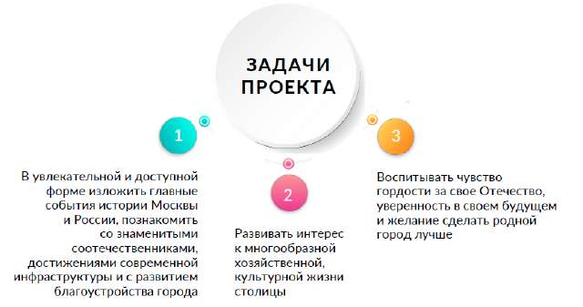

# Программа «Моя Москва, горжусь тобой!» (интегрированный курс урочной и внеурочной деятельности)

> Основная образовательная программа начального общего образования ГБОУ Школа № 1366. ФГОС 3.0. Страницы PDF: 1463–1471.

отношения к природе, стремления действовать в окружающей среде в соответствии с экологическими нормами поведения. Основы религиозных культур и светской этики: понимание необходимости нравственного совершенствования, духовного развития, роли в этом личных усилий человека; развитие умений анализировать и давать нравственную оценку поступкам, отвечать за них, проявлять готовность к сознательному самоограничению в поведении; построение суждений оценочного характера, раскрывающих значение нравственности, веры как регуляторов поведения человека в обществе и условий духовно-нравственного развития личности; понимание ценности семьи; овладение навыками общения с людьми разного вероисповедания, осознание, что оскорбление представителей другой веры есть нарушение нравственных норм поведения в обществе; понимание ценности человеческой жизни, человеческого достоинства, честного труда людей на благо человека, общества; формирование умений объяснять значение слов «милосердие», «сострадание», «прощение», «дружелюбие», находить образы, приводить примеры проявления любви к ближнему, милосердия и сострадания в религиозной культуре, истории России, современной жизни, открытость к сотрудничеству, готовность оказывать помощь; осуждение любых случаев унижения человеческого достоинства, знание общепринятых в российском обществе норм морали, отношений и поведения людей, основанных на российских традиционных духовных ценностях, конституционных правах, свободах и обязанностях гражданина. Изобразительное искусство: выполнение творческих работ с использованием различных материалов и средств художественной выразительности изобразительного искусства; умение характеризовать виды и жанры изобразительного искусства; умение характеризовать отличительные особенности художественных промыслов России. Музыка: знание основных жанров народной и профессиональной музыки. Труд (технология): формирование общих представлений о мире профессий, значении труда в жизни человека и общества, многообразии предметов материальной культуры. Физическая культура: формирование общих представлений о физической культуре и спорте, физической активности человека, физических качествах, жизненно важных прикладных умениях и навыках, основных физических упражнениях; развитие умения взаимодействовать со сверстниками в игровых заданиях и игровой деятельности, соблюдая правила честной игры. Программа реализуются при поддержке федерального ресурса разговорыоважном.рф

Программа «Моя Москва, горжусь тобой!» (интегрированный курс урочной и внеурочной деятельности) Проект представляет собой мультиформатный образовательный комплекс, решающий задачи исторического просвещения и патриотического воспитания младших школьников.

Ключевой особенностью проекта является технология вовлечения детей, их семей и педагогов в совместный процесс формирования содержания и материалов комплекса через творческий процесс познания и организацию проектно-исследовательской деятельности.

Уникальный, развивающий компонент проекта — система творческих проектов. В учебном пособии размещены подробные технологические карты изготовления поделок. По мере работы с учебным пособием поделки складываются в несколько коллективных учебных панорам города Москвы, представляющих её в разные периоды времени. Создание поделок в разных техниках помогает первоклассникам через продуктивную деятельность погрузиться в различные исторические эпохи.

В процессе работы с пособием дети создадут семь коллективных проектов:

«Боровицкий холм» «Первые поселения и деревянный Кремль» «Белокаменный Кремль» «Мастера и ремесленники» «Зима в древней Москве» «Улица позапрошлого века» «Современная Москва»

Последовательно собирая собственные панорамы Москвы, дети будут возвращаться к содержанию снова и снова, закрепляя краеведческие и исторические знания через связь с современной жизнью города.

Цифровые сервисы: предлагается дополнительный контент как средство вовлечения в содержание проекта для совместной работы педагогов, детей и родителей: электронная книга; аудиокнига; анимационный сериал; интерактивные 3-d модели объектов; интерактивные задания; фотогалерея; поурочные разработки; дополнительные материалы к урокам.

Комплекс конкурсных мероприятий, направленных на развитие исторического просвещения и патриотического воспитания школьников, позволяет участникам проекта делиться своими открытиями и результатами работы друг с другом. Представление созданных в процессе реализации проекта творческих работ на общешкольных и городских конкурсах позволит сформировать единое воспитательное пространство начальной школы для сохранения и укрепления интереса к традиционным российским ценностям.

Актуальность проекта определяется важностью развития исторического просвещения и патриотического воспитания на уровне начальной школы. Проект предназначен для обучающихся 1-х классов, используется в рамках основной образовательной программы начального общего образования. Содержание проекта разработано в соответствии с требованиями Федерального государственного образовательного стандарта начального общего образования и Федеральной образовательной программы начального общего образования.

Реализация исторического просвещения и патриотического воспитания согласно Федеральной программе воспитания осуществляется как в урочной, так и во внеурочной деятельности, поэтому проект «Моя Москва, горжусь тобой!» может быть представлен через содержание учебных предметов, тематически связанных с программой проекта, а также через организацию отдельного курса внеурочной деятельности.

Проект «Моя Москва, горжусь тобой!» инициирует и поддерживает учебно-исследовательскую и проектную деятельность обучающихся планирование и выполнение индивидуальных и групповых проектов развивающей и воспитательной направленности.

Реализация программы Школа реализует программу проекта «Моя Москва, горжусь тобой!» на уроках по учебным предметам обязательной части учебного плана для 1 класса (русский язык, литературное чтение, математика, окружающий мир, изобразительное искусство, музыка, технология, физическая культура) в объёме 33 учебных часов (33 тем учебного пособия). Школа может предусмотреть изучение тем учебного пособия, которые дополняют основное содержание программы в объёме 32 часов, и реализовать их через учебный курс «Моя Москва, горжусь тобой!» или курс внеурочной деятельности.

## Содержание курса

Представление ключевых событий и процессов, связанных с историей Москвы. Образ жизни и занятия жителей города в разные эпохи. История появления важнейших культурных, исторических, инфраструктурных объектов столицы. Развитие производства и транспорта, благоустройства города в разные эпохи.

## Планируемые результаты освоения курса

Личностные результаты Проявление познавательного интереса, активности, инициативности, любознательности и самостоятельности в расширении своих знаний о Москве, о Родине. Представление об основных достопримечательностях Москвы. Проявление уважительного отношения, восприимчивости и интереса к разным видам ремесла родного края. Понимание культурно-исторической ценности традиций, отражённых в предметном мире; чувство сопричастности к культуре своего народа. Становление ценностного отношения к своей Родине — России — Москве: чувство гордости за свою страну, город, уважение к его истории и культуре.

Метапредметные результаты Познавательные универсальные учебные действия (базовые логические и начальные исследовательские действия, работа с информацией). Коммуникативные универсальные учебные действия (общение, совместная деятельность, презентация). Регулятивные универсальные учебные действия (саморегуляция, самоконтроль).

Предметные результаты

по русскому языку:

- читать вслух и про себя (с пониманием) короткие тексты с соблюдением интонации и пауз в соответствии со знаками препинания в конце предложения; находить в тексте слова, значение которых требует уточнения; по литературному чтению:
- отвечать на вопросы по фактическому содержанию произведения;
- владеть элементарными умениями анализа текста прослушанного/прочитанного произведения: определять последовательность событий в произведении, характеризовать поступки (положительные или отрицательные) героя,
- объяснять значение незнакомого слова с использованием словаря;
- участвовать в обсуждении; ориентироваться в книге/учебнике по обложке, оглавлению, иллюстрациям;
- выбирать книги для самостоятельного чтения прослушанного/ прочитанного произведения; по математике:
- находить и называть закономерности в ряду объектов повседневной жизни;
- устанавливать между объектами соотношения: слева/справа, дальше/ближе, между, перед/за, над/под; решать задачи-расчёты; по окружающему миру:
- воспроизводить название своего населённого пункта, региона, страны;
- приводить примеры культурных объектов родного края, школьных традиций и праздников, традиций и ценностей своей семьи, профессий; по изобразительному искусству:
- учиться анализировать соотношения пропорций, визуально сравнивать пространственные величины;
- создавать творческую работу на заданную тему с опорой на зрительные впечатления;
- приобретать представления о глиняных игрушках отечественных народных художественных промыслов (с учётом местных промыслов) и опыт практической художественной деятельности;
- рассматривать различные произведения архитектуры Москвы (по фотографиям в условиях урока); анализировать и характеризовать особенности и составные части рассматриваемых зданий;
- осваивать приёмы конструирования; приобретать опыт пространственного макетирования; по музыке:
- исполнять Гимн Российской Федерации;
- исполнять песни, посвящённые Великой Отечественной войне, песни, воспевающие красоту родной природы, выражающие разнообразные эмоции, чувства и настроения;
- с уважением относиться к достижениям отечественной музыкальной культуры;
- стремиться к расширению своего музыкального кругозора; по технологии:
- с помощью учителя выполнять практическую работу с опорой на инструкционную карту, образец, шаблон;
- различать разборные и неразборные конструкции несложных изделий;
- выполнять несложные коллективные работы проектного характера; по физической культуре: играть в подвижные игры с общеразвивающей направленностью.

## Тематическое планирование

| № | Наименование темы |
| --- | --- |
| 1 | Моя Москва, горжусь тобой! Знакомство с героями |
| 2 | Моя Москва, горжусь тобой! Столица нашей Родины |
| 3 | Моя Москва, горжусь тобой! Любимый город |
| 4 | Моя Москва, горжусь тобой! Земля Московская |
| 5 | Моя Москва, горжусь тобой! Проект «Боровицкий холм». Тема «Соберём бор по сосенке» |
| 6 | Моя Москва, горжусь тобой! Проект «Боровицкий холм». Тема «Лесной богатырь» |
| 7 | Моя Москва, горжусь тобой! Первые поселенцы |
| 8 | Моя Москва, горжусь тобой! Крепость на холме |
| 9 | Моя Москва, горжусь тобой! Проект «Первые поселения и Деревянный Кремль».Тема «Возводим башни» |
| 10 | Моя Москва, горжусь тобой! Проект «Первые поселения и Деревянный Кремль».Тема «Панорама «Кремль на холме» |
| 11 | Моя Москва, горжусь тобой! Возвышение Москвы |
| 12 | Моя Москва, горжусь тобой! Великое княжество |
| 13 | Моя Москва, горжусь тобой! От Москвы до поля Куликова |
| 14 | Моя Москва, горжусь тобой! Проект «Первые поселения и Деревянный Кремль».Тема «Снарядим дружинника» |
| 15 | Моя Москва, горжусь тобой! Проект «Белокаменный Кремль». Тема «Белокаменная башня» |
| 16 | Моя Москва, горжусь тобой! Город мастеров |
| 17 | Моя Москва, горжусь тобой! Кузнецы |
| 18 | Моя Москва, горжусь тобой! Литейщики |
| 19 | Моя Москва, горжусь тобой! Проект «Мастера и ремесленники». Тема «Колокольное литьё» |
| 20 | Моя Москва, горжусь тобой! Гончары |
| 21 | Моя Москва, горжусь тобой! Проект «Мастера и ремесленники». Тема «Гончарная мастерская» |
| 22 | Моя Москва, горжусь тобой! Пряхи и ткачи |
| 23 | Моя Москва, горжусь тобой! Во главе русских земель |
| 24 | Моя Москва, горжусь тобой! Царский город |
| 25 | Моя Москва, горжусь тобой! Четыре крепости |
| 26 | Моя Москва, горжусь тобой! Возрождение после Смуты |
| 27 | Моя Москва, горжусь тобой! Торговый люд |
| 28 | Моя Москва, горжусь тобой! Проект «Мастера и ремесленники». Тема «Телега для хозяина» |
| 29 | Моя Москва, горжусь тобой! Проект «Мастера и ремесленники». Тема «Ленивый торг» |
| 30 | Моя Москва, горжусь тобой! Московское чудо света |
| 31 | Моя Москва, горжусь тобой! Учёные горожане |
| 32 | Моя Москва, горжусь тобой! Делу время и потехе час |
| 33 | Моя Москва, горжусь тобой! Проект «Зима в древней Москве». Тема «Расписные сани» |
| 34 | Моя Москва, горжусь тобой! Москва Петра Великого |
| 35 | Моя Москва, горжусь тобой! Лечебное дело |
| 36 | Моя Москва, горжусь тобой! Первопрестольная |
| 37 | Моя Москва, горжусь тобой! «Спалённая пожаром…» |
| 38 | Моя Москва, горжусь тобой! Обновлённый город |
| 39 | Моя Москва, горжусь тобой! Проект «Улица позапрошлого века». Тема «Образцовые дома» |
| 40 | Моя Москва, горжусь тобой! Фонарщики |
| 41 | Моя Москва, горжусь тобой! Проект «Улица позапрошлого века». |
| | Тема «Осветим наш город ночью» |
| 42 | Моя Москва, горжусь тобой! Чугунка и фабрики |
| 43 | Моя Москва, горжусь тобой! Музеи и театры |
| 44 | Моя Москва, горжусь тобой! Гостеприимная Москва |
| 45 | Моя Москва, горжусь тобой! Проект «Улица позапрошлого века». Тема «Конный трамвай» |
| 46 | Моя Москва, горжусь тобой! Проект «Улица позапрошлого века». Тема «Панорама «Улица старой Москвы» |
| 47 | Моя Москва, горжусь тобой! Век электричества |
| 48 | Моя Москва, горжусь тобой! Столица СССР |
| 49 | Моя Москва, горжусь тобой! Подземные дороги и дворцы |
| 50 | Моя Москва, горжусь тобой! Автомобили и аэропланы |
| 51 | Моя Москва, горжусь тобой! Проект «Современная Москва». Тема «Цветы для любимой Москвы» |
| 52 | Моя Москва, горжусь тобой! Порт пяти морей |
| 53 | Моя Москва, горжусь тобой! Битва под Москвой |
| 54 | Моя Москва, горжусь тобой! Великая Победа |

Моя Москва, горжусь тобой! Москва высотная

| 56 | Моя Москва, горжусь тобой! Время новоселий |
| --- | --- |
| 57 | Моя Москва, горжусь тобой! Проект «Современная Москва». Тема «Тучерезы-небоскрёбы» |
| 58 | Моя Москва, горжусь тобой! Говорит и показывает Москва |
| 59 | Моя Москва, горжусь тобой! Столица космоса |
| 60 | Моя Москва, горжусь тобой! Всемирные праздники |
| 61 | Моя Москва, горжусь тобой! Выходные в парке |
| 62 | Моя Москва, горжусь тобой! Новая Москва |
| 63 | Моя Москва, горжусь тобой! Проект «Современная Москва». Тема «Электрический трамвай» |
| 64 | Моя Москва, горжусь тобой! Проект «Современная Москва». Тема «Панорама «Уголок современной Москвы» |
| 65 | Моя Москва, горжусь тобой! Мой город завтра |
