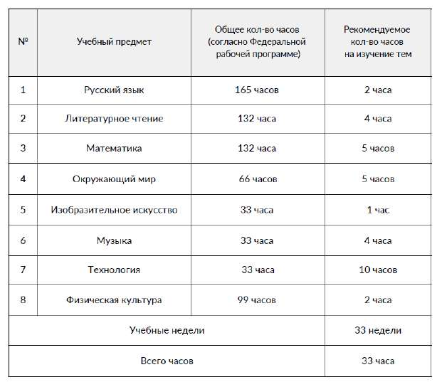

# Программа внеурочного курса «Русский язык для школьной программы»

> Основная образовательная программа начального общего образования ГБОУ Школа № 1366. ФГОС 3.0. Страницы PDF: 1472–1507.

Итого тем: 65, проектов:- 19

Учебные предметы с рекомендуемым количеством часов, отведённых на изучение тем проекта «Моя Москва, горжусь тобой!»

## Пояснительная записка

Рабочая программа курса внеурочной деятельности «Русский язык для школьной программы» составлена на основе требований к результатам освоения основной̆ образовательной̆ программы, представленных в Федеральном государственном образовательном стандарте начального общего образования, с опорой на Общеевропейские компетенции владения иностранным языком, включая дескрипторы для детей младшего школьного возраста, а также с учётом Федеральной̆ рабочей̆ программы воспитания. Программа соответствует возрастным особенностям младшего школьника.

Рабочая программа курса внеурочной деятельности «Русский язык для школьной программы» ориентирована на восполнение дефицитов в языковой, речевой и коммуникативной компетенциях, необходимых для успешного освоения образовательной программы на русском языке, а также на языковую поддержку школьников, осваивающих русский язык как второй или неродной и/ или обладающих миграционным опытом.

## Общая характеристика курса внеурочной деятельности «Русский язык для школьной программы»

Курс внеурочной деятельности «Русский язык для школьной программы» играет ключевую роль в интеграции в русскоязычную образовательную среду детей, осваивающих русский язык в условиях ограниченной языковой среды или обладающих миграционным опытом. Курс нацелен на языковую поддержку и восполнение языковых и речевых дефицитов, препятствующих достижению успешных образовательных результатов при освоении основной образовательной программы начального общего образования.

Содержание и логика курса основаны на фундаментальных достижениях лингвистики, теории освоения языка и лингводидактики русского языка. Архитектура курса базируется на современных принципах проектирования и отбора содержания, методов и приемов обучения русскому языку. Она предполагает применение дифференцированного подхода к обучению смешанных групп учащихся с разным уровнем владения русским языком, включая детей-инофонов и несбалансированных полилингвов. Ключевая цель курса внеурочной деятельности – языковая подготовка к освоению образовательной программы на русском языке – определяет необходимость интеграции методики обучения языку общего владения и методики обучения языку в специальных целях (русскому языку как языку обучения).

Курс внеурочной деятельности предполагает взаимосвязанное обучение видам речевой деятельности и аспектам русского языка. Работа с лексикой в рамках курса построена в логике расширения словарного запаса от бытовой и общеупотребительной лексики к общеучебной лексике и терминологическому ядру образовательной программы начального общего образования; от пассивного овладения лексическими единицами до их активного употребления в речи. Отбор лексического материала к урокам осуществляется с учетом принципа частотности лексики и коллокаций в текстах, с которыми школьникам необходимо взаимодействовать или которые необходимо порождать: тексты из учебников и учебных пособий, детской художественной литературы для младшего школьного возраста, транскрипты диалогов учеников с учителем и между собой, задания ВПР.

Грамматический аспект курса представлен вариативно: с одной стороны, он соответствует грамматическому ядру уровней владения русским языком как иностранным А1-А2, с другой – отражает ключевые трудности, вызванные языковой интерференцией в речи билингвов и полилингвов. Организация грамматического материала в рамках курса учитывает принцип концентризма и сочетает функционально-коммуникативный (от значения к форме) и системный (от формы к значению) подходы.

Курс внеурочной деятельности структурно включает две части, из которых первая позволяет систематизировать представление о грамматическом строе русского языка и восполнить дефициты в языковой, речевой и коммуникативной компетенциях, в то время как вторая

предполагает освоение языковых средств, необходимых для успешного обучения в начальной школе, с точки зрения как рецептивных, так и продуктивных видов речевой деятельности.

Курс предполагает выявление индивидуальных речевых трудностей, спровоцированных языковой интерференцией, и формирование навыка самокоррекции, способствующего предупреждению ошибок в устной и письменной речи учащегося.

Развитие читательских навыков и умений в рамках курса осуществляется в направлении от фрагментарного понимания текста к синтетическому и включает работу над техникой чтения, включая коррекцию звукопроизносительных навыков, освоение читательских стратегий и аналитическую работу с текстом.

Формирование и развитие навыков письменной речи, с одной стороны, носит функциональный характер, а с другой – определяется требованиями к освоению образовательной программы начального общего образования.

Работа над навыками правописания позволяет восполнить дефициты в знании программы по русскому языку за 1-й класс и скорректировать ошибки при графической передаче устной речи, обусловленные фонетической интерференцией родного языка.

Курс внеурочной деятельности подразумевает широкий репертуар использования образовательных технологий: технологий дифференцированного обучения, интерактивных и игровых форматов, проектной работы, а также включает в себя приемы интенсивного обучения.

Цель изучения курса внеурочной деятельности «Русский язык для школьной программы»

Целью курса внеурочной деятельности «Русский язык для школьной программы» является формирование и развитие у школьников языковых и речевых навыков во всех видах речевой деятельности, необходимых для успешного достижения образовательных результатов по программе начального общего образования, а также формирование и развитие коммуникативной компетенции в бытовой, учебной и социокультурной сферах общения. Курс внеурочной деятельности также способствует развитию навыков самостоятельного обучения и коммуникации в полилингвальном и поликультурном обществе с учётом принципов толерантности и диалога культур, тем самым создавая основу для будущих учебных и профессиональных успехов.

Достижение поставленной цели обеспечивается решением ряда задач:

- представление типологических особенностей русской языковой системы (фонологический строй, морфологический строй, грамматический строй, синтаксический строй) в зависимости от уровня сложности, вызванной языковой интерференцией;
- расширение пассивного и активного словарного запаса, совершенствование рецепции метаязыка учебных инструкций;
- формирование навыка самокоррекции, развитие автономности в обучении, а также компенсаторных стратегий при обучении;
- развитие навыков письменной и устной речи учащегося в различных ситуациях общения;
- обучение уверенному общению на разные темы, развитие умение выражать свои мысли и идеи;
- изучение культурных особенностей страны, в которой проживают дети;
- обучение активному слушанию и пониманию речи носителей языка;
- обучение использованию различных источников, в том числе текстов, аудио и видеоматериалов, интерактивных ресурсов;
- практика коммуникативных ситуаций;
- поддержка и поощрение детей для развития уверенности в своих языковых навыках и коммуникативной компетенции.

## Место курса внеурочной деятельности «Русский язык для школьной программы» в образовательной программе

Курс внеурочной деятельности реализуется в рамках внеурочной деятельности. На освоение курса во 2–4-х классах отводится 80 часов (2-3 часа в неделю, 30 учебных недель): из них 24 часа нацелено на компенсацию дефицитов в общем владении русским языком и в знании программы по русскому языку за 1 класс; 56 часов — на языковую поддержку в освоении программы начального общего образования для 2–4-х классов.

## Планируемые результаты освоения курса внеурочной деятельности «Русский язык для школьной программы»

В результате изучения курса «Русский язык для школьной программы» на уровне начального образования учащиеся достигнут следующих результатов.

# ЛИЧНОСТНЫЕ РЕЗУЛЬТАТЫ

- становление ценностного отношения к России через изучение русского языка, отражающего историю и культуру страны;
- понимание роли русского языка как государственного языка Российской Федерации и языка межнационального общения на территории России;
- уважение к русскому и другим народам;
- уважительное отношение и интерес к русской культуре, традициям и творчеству русского и других народов;
- первоначальные представления о человеке как члене общества, о правах и ответственности, уважении и достоинстве человека, о нравственно-этических нормах поведения и правилах межличностных отношений;
- признание индивидуальности каждого человека с опорой на собственный жизненный и читательский опыт;
- проявление сопереживания, уважения и доброжелательности, в том числе с использованием адекватных языковых средств для выражения своего состояния и чувств;
- неприятие любых форм поведения, направленных на причинение физического и морального вреда другим людям (в том числе связанного с использованием недопустимых средств языка);
- осознание важности русского языка как средства общения и самовыражения;
- первоначальные представления о системе языка как одной из составляющих целостной научной картины мира;
- познавательные интересы, активность, инициативность, любознательность и самостоятельность в познании русского языка;
- бережное отношение к физическому и психическому здоровью, проявляющееся в выборе приемлемых способов речевого самовыражения и соблюдении норм речевого этикета и правил общения;
- бережное отношение к природе, формируемое в процессе работы с текстами, неприятие действий, приносящих вред окружающей среде.

# МЕТАПРЕДМЕТНЫЕ РЕЗУЛЬТАТЫ

- сравнивать различные языковые единицы (звуки, слова, предложения, тексты), устанавливать основания для сравнения языковых единиц (грамматический признак, лексическое значение и др.);
- объединять языковые единицы по определённому признаку;
- определять существенный признак для классификации языковых единиц (звуков, слов, предложений, текстов) и классифицировать языковые единицы;
- находить в языковом материале закономерности и противоречия на основе предложенного учителем алгоритма наблюдения;
- выявлять недостаток информации для решения учебной и практической задачи, формулировать запрос на дополнительную информацию;
- устанавливать причинно-следственные связи в ситуациях наблюдения за языковым материалом, делать выводы;
- с помощью учителя формулировать цель, планировать изменения языкового объекта, речевой ситуации;
- выполнять по предложенному плану проектное задание;
- формулировать выводы и подкреплять их доказательствами на основе результатов проведённого наблюдения за языковым материалом (классификации, сравнения, исследования);
- выбирать нужный словарь для получения и уточнения запрашиваемой информации;
- согласно заданному алгоритму находить представленную в явном виде информацию в предложенном источнике: в словарях, справочниках;
- соблюдать с помощью учителя правила информационной безопасности при поиске информации в Интернете;
- анализировать текстовую, видео-, графическую, звуковую информацию в соответствии с учебной задачей;
- понимать лингвистическую информацию, зафиксированную в виде таблиц, схем.

# ПРЕДМЕТНЫЕ РЕЗУЛЬТАТЫ

- овладение нормами речевого этикета и использование их в своей речевой практике при создании устных и письменных высказываний, владение базовыми коммуникативными формулами при вступлении в коммуникацию;
- развитие техники чтения и коррекция звукопроизносительных навыков;
- владение различными читательскими стратегиями, понимание темы и идеи текста, основной и дополнительной информации, содержащейся в тексте, умение использовать — фрагменты текста в рамках продуктивной и репродуктивно-продуктивной речевой деятельности;
- владение навыками различных видов чтения (изучающим, ознакомительным, просмотровым) и информационной переработки прочитанного материала;
- умение понимать, интерпретировать и комментировать тексты различных функционально-смысловых типов речи (повествование, описание, рассуждение) и функциональных разновидностей языка (в том числе в части понимания инструкций, условий и требованиям к учебным и контрольным заданиям);
- умение анализировать текст с точки зрения его темы, цели, основной мысли, основной и дополнительной информации;
- умение запрашивать и сообщать информацию о факте или событии, лице, предмете, месте, времени, причине, следствии и цели действия или события;
- умение выражать отношение к явлению или событию, выражать различные интенции (согласие, несогласие, уверенность, неуверенность, сомнение, желание, предложение, совет, приглашение, отказ и др.);
- умение выражать своё мнение и комментировать мнение других, аргументировать свою позицию;
- опознавание и анализ основных единиц языка, грамматических категорий языка, уместное употребление языковых единиц адекватно ситуации речевого общения;
- умение строить устное монологическое высказывание в соответствии с определенной коммуникативной установкой;
- умение строить письменное монологическое высказывание продуктивного характера в соответствии с определенной коммуникативной установкой (сочинение);
- умение строить устное монологическое высказывание репродуктивно-продуктивного характера на основе прочитанного текста (пересказ);
- понимание содержания высказываний собеседника и умение адекватно реагировать на его реплики;
- умение опознавать самостоятельные части речи и их формы, а также служебные части речи и междометия;
- умение опознавать основные единицы синтаксиса (словосочетание, предложение, текст);
- владение навыками работы с учебной книгой, словарями и другими информационными источниками;
- умение использовать орфографические, толковые, орфоэпические словари.

## Содержание курса внеурочной деятельности «Русский язык для школьной программы»

Содержание программы сосредоточено в первую очередь на формировании и развитии речевых и коммуникативных умений, таких как понимание и использование в речи лексических единиц, грамматических форм, синтаксических конструкций и пр. В русле подходов к обучению русскому языку как иностранному / неродному / второму, учитывающих естественный порядок освоения языка, теоретические знания о структуре русского языка, а также соответствующая языковая терминология не эксплицируются. Так, в описании содержания программы термин «спряжение глагола» используется для описания грамматического навыка – умения использовать в речи грамматически корректные личные формы глагола в настоящем и будущем времени. Само лингвистическое понятие при этом не вводится. Отдельные случаи, когда введение соответствующего лингвистического понятия целесообразно и соответствует содержанию федеральной рабочей программы по русскому языку, в программе отмечены комментарием «введение лингвистического понятия». Тема 1. Знакомство (2 ч) Коммуникативная ситуация знакомства. Умение привлечь внимание, обратиться и познакомиться с кем-либо, умение представиться и представить другого человека. Умение реагировать на представление. Умение поздороваться, попрощаться, руководствуясь нормами русского речевого этикета. Владение базовыми коммуникативными формулами при вступлении в коммуникацию. Владение нормами русского речевого этикета.

Понимание обращенной речи на примере функционального языка обучения. Умение использовать алфавит для упорядочения списка слов, а также работая со словарем. Артикуляция гласных звуков (а, о, у, и, э). Чтение буквы О в разной позиции. Произнесение слов с соблюдением правильного ударения.

Умение указывать на окружающие предметы, объекты и лица. Умение характеризовать существительные по критерию одушевленности\неодушевленности. Умение задать вопрос к одушевленному и неодушевленному существительному (Кто это?/Что это?). Умение определять в тексте существительное в форме именительного падежа и личные местоимения.

Умение писать без искажений прописные и строчные буквы русского алфавита. Определять границы слов и предложений, оформлять их границы при письме. Умение соотносить печатные и прописные буквы. Раздельное написание слов в предложении. Прописная буква в именах людей, кличках животных, названиях (имена собственные). Правописание личных местоимений в начальной форме Раздельное написание местоимений со словами. Словарные слова: привет, здравствуй, здравствуйте, до свидания и др.

Технические навыки чтения (правильность, беглость, выразительность).

Лексика. Примерный список слов: Алфавит, буква, звук, гласный звук, ударение, слово, предложение, текст, здравствуйте, здравствуй, привет, доброе утро, добрый день, добрый вечер, до свидания, до встречи, увидимся, пока, имя, звать, меня, тебя, его, её, нас, вас, их, местоимение, кто, что, я, ты, он, она, мы, вы, они, отлично, хорошо, нормально, неплохо, так себе, плохо, ужасно, очень, (по)знакомиться, это, приятно, существительное, искать/найти, спрашивать, задавать, вопрос, отвечать, ответ, семья, названия стран и городов и т.п.

Тема 2. Моя школа. Притяжательные местоимения. Категория числа и рода. (4 часа) Коммуникативная ситуация урока. Умение понять вопрос, понять инструкции учителя. Умение уточнять информацию (Как называется? Как это будет по-русски? Как сказать это по-русски? Что такое …?). Умение сообщить о затруднении, умение переспросить. Умение благодарить, извиняться, отвечать на благодарность и извинения, вежливо формулировать просьбу, вежливо соглашаться/не соглашаться выполнить просьбу; приглашать собеседника к совместной деятельности, вежливо соглашаться/не соглашаться на предложение собеседника.

Звук Й и йотированные гласные (я, ё, ю, е), дифференциация Й-И. Умение понимать и использовать логическое ударение во фразе, предложении. Произнесение фраз/предложений с соблюдением их ритмико-интонационных особенностей: повествовательное (утвердительное и отрицательное), вопросительное (общий вопрос). Умение правильно произносить предложения с однородными членами (интонация перечисления).

Умение образовывать и распознавать форму множественного числа существительных (твёрдая основа, мягкая основа). Умение определять род существительного по окончанию (женский род, мужской род, средний род). Согласование притяжательных местоимений и местоимения чей с существительным по роду. Умение определить род существительного по окончанию. Согласование притяжательных местоимений и местоимения чей с существительным по роду. Число имен существительных. Согласование притяжательных местоимений и местоимения чей с существительным по числу.

Согласование притяжательных местоимений и местоимения чей с существительным по числу. Умение сообщать о наличии чего-либо (“У меня есть+Им.п.”). Умение выделять в тексте существительные, личные и притяжательные местоимения. Случаи употребления синонимов и антонимов (без называния терминов).

Умение писать на слух слова без пропусков и искажений букв. Без искажений отображать буквы и буквенные сочетания. Правописание окончаний существительных в начальной форме, в форме множественного числа именительного падежа. Проверяемые безударные гласные в корне. Правописание притяжательных местоимений в начальной форме. Словарные слова: класс, русский, математика, искусство, спасибо, пожалуйста, учитель, учительница, портфель, пенал, карандаш, ножницы, чёрный.

Умение различать на письме и в речи слово и предложение. Интонационное оформление предложения. Пунктуация: оформление предложения (прописная буква в начале предложения, знаки препинания в конце предложения). Технические навыки чтения. Коррекция звукопроизносительных навыков. Лексика. Примерный список слов: Школа, предмет, мой, моя, моё, мои, твой, твоя, твоё, твои, он, его, она, её, наш, наша, наше, наши, ваш, ваша, ваше, ваши, их, род, русский язык, математика, чтение, окружающий мир, Труд (технология), труд, этика, религия, религиозный, светский, культура, изобразительное

искусство (ИЗО), физическая культура (физкультура), хореография, танцы, гимнастика, кабинет, класс, коридор, столовая, спортивный зал, актовый зал, медицинский, учительская, учитель, директор, завуч, понимать, повторять, извинять, пожалуйста, спасибо, надо, нужно (-а,-и), нужен, парта, стул, доска, мел, тряпка, дверь, окно, лампа, сумка, рюкзак, ножницы, портфель, пенал, карандаш, ручка, точилка, линейка, ластик, клей, замазка, учебник, тетрадь, словарь, страница, обложка, цветной, простой, синий, чёрный, зелёный, красный и т.п.

Тема 3. Чем ты занят? Инфинитив. Согласование слов в предложении (4 часа) Умение рассказать о повседневных активностях. Умение называть конкретное действие, использую начальную форму глагола (инфинитив). Умение выделять в тексте глагол в форме инфинитива. Представление о глагольном управлении.

Умение различать шипящие звуки (Ж, Ш, Щ, Ч,). Произнесение фраз/предложений с соблюдением их ритмико-интонационных особенностей: вопросительное (специальный, альтернативный и разделительный вопросы).

Умение называть действие (начальная форма глагола). Умение характеризовать действия (наречия образа действия). Представление о структуре предложения (смысловая связь). Определение главных и второстепенных (без деления на виды) членов, распознавать распространённые и нераспространённые предложения.

Умение составлять предложение из предложенных слов. Написание ь в инфинитивах. Раздельное написание предлогов со словами. Правописание суффикса -о в наречиях. Единообразное написание приставок. Правописание проверяемых согласных в корне. Словарные слова: медленно, завтрак, обед, ужин, рисовать, рисунок, портрет, натюрморт, пейзаж.

Технические навыки чтения. Коррекция звукопроизносительных навыков. Лексика. Примерный список слов: Мочь, знать, уметь, учить, (учиться), читать, писать, смотреть, слушать, рисовать, готовить, видеть, книга, статья, отрывок, абзац, письмо, упражнение, фильм, кино, мультфильм (мультик), программа, сериал, новости, музыка, портрет, натюрморт, пейзаж, завтрак, обед, ужин, еда, плохо, хорошо, быстро, медленно, громко, тихо, правильно, неправильно, так, по-другому, легко, просто, сложно, трудно, изменить, окончание, добавить и т.п.

Тема 4. Вчера, сегодня, завтра. Прошедшее, настоящее и будущее время глагола. Предлоги со значением времени (6 часов) Умение называть действие в прошлом, настоящем и будущем времени (настоящее, прошедшее, будущее время глагола). Умение располагать действия на шкале времени. Умение формулировать побуждение, приказ, просьбу с помощью императива (утвердительная и отрицательная форма).

Различение согласных по твёрдости-мягкости. Согласные Б-Бь, В-Вь, Н-Нь, Д-Дь, З-Зь. Произнесение фраз/предложений с соблюдением их ритмико-интонационных особенностей: побудительное, восклицательное предложения.

Умения использовать слов, указывающих на время совершения действия (наречия со значением времени, сочетания слов «в прошлые выходные», «прошлым летом», «в следующем году», «в настоящий момент»).

Умение составлять текст из разрозненных предложений, частей текста. Правописание родочисловых окончаний глаголов прошедшего времени. Различение предлога и приставки. Чередование согласных в корне. Правописание предлогов, единообразное написание приставок. Словарные слова: вчера, сегодня, завтра, вечер.

Лексика. Примерный список слов: Вчера, сегодня, завтра, время, утром, днём, вечером, ночью, утро, день, вечер, ночь, расписание, каждый, ежедневный, регулярный, начинать, продолжать, заканчивать, перемена, перерыв, настоящее, будущее, прошедшее, прошлый, этот, следующий, план, планировать, делать, глагол, форма, дать, сказать, взять, брать и т.п.

Умение применять стратегии изучающего чтения (чтение с пониманием основного содержания текста). Умение определять основную тему, мысль предложения и текста. Умение определять главные факты/события в прочитанном тексте (опуская второстепенные). Умение определять связь предложений в тексте (с помощью личных местоимений, синонимов, союзов и, а, но). Умение озаглавливать текст/его отдельные части.

Тема 5. Свободное время. Несовершенный и совершенный вид глагола. 1 и 2 спряжение (4 часа) Умение описывать свои увлечения. Умение обозначать объект действия (переходные глаголы с винительным падежом). Умение соблюдать правила ведения диалога.

Согласные Л-ЛЬ, Р-РЬ. Орфоэпические случаи (е-э) на ограниченных примерах из лексики урока (теннис, бассейн, квест) Значение видов глагола процесс-результат (без введения понятия). Употребление глаголов несовершенного вида в значении регулярного действия (как часто?). Общее представление о глаголах I и II спряжения (без введения понятия)

Умение создавать план текста на основе выписанных ключевых слов/фраз. Правописание приставки с-. Правописание личных окончаний глаголов. Правописание жи — ши. Использование ь для обозначения мягкости согласного. Словарные слова: футбол, хоккей, волейбол, баскетбол, теннис, бассейн, квест, стадион, велосипед, скейтборд, пикник, компьютер.

Умение применять стратегии изучающего чтения. Умение определять ключевые слова в тексте/абзаце. Лексика. Примерный список слов: Любить, хотеть, свободный, отдыхать, заниматься, спорт, футбол, ворота, вратарь, команда, игрок, хоккей, волейбол, сетка, баскетбол, теннис, мяч, ракетка, стадион, корт, поле, танцы, балет, гимнастика, коврик, станок, фигурное катание, кататься, коньки, велосипед, самокат, скейтборд, бег, плавание, бассейн, бокс, ринг, лыжи, палки, <...>, гулять, плавать, бегать, прыгать, скакалка, прыгалки, ходить, посещать, пикник, настольная игра, играть, карты, кубик, фишка, ходить, ход, пропускать, догонялки, догонять, вышибалы, кидать, бросать, попасть, шахматы, прятки, прятаться, искать, найти, молчанка, молчать, компьютер, стратегия, квест, симулятор, бродилка, гонка, вместе, один (одна) и т. п.

Тема 6. Проверяем свои знания (4 часа)

Обобщение и проверка пройденного материала. Умение ориентироваться в изученных понятиях; соотносить понятие с его краткой характеристикой. В процессе учебного диалога отвечать на вопросы по изученному материалу. Технические навыки чтения и стратегии изучающего чтения. Применение компенсаторных стратегий. Умение написать текст (5 предложений).

Диагностика в формате интерактивных проверочных работ. Проведение работы над ошибками. Тема 7. Я и моё окружение. Повторение изученного материала (3 часа) Умение рассказать о себе, своих друзьях, увлечениях, а также о своём распорядке дня. Умение отвечать на вопросы, кратко объяснять свои ответы, дополнять ответы других участников, составлять свои вопросы и высказывания на заданную тему.

Умение дифференцировать гласные и согласные, твёрдые и мягкие, глухие и звонкие звуки в разных позициях. Умение корректно отображать на письме все буквы русского алфавита.

Умение свободно пользоваться алфавитом при поиске в словаре. Твердые и мягкие согласные Г-Гь, К-Кь, Х-Хь Предложно-падежная система на ограниченных примерах. Умение составить рассказ о себе. Повторение пройденного учебного материала в комплексе. Умение распознавать существительные, глаголы, местоимения и наречия. Умение выделить основу предложения.

Составление плана текста-повествования (на примере текста об увлечениях). Умение применять стратегии поискового чтения. Умение находить в прочитанном тексте и понимать запрашиваемую информацию, представленную в эксплицитной (явной) форме. Умение соотносить иллюстрацию с текстом.

Тема 8. Я живу в Москве. Предложно-падежная система. (6 часов) Умение распознавать слова, отвечающие на вопросы «какой?», «какая?», «какое?», «какие?». Умение обозначить своё местоположение и местоположение предметов и других лиц. Выражение места в простом предложении.

Дифференциация А-Я / Ы-И. Повторение дифференциации И-Й на новых примерах. Умение согласовывать прилагательные с существительным в роде и числе. Правописание окончаний прилагательных в начальной форме с основой на твёрдые согласные и на мягкие согласные. Умение создавать небольшой письменный рассказ с опорой на образец, план, иллюстрацию, таблицу, прочитанный/прослушанный текст (на примере описания любимого/родного города). Правописание падежных окончаний имён существительных. Правописание соединительной

гласной в сложных словах. Правописание разделительного ъ. Правописание ча-ща. Правописание проверяемых гласных и согласных в корне. Словарные слова: впереди, сзади, наверху, внизу, слева, справа, напротив, район, столица, деревня, тротуар, адрес, этаж, магазин, театр, цирк.

Умение применять стратегии ознакомительного чтения. Знакомство с текстом-описанием (на примере описания города). Составление плана текста. Компенсаторные стратегии чтения. Умение объяснять значение незнакомого слова с опорой на контекст (языковая, контекстуальная догадка).

Лексика. Примерный список слов: Находиться, впереди, сзади, наверху, внизу, слева, справа, напротив, за, перед, над, под, около, рядом, у, вокруг, похож, сходство, отличие, отличаться, различие, различаться, столица, центр, район, деревня, страна, памятник, река, пруд, пешеходный переход, подземный переход, дорога, светофор, тротуар, площадь, бульвар, улица, переулок, адрес, квартира, подъезд, этаж, жить, торговый центр, поликлиника, больница, банк, магазин, театр, музей, цирк, парк, детский сад, офис и т.п.

Тема 9. Транспорт Москвы и Подмосковья. Предложно-падежная система. (6 часов) Умение рассказать о передвижении внутри и за пределами города. Ориентация в названиях разных видах транспорта. Дифференциация Э-Е/ У-Ю / О-Ё. Умение описать движение на транспорте и пешком. Умение использовать наречия места, наречия, указывающие направление. Умение сравнивать объекты и предметы по предложенным критериям (сравнительная степень прилагательных и наречий длиннее/короче, выше/ниже, шире/уже).

Умение выписывать необходимые фрагменты текста и соотносить их с предложенным иллюстративным материалом для дальнейшего пересказа. Правописание парных по глухости-звонкости согласных на конце слова. Написание удвоенных согласных в корне слова.

Написание суффиксов прилагательных сравнительной степени. Написание сложных слов. Написание слов с буквой э. Написание суффиксов прилагательных превосходной степени. Словарные слова: транспорт, автомобиль, автобус, троллейбус, трамвай, метро, такси, маршрут, маршрутка, станция, эскалатор, вагон, билет, касса, экскурсия, экскурсовод, каникулы, аэропорт.

Умение делать пересказ прочитанного текста с опорой на вопросы, рисунки, картинки, фотографии, ключевые слова, предложенный план. Чтение несплошных текстов (на примере построения маршрута с использованием дорожных карт, схемы метро).

Лексика. Примерный список слов: Транспорт, общественный, личный, междугородний, машина, автомобиль, грузовик, автобус, маршрутка, троллейбус, трамвай, речной трамвай, метро, поезд, электричка, такси, остановка, станция, эскалатор, турникет, пути, рельсы, железная дорога, место, вагон, открываться, закрываться, билет, карточка, касса, купить, поездка, поход, кошелёк, экскурсия, экскурсовод, гид, аудиогид, выставка, каникулы, отпуск, путешествие, путёвка, тур, пикник, горы, лес, море, пляж, отель, гостиница, маршрут, собирать(-ся), чемодан, паспорт, самолёт, аэропорт, полёт, ремень безопасности и т.п.

Тема 10. Еда и продукты. Количественные и порядковые числительные. (6 часов)

Коммуникативная ситуация, связанная с покупкой и заказом еды и продуктов питания. Умение называть виды еды и продукты. Употребление вежливого общения к незнакомому человеку (продавцу, официанту), речевые формулы для заказа еды.

Звук Ц. Дифференциация Ц-С. Количественные числительные. Сочетание числительных с существительными. Винительный падеж существительных и прилагательных (купить что?)

Умение использовать единицы измерения. Умение пересчитывать различные объекты. Умение считать по порядку (порядковые числительные). Умение устанавливать порядковый номер объекта. Умение называть инструменты (творительный падеж +чем?). Несклоняемые имена существительные. Умение создавать краткий письменный пересказ, применяя стратегии компрессии текста, по коллективно или самостоятельно составленному плану. Написание числительных. Правописание падежных окончаний существительных и прилагательных. Правописание проверяемых гласных и согласных в корне. Правописание буквосочетания чн. Правописание удвоенных согласных в корне. Словарные слова: корзина, овощ, молоко, кефир, йогурт, колбаса, мороз, заморозить, пирог, конфета, шоколад, десерт, кофе, какао, компот, тарелка, стакан, кастрюля, сковородка, салфетка, скатерть, меню, официант, счёт, ингредиент, рецепт, кулинария, сахар, перец, грамм, килограмм, миллиграмм, миллилитр, пакет, горячий.

Знакомство с текстом-повествованием. Умение применять стратегии поискового чтение. Умение выделять последовательность событий, изложенных в тексте. Восстановление нарушенной последовательности (на примере рецепта). Умение применять компенсаторные стратегии чтения. Умение игнорировать информацию, которая не является необходимой для понимания основного содержания прочитанного/прослушанного текста или для нахождения в тексте запрашиваемой информации (на примере математической задачи).

Лексика. Примерный список слов: Супермаркет, продукты, еда, корзина, тележка, полка, витрина, цена, скидка, состав, отдел, овощ, фрукт, молоко, кефир, ряженка, йогурт, творог, сыр, молочный, мясо, говядина, свинина, курица, индейка, баранина, колбаса, сосиски, рыба, свежий, готовый, замороженный, заморозить, копчёный, варёный, варить, жареный, жарить, хлеб, булка, пирог, торт, конфета, шоколад, десерт, суп, первое, второе, завтрак, обед, полдник, ужин, перекус, чай, кофе, какао, компот, вода, газированный, газировка, напиток, тарелка, миска, чашка, кружка, стакан, кастрюля, сковородка, вилка, ложка, чайная ложка, нож, салфетка, скатерть, меню, официант, повар, счёт, сдача, ингредиенты, рецепт, кулинария, резать, мешать, добавлять, соль, солить, солёный, сахар, сахарить, сладкий, перец, перчить, перчёный, острый, кислый, горький, грамм, килограмм, миллиграмм, литр, миллилитр, упаковка, пакет, горячий и т. п.

Тема 11. Времена года. Словообразование глаголов. Родительный падеж (6 часов) Умение описать разные явления, сравнить и дать развернутую характеристику. Умение обсудить календарный год (значимые даты, государственные праздники и т.д.).

Твердые и мягкие согласные. Дифференциация П-Пь / Ф-Фь / Т-Ть / М-Мь / С-Сь. Умение употреблять при сравнении превосходную степень прилагательных.

Умение выразить свою оценку и своё отношение к предмету и\или лицу. Двусоставные порядковые числительные. Умение указывать даты разных личных и общественных событий (родительный падеж). Умение писать поздравительную открытку. Умение создавать схемы, таблицы для представления информации (с поддержкой учителя). Удвоенные согласные на стыке морфем. Правописание слов с непроизносимыми согласными. Использование ь для обозначения мягкости согласного. Правописание буквы й после гласных. Прописная буква в названиях праздников. Правописание дат. Правописание проверяемых гласных и согласных в корне. Словарные слова: календарь, сезон, месяц, декабрь, январь, февраль, апрель, сентябрь, октябрь, природа, Масленица, отечество, победа, хозяин, желать, праздник.

Умение читать несплошные тексты (вербальный и визуальный компонент). Работа с календарём, таблицей и понимание представленной в них информации.

Лексика. Примерный список слов: год, время года, сезон, зима, весна, лето, осень, зимний, летний, весенний, осенний, месяц, декабрь, январь, февраль, март, апрель, май, июнь, июль, август, сентябрь, октябрь, дата, календарь, число, природа, праздник, Новый год, Рождество, Масленица, Пасха, Международный женский день, День защитника Отечества, День Победы, День города, День знаний <...>, день рождения, праздновать, отмечать, устраивать, хозяин, хозяйка, гость, накрывать на стол, приглашать, открытка, подарок, дарить, поздравлять, желать, подписывать и т. п.

Тема 12. Погода. Сравнительная степень наречий. Сослагательное наклонение (6 часов) Умение сравнивать объекты и лица по выделенным критериям (предложенным в тексте или учителем). Звонкие и глухие согласные Б-П / В-Ф / Г-К / Д-Т / Ж-Ш / З-С. Умение различать наречие и прилагательное в конструкциях (на улице тепло-погода теплая). Однородные члены предложения. Сравнительная степень наречий. Сослагательное наклонение. Умение самостоятельно устанавливать основания для сравнения.

Умение заполнять таблицу на основе предложенного образца. Правописание сложных существительных. Правописание проверяемых гласных и согласных в корне. Удвоенные согласные на стыке морфем. Правописание буквосочетания чн. Правописание разделительного ъ. Прописная буква в географических названиях. Словарные слова: погода, прогноз, температура, ветреный, солнце, облако, континент, океан, север, запад, восток, полюс, тайга, саванна, компас, костёр.

Умение применять стратегии поискового чтения. Умение сравнивать, группировать предметы, объекты, явления, процессы, лица в рамках изученной тематики по предложенному алгоритму (по аналогии и по контрасту). Работа с картой.

Лексика. Примерный список слов: погода, прогноз, температура, градус, жара, жаркий (-о), холод, холодный(-о), мороз, теплый(-о), прохладный(-о), прохлада, дождь, ливень, листопад, радуга, снег, снегопад, лёд, гололёд, слякоть, лужа, сугроб, гроза, гром, молния, ветер, ветреный(-о), порыв, солнце, солнечный(-о), облако, облачный(-о), пасмурный(-о), ясный(-о), туман, туманный(-о), зонт, шарф, шапка, глобус, материк, континент, Евразия, Африка, Северная Америка, Южная Америка, Австралия, Антарктида, океан, суша, юг, южный, север, северный, запад, западный, восток, восточный, Северный полюс, Южный полюс, пустыня, степь, тайга, тундра, саванна, тропики, ледник, хвойный, лиственный, компас, палатка, костёр, подъём, высокий, низкий, глубокий, мелкий и т. п.

Тема 13.

Мир животных. Словообразование существительных. (6 часов) Умение кратко изложить результаты выполненной проектной работы (монологическое высказывание по заданному плану). Использование компенсаторных стратегий: при непосредственном общении догадываться о значении незнакомых слов с помощью используемых собеседником жестов и мимики.

Дифференциация Б-П / В-Ф / Г-К в сильной позиции (перед гласными и звонкими согласными). Словообразование существительных с помощью уменьшительно-ласкательных суффиксов (слон — слонёнок). Однородные члены предложения. Повелительное наклонение глагола. Составление команды, запрета, просьбы, приказа.

Умение составлять план текста, создавать по нему текст для выступления и корректировать текст. Правописание суффиксов -онок- — - ёнок-. Правописание некоторых суффиксов существительных. Прописная буква в кличках животных. Правописание окончаний существительных и прилагательных. Правописание проверяемых гласных и согласных в корне. Правописание жи — ши. Словарные слова: животное, собака, попугай, хомяк, шиншилла, корова, петух, цыплёнок, жеребёнок, заяц, кабан, медведь, жираф, берлога, зоопарк, забота, дрессировка, дрессировщик, дрессировать.

Пунктуация: запятая в сложном предложении, запятая при однородных членах предложения. Знакомство с текстом-рассуждением. Умение устанавливать причинно-следственные связи в тексте (так как, потому что, поэтому, из-за, благодаря). Умение читать с целью извлечения конкретной (запрашиваемой или интересующей) информации, уметь использовать соответствующие ориентиры (заглавные буквы, цифры и т. д.).

Лексика. Примерный список слов: животное, зверь, домашний, дикий, собака, кошка, попугай, хомяк, шиншилла, кролик, корова, телёнок, бык, коза, козёл, козлёнок, курица, петух, цыплёнок, лошадь, конь, жеребёнок, свинья, поросёнок, утка, селезень, утёнок и другие; заяц, волк, лиса, кабан, медведь, белка, тигр, лев, жираф, слон и другие; нора, берлога, дупло, гнездо, зоопарк, сотрудник, вольер, кормить, корм, ухаживать, уход, забота, заботиться, дрессировка, дрессировщик, дрессировать и т. п.

Тема 14. Мир растений. Словообразование прилагательных. (6 часов) Умение распознавать в речи и на письме формы разных частей речи: прилагательных, существительных, глаголов, наречий, числительных, местоимений (без введения понятий). Умение кратко изложить результаты выполненной проектной работы (монологическое высказывание по заданному плану).

Дифференциация Д-Т / Ж-Ш / З-С в сильной позиции (перед гласными и звонкими согласными). Предложно-падежная система (согласование прилагательного и существительного в разных падежах с предлогами). Умение составлять план текста для выступления, создавать по нему текст и корректировать текст. Наблюдение за чередующимися гласными и согласными в корне. Правописание буквосочетания чн. Правописание окончаний существительных, прилагательных и глаголов. Словарные слова: растение, расти, выращивать, вырос, росло, огород, семья, горшок, ягода, комната, фиалка, берёза, мусор, работа, переработка, собирать, соберу, поджигать, поджечь, беречь, берегу, экология, орхидея, проект.

Пунктуация: запятая в сложном предложении, запятая при однородных членах предложения.

Умение пересказывать (устно) содержание текста с изменением лица. Умение использовать справочную литературу для получения дополнительной информации в соответствии с учебной задачей, в том числе верифицированные электронные ресурсы, включённые в федеральный перечень. Работа со схемой (огород), составление схемы.

Лексика. Примерный список слов: растение, цветок, куст, клумба, трава, сад, огород, дерево, сажать, пересаживать, удобрять, выращивать, расти, семя, поливать, лейка, шланг, теплица, горшок, полевые, садовые, ягода, плод, комнатные, кактус, роза, фиалка, орхидея, тюльпан и пр.; берёза, дуб, липа и пр.; мусор, убирать, уборка, выбрасывать, урна, мусорный бак, переработка, перерабатывать, грязь, загрязнение, поднимать, собирать, выносить, огонь, жечь, поджигать, рвать, срывать, тушить, ломать, шуметь, разрушать, мешать, беречь, экология и т. п.

Тема 15. Как ты себя чувствуешь? Слова категории состояния. (3 часа) Умение рассказать о собственном самочувствии, обратиться за помощью к врачу. Умение описать свои эмоции и чувства. Сложные предложения (Если…то; Когда…то).

Умение выражать свою точку зрения и обосновывать её, высказывать своё согласие/несогласие с точкой зрения собеседника, выражать сомнение, давать эмоциональную оценку обсуждаемым событиям (восхищение, удивление, радость, огорчение и т. д.). Умение корректно и аргументированно высказывать своё мнение.

Дифференциация Ч, Щ, Ц. Категория состояния (дательный падеж). Умение описывать своё настроение и состояние. Умение написать краткий отзыв, дать краткую характеристику предмету, объекты, явлению или лицу на основе образца. Правописание личных местоимений в косвенных падежах. Правописание слов с непроизносимыми согласными. Наблюдение за чередующимися согласными в корне. Наблюдение за падежными окончаниями в существительных на -ия, -ие. Словарные слова: здоровье, выздоравливать, поликлиника, доктор, медсестра, пациент, жалоба, рецепт, аптека, таблетка, микстура, спрей, состояние, эмоция, чувство, чувствовать.

Пунктуация: запятая в сложном предложении, запятая при однородных членах предложения. Умение применять стратегии изучающего чтения. Умение выражать отношение к прочитанному, умение давать оценку полученной информации. Умение подтверждать свой ответ примерами из текста.

Лексика. Примерный список слов: здоровье, здоровый, боль, болеть, больной, беспокоить, поликлиника, больница, врач, доктор, медсестра, пациент, осмотр, осматривать, жалоба, жаловаться, справка, рецепт, аптека, лекарство, таблетки, капли, микстура, спрей, лечить, лечиться, выздоравливать, поправляться, капать, полоскать, принимать, температура, мерить температуру, градусник, инструменты, настроение, состояние, эмоция, чувство, чувствовать, испытывать, весёлый(-о), веселиться, веселье, грустный(-о), грустить, грусть, радость, радостны(-о), радоваться, волнение, волнительный(-о), волноваться, удивление, удивительный(-о),удивлённый(-о), удивляться, страх, бояться, страшный(-о), скука, скучный(-о), скучать и т. п.

Тема 16. Проверяем свои знания (3 часа)

Обобщение и проверка пройденного материала. Умение объяснять значение незнакомого слова с использованием словарей различных типов. Умение устно и письменно формулировать простые выводы на основе прочитанного или услышанного текста.

Умение извлекать информацию из текста в том объеме, который необходим для решения конкретной коммуникативной задачи, используя разные стратегии чтения. Умение обращаться к разным видам чтения (изучающее, ознакомительное, поисковое выборочное, просмотровое выборочное) в зависимости от учебной задачи.

Умение анализировать текстовую, графическую и звуковую информацию в соответствии с учебной задачей; «читать» информацию, представленную в схеме, таблице, а также самостоятельно представлять информацию в виде схемы, таблицы.

Умение создавать устные и письменные тексты (описание, рассуждение, повествование/сообщение) на заданную тему. Владение элементарными умениями анализа и интерпретации текста, а также стратегиями чтения при решении разных учебных задач. Умение выходить из положения в условиях дефицита языковых средств при получении и передаче информации в рамках учебного диалога за счет компенсаторных стратеги.

Умение строить монологическое и диалогическое высказывание с соблюдением норм русского литературного языка (норм произношения, словоупотребления, грамматики).

Диагностика в формате интерактивных проверочных работ. Проведение работы над ошибками. Тема 17. Здравствуй, Лето! Работа над ошибками. Повторение (5 часов) Умение сделать развернутый рассказ и понимать, и отвечать на вопросы о себе, своих друзьях, родном городе, питомце, увлечениях. Актуализация полученных знаний.

Дифференциация Ж-Ш-С. Повторение основных легкико-грамматических категорий. Отработках в диалогах, употребление изученных речевых формул русского речевого этикета.

Предложно-падежная система, род и число существительных и прилагательных, вид глагола, время глагола, спряжение глагола, количественные и порядковые числительные, степени сравнения прилагательных, согласование слов в предложении, сложное предложение, однородные члены предложения.

Повторение и закрепление изученного материала. Работа над ошибками. Умение составлять список планов и желаний на ближайшее будущее (например, «Что я хочу сделать летом»). Работа с пиктограммами, запрещающими знаками. Умение составлять краткий отзыв по алгоритму (на примере любимого мультипликационного произведения). Компенсаторные стратегии (заимствованные слова, интернациональные слова).

## ТЕМАТИЧ ТЕМАТИЧЕСКОЕ ПЛАНИРОВАНИЕ КУРСА ВНЕУРОЧНОЙ ДЕЯТЕЛЬНОСТИ «РУССКИЙ

ЯЗЫК ДЛЯ ШКО Тематическое планирование курса внеурочной деятельности «Русский язык для школьной программы»

Темы занятий и кол-во часов Основное содержание Формы проведения занятий

Тема 1. Знакомство. Личные местоимения (2 часа)

Поздороваться. Прощаться. Представиться. Отреагировать на представление. Узнать, как дела. Знать алфавит. Рассказать о себе. Различать понятия буква и звук. Уметь оформлять на письме имена собственные

Беседа, дискуссия, игровые задания, интерактивные задания, познавательные игры, игры с ролевым акцентом, викторина, соревнование

Давайте знакомиться!

Представить кого-то. Отреагировать на представление Знать, что является именем существительным. Найти существительное в тексте. Определить не/одушевленность существительного. Знать понятие ударения. Правильно читать букву О в разной позиции

Игровые задания, интерактивные задания. Беседа

Как тебя зовут?

Тема 2. Моя школа. Притяжательные местоимения. Категория числа и рода (4 часа)

Знать названия школьных предметов. Род неодушевлённых существительных. Притяжательное местоимение (введение лингвистического понятия). Речевые формулы для выражения принадлежности. Речевые формулы для выражения непонимания. Речевые формулы, чтобы узнавать, как сказать что-либо на русском языке

Беседа, дискуссия, игровые задания, интерактивные задания, познавательные игры, игры с ролевым акцентом, викторина, соревнование

Что есть в нашей школе

Технические навыки чтения. Коррекция звукопроизносительных навыков. Правописание окончаний существительных в начальной форме, в форме множественного числа именительного падежа. Проверяемые безударные гласные в корне. Правописание притяжательных местоимений в начальной форме. Умение различать на письме и в речи слово и предложение. Интонационное оформление предложения. Пунктуация: оформление предложения (прописная буква в начале предложения, знаки препинания в конце предложения)

Игровые задания, интерактивные задания. Творческая проектная работа в группах или индивидуально

Мои уроки

Беседа, дискуссия, игровые задания, интерактивные задания, познавательные игры, игры с ролевым акцентом, викторина, соревнование

Мой класс Технические навыки чтения. Коррекция звукопроизносительных навыков.

Школьные принадлежности

Написание на слух слов без пропусков и искажений букв. Отображение букв и буквенных сочетаний без искажений

Тема 3. Чем ты занят? Инфинитив. Согласование слов в предложении (4 часа)

Рассказ о повседневных активностях. Начальная форма глагола (инфинитив). Различание шипящих звуков (Ж, Ш, Щ, Ч,). Наречие. Ритмико-интонационные особенности фраз/предложений: вопросительная интонация (специальный, альтернативный и разделительный вопросы)

Игровые задание, интерактивные задания, беседа по тематике урока

Что я умею?

Глагол в форме инфинитива. Представление о глагольном управлении. Умение характеризовать действия (наречия образа действия). Представление о структуре предложения (смысловая связь). Определение главных и второстепенных (без деления на виды) членов. Распространённые и нераспространённые предложения

Беседа, дискуссия, игровые задания, интерактивные задания, познавательные игры, игры с ролевым акцентом, викторина, соревнование

Чему я учусь?

Технические навыки чтения. Коррекция звукопроизносительных навыков. Чтение слов, отличающихся одной буквой. Чтение предложений, содержащих близкие по звучание слова

Игровые задание, интерактивные задания, беседа по тематике урока

Читаю и понимаю

Беседа, дискуссия, игровые задания, интерактивные задания, познавательные игры, игры с ролевым акцентом, викторина, соревнование

Составление предложение из набора форм слов. Написание ь в инфинитивах. Раздельное написание предлогов со словами. Правописание суффикса -о в наречиях. Единообразное написание приставок. Правописание проверяемых согласных в корне

Пишу и говорю

Тема 4. Вчера, сегодня, завтра. Прошедшее, настоящее и будущее время глагола. Предлоги со значением времени (6 часов)

Настоящее, прошедшее, будущее время глагола. Речевые формулы, чтобы формулировать побуждение, приказ, просьбу с помощью императива (утвердительная и отрицательная форма). Различение согласных по твёрдости-мягкости. Согласные Б-Бь, В-Вь, Н-Нь, Д-Дь, З-Зь

Беседа, дискуссия, игровые задания, интерактивные задания, познавательные игры, игры с ролевым акцентом, викторина, соревнование

Ход времени

Произнесение фраз/предложений с соблюдением их ритмико-интонационных особенностей: побудительное, восклицательное предложения. Использование слов, указывающих на время совершения действия (наречия со значением времени, сочетания слов "в прошлые выходные", "прошлым летом", "в следующем году", "в настоящий момент")

Игровые задания, интерактивные задания. Творческая проектная работа в группах или индивидуально

До и после

Игровые задания, интерактивные задания. Творческая проектная работа в группах или индивидуально

Умение определять связь предложений в тексте (с помощью личных местоимений, синонимов, союзов и, а, но). Умение озаглавливать текст/его отдельные части

Мой день в школе

Беседа, дискуссия, игровые задания, интерактивные задания, познавательные игры, игры с ролевым акцентом, викторина, соревнование

Правописание родочисловых окончаний глаголов прошедшего времени. Различение предлога и приставки. Чередование согласных в корне. Правописание предлогов, единообразное написание приставок. Умение составлять текст из разрозненных предложений, частей текста

Планы на завтра

Игровые задания, интерактивные задания. Творческая проектная работа в группах или индивидуально

Стратегии изучающего чтения (чтение с пониманием основного содержания текста). Определение основной темы, мысли предложения и текста. Определение главных фактов/событий в прочитанном тексте (опуская второстепенные)

Читаю, читал, буду читать

Скажи, пожалуйста! Обобщение информации об использовании глагола в разном времени Проектная мастерская

Тема 5. Свободное время. 1 и 2 спряжение (4 часа)

Описание своих увлечений. Обозначение объекта действия (переходные глаголы с винительным падежом). Согласные Л-ЛЬ, Р-РЬ Орфоэпические случаи (е-э) на ограниченных примерах из лексики урока (теннис, бассейн, квест)

Беседа, дискуссия, игровые задания, интерактивные задания, познавательные игры, игры с ролевым акцентом, викторина, соревнование

Что я умею и чему хочу научиться

Игровые задания, интерактивные задания. Творческая проектная работа в группах или индивидуально

Значение видов глагола процесс-результат (без введения понятия). Употребление глаголов несовершенного вида в значении регулярного действия (как часто?). Общее представление о глаголах I и II спряжения (без введения понятия)

Чем я занимаюсь

Беседа, дискуссия, игровые задания, интерактивные задания, познавательные игры, игры с ролевым акцентом, викторина

Любимые занятия Стратегии изучающего чтения. Определение ключевых слов в тексте/абзаце

Коллективно-творческое дело, викторина, соревнование, игровые задания, интерактивные задания

Создание плана текста на основе выписанных ключевых слов/фраз. Правописание приставки с-. Правописание личных окончаний глаголов. Правописание жи — ши. Использование ь для обозначения мягкости согласного

Игры, в которые мы играем

Тема 6. Проверяем свои знания (4 часа)

Диагностика (Обобщение) Обобщение изученного учебного материала за второй семестр Интерактивные задания, игровые задания, беседа

Диагностика (Проверяем себя) Проведение итоговой диагностики. Интерактивный тест

Работа над ошибками. (Существительное и местоимение)

Разбор частотных ошибок. Выполнение работы над ошибками. Рефлексия

Интерактивные задания, игровые задания, беседа

Работа над ошибками. (Глагол и наречие)

Разбор частотных ошибок. Выполнение работы над ошибками. Рефлексия Интерактивные задания, игровые задания, беседа

Тема 7. Я и моё окружение. Повторение изученного материала (3 часа)

Беседа, дискуссия, игровые задания, интерактивные задания, познавательные игры, игры с ролевым акцентом, викторина, соревнование

Рассказ о себе, своих друзьях, увлечениях, а также о своём распорядке дня. Дифференциация гласных и согласных, твёрдых и мягких, глухих и звонких звуков в разных позициях. Корректное отображение на письме всех букв русского алфавита

Я и мои друзья

Свободное пользование алфавитом при поиске в словаре, составлении списков по алфавиту. Твердые и мягкие согласные Г-Гь, К-Кь, Х-Хь. Предложно-падежная система на ограниченных примерах. Составление рассказа о себе/о своём друге/однокласснике. Стратегии поискового чтения. Умение находить в прочитанном тексте и понимать запрашиваемую информацию, представленную в эксплицитной (явной) форме. Умение соотносить иллюстрацию с текстом

Коллективно-творческое дело, викторина, соревнование, игровые задания, интерактивные задания

Мои увлечения

Проектная деятельность. Подготовка проекта и его представление в устной и/или письменной форме

Мой распорядок дня Составление плана текста-повествования (на примере текста об увлечениях)

Тема 8. Я живу в Москве. Предложно-падежная система (6 часов)

Распознавание слов, отвечающие на вопросы «какой?», «какая?», «какое?», «какие?». Обозначение своего местоположение и местоположение предметов и других лиц. Выражение места в простом предложении. Дифференциация А-Я Ы-И Повторение дифференциации И-Й на новых примерах.

Беседа, дискуссия, игровые задания, интерактивные задания, познавательные игры, игры с ролевым акцентом, викторина, соревнование.

Что есть в городе

Игровые задания, интерактивные задания. Творческая проектная работа в группах или индивидуально

Умение согласовывать прилагательные с существительным в роде и числе. Правописание окончаний прилагательных в начальной форме с основой на твёрдые согласные и на мягкие согласные

Где что находится

Беседа, дискуссия, игровые задания, интерактивные задания, познавательные игры, игры с ролевым акцентом, викторина, соревнование

Текст-повествование о расположении объектов в городе. Использование предложного и творительного падежей с разными существительными. Компенсаторные стратегии чтения: объяснение значения незнакомого слова с опорой на контекст (языковая, контекстуальная догадка)

Справа или слева?

Составление плана текста-повествования (на примере текста об увлечениях). Правописание падежных окончаний имён существительных. Правописание соединительной гласной в сложных словах. Правописание разделительного ъ. Правописание ча-ща. Правописание проверяемых гласных и согласных в корне

Игровые задания, интерактивные задания. Творческая проектная работа в группах или индивидуально

Мой адрес

Москва - столица России

Стратегии ознакомительного чтения. Знакомство с текстом-описанием (на примере описания города). Составление плана текста Виртуальная экскурсия

Москва и мой родной город: сходства и различия

Представление информации о двух городах по выбору (родном городе и Москве). Обобщение полученного материала по тексту-описанию. Проектная мастерская

Тема 9. Транспорт Москвы и Подмосковья. Предложно-падежная система.

Глаголы движения (6 часов)

Рассказ о маршруте, о передвижении на разных видах транспорта. Дифференциация Э-Е У-Ю О-Ё

Беседа, дискуссия, игровые задания, интерактивные задания, познавательные игры, игры с ролевым акцентом, викторина, соревнование

Виды транспорта

Описание движения на транспорте и пешком. Использование наречия места, наречия, указывающие направление. Сравнение объектов и предметов по предложенным критериям (сравнительная степень прилагательных и наречий длиннее/короче, выше/ниже, шире/уже)

Московское метро

Виртуальная экскурсия

Коллективно-творческое дело, викторина, соревнование, игровые задания, интерактивные задания

Поездка с классом Пересказ прочитанного текста с опорой на вопросы, рисунки, картинки, фотографии, ключевые слова, предложенный план

Правописание парных по глухости-звонкости согласных на конце слова. Написание удвоенных согласных в корне слова. Написание суффиксов прилагательных сравнительной степени. Написание сложных слов. Написание слов с буквой э. Написание суффиксов прилагательных превосходной степени. Умение выписывать необходимые фрагменты текста и соотносить их с предложенным иллюстративным материалом для дальнейшего пересказа

Беседа, дискуссия, игровые задания, интерактивные задания, познавательные игры, игры с ролевым акцентом, викторина, соревнование

Каникулы

Игровые задания, интерактивные задания. Творческая проектная работа в группах или индивидуально.

Места для отдыха Чтение несплошных текстов (на примере построения маршрута с использованием дорожных карт, схемы метро)

Путешествие Оформление рассказа о путешествии в виде проекта (решение проблемной ситуации во время путешествия) Проектная мастерская

Тема 10. Еда и продукты. Количественные и порядковые числительные. Согласование слов в предложении (6 часов)

Беседа, дискуссия, игровые задания, интерактивные задания, познавательные игры, игры с ролевым акцентом, викторина, соревнование

Звук Ц. Дифференциация Ц-С. Коммуникативная ситуация, связанная с покупкой и заказом еды и продуктов питания. Названия видов еды и продуктов, отделов магазина. Употребление вежливого общения к незнакомому человеку (продавцу, официанту), речевые формулы для заказа еды

Магазин

Решение математической задачи. Тренировка счёта на наименовании продуктов (кг., граммы, литры и т.д.) Количественные числительные. Сочетание числительных с существительными. Умение использовать единицы измерения. Умение пересчитывать различные объекты

Коллективно-творческое дело, викторина, соревнование, игровые задания, интерактивные задания

Готовим и считаем

Знакомство с текстом-повествованием. Стратегии поискового чтение. Выделение последовательности событий, изложенных в тексте. Названия национальных блюд и традиции, обычаи, связанные с особенностями культуры питания

Национальные блюда

Исследовательский проект

Винительный падеж существительных и прилагательных (купить что?) Восстановление последовательности рецепта. Компенсаторные стратегии чтения: умение игнорировать информацию, которая не является необходимой для понимания основного содержания прочитанного/прослушанного текста или для нахождения в тексте запрашиваемой информации (на примере математической задачи)

Работа со словарём, игровые задания, интерактивные задания. Творческая проектная работа в группах или индивидуально

Столовый этикет

Беседа, дискуссия, игровые задания, интерактивные задания, познавательные игры, игры с ролевым акцентом, викторина, соревнование

Порядковые числительные. Порядковый номер объекта/лица. Творительный падеж +чем? (значение инструмента). Несклоняемые имена существительные

Меню

Написание числительных. Правописание падежных окончаний существительных и прилагательных. Правописание проверяемых гласных и согласных в корне. Правописание буквосочетания чн. Правописание удвоенных согласных в корне. Умение создавать краткий письменный пересказ, применяя стратегии компрессии текста, по коллективно или самостоятельно составленному плану

Проектная деятельность. Подготовка проекта и его представление в устной и/или письменной форме

Рецепты

Тема 11. Времена года. Текст-описание. Словообразование глаголов.

Родительный падеж в дате (6 часов)

Название времён года. Описание разных природных явлений, сравнение и развернутая характеристика. Значимые даты, государственные праздники России и т. д. Сравнение традиций празднования в разных странах (на ограниченном лексическом материале). Твердые и мягкие согласные. Дифференциация П-Пь Ф-Фь Т-Ть М-Мь С-Сь

Беседа, дискуссия, игровые задания, интерактивные задания, познавательные игры, игры с ролевым акцентом, викторина, соревнование

Времена года

Природа зимой, весной, летом и осенью

Превосходная степень прилагательных. Двусоставные порядковые числительные. Родительный падеж с указанием дат Виртуальная экскурсия

Игровые задания, интерактивные задания. Творческая проектная работа в группах или индивидуально

Красота вокруг нас Умение выразить свою оценку и своё отношение к предмету и\или лицу.

Умение создавать схемы, таблицы для представления информации (с поддержкой учителя). Удвоенные согласные на стыке морфем. Правописание слов с непроизносимыми согласными. Использование ь для обозначения мягкости согласного. Правописание буквы й после гласных. Прописная буква в названиях праздников. Правописание дат. Правописание проверяемых гласных и согласных в корне

Календарь

Проектная мастерская

Коллективно-творческое дело, викторина, соревнование, игровые задания, интерактивные задания

Национальные праздники

Умение читать несплошные тексты (вербальный и визуальный компонент). Работа с календарём, таблицей и понимание представленной в них информации

Важные даты Обобщение информации по теме, используя дополнительную справочную литературу. Презентация проекта Проектная мастерская

Тема 12. Погода. Сравнительная степень прилагательного.

Текст-рассуждение (6 часов)

Звонкие и глухие согласные Б-П В-Ф Г-К Д-Т Ж-Ш З-С Однородные члены предложения. Сравнительная степень наречий. Различение наречия и прилагательного в конструкциях (например, на улице тепло-погода теплая)

Беседа, дискуссия, игровые задания, интерактивные задания, познавательные игры, игры с ролевым акцентом, викторина, соревнование

Прогноз погоды

Коллективно-творческое дело, викторина, соревнование, игровые задания, интерактивные задания

Природные явления Сослагательное наклонение. Умение самостоятельно устанавливать основания

для сравнения

Виртуальная экскурсия, работа с интерактивной картой, игровые задания, интерактивные задания, викторина

Стратегии поискового чтения: умение сравнивать, группировать предметы, объекты, явления, процессы, лица в рамках изученной тематики по предложенному алгоритму (по аналогии и по контрасту)

Сравнение погоды в разных странах

Виртуальная экскурсия, работа с интерактивной картой, игровые задания, интерактивные задания, викторина

Карта природы Представление карты, на которой расположены природные зоны

Заполнение таблицы на основе предложенного образца. Правописание сложных существительных. Правописание проверяемых гласных и согласных в корне. Удвоенные согласные на стыке морфем. Правописание буквосочетания чн. Правописание разделительного ъ. Прописная буква в географических названиях

Природные зоны

Проектная мастерская

Идём в поход Обобщение информации по теме, используя дополнительную справочную литературу. Презентация проекта Проектная мастерская

Тема 13. Мир животных. Словообразование существительных.

Текст-повествование (6 часов)

Краткое изложение результатов выполненной проектной работы (монологическое высказывание по заданному плану). Использование компенсаторных стратегий: при непосредственном общении догадываться о значении незнакомых слов с помощью используемых собеседником жестов и мимики. Дифференциация Б-П В-Ф Г-К в сильной позиции (перед гласными и звонкими согласными)

Беседа, дискуссия, игровые задания, интерактивные задания, познавательные игры, игры с ролевым акцентом, викторина, соревнование

Такие разные животные

Виртуальная экскурсия, работа с интерактивной картой, игровые задания, интерактивные задания, викторина

Словообразование существительных с помощью уменьшительно-ласкательных суффиксов (слон — слонёнок). Однородные члены предложения. Повелительное наклонение глагола. Составление команды, запрета, просьбы, приказа

Зоопарк

Игровые задания, интерактивные задания, викторина

Дети и детёныши Знакомство с текстом-рассуждением. Умение устанавливать причинно-следственные связи в тексте (так как, потому что, поэтому, из-за, благодаря)

Составление плана текста, создавать по нему текст для выступления и корректировать текст. Правописание суффиксов -онок- — -ёнок-. Правописание некоторых суффиксов существительных. Прописная буква в кличках животных. Правописание окончаний существительных и прилагательных. Правописание проверяемых гласных и согласных в корне. Правописание жи — ши. Пунктуация: запятая в сложном предложении, запятая при однородных членах предложения

Коллективно-творческое дело, викторина, соревнование, игровые задания, интерактивные задания

Домашние животные

Коллективно-творческое дело, викторина, соревнование, игровые задания, интерактивные задания

Умение читать с целью извлечения конкретной (запрашиваемой или интересующей) информации, уметь использовать соответствующие ориентиры (заглавные буквы, цифры и т. д.)

Забота о животных

Проектная работа по теме «Мои любимые животные»

Обобщение информации по теме, используя дополнительную справочную литературу. Презентация проекта Проектная мастерская

Тема 14. Мир растений. Словообразование прилагательных.

Работа с разными типами текстов (6 часов)

Дифференциация Д-Т Ж-Ш З-С в сильной позиции (перед гласными и звонкими согласными). Умение распознавать в речи и на письме формы разных частей речи: прилагательных, существительных, глаголов, наречий, числительных, местоимений (без введения понятий)

Виртуальная экскурсия, работа с интерактивной картой, игровые задания, интерактивные задания, викторина

Виды растений и цветов

В саду и огороде Предложно падежная система. Монологическое высказывание по заданному плану Исследовательский проект

Дары природы Устный пересказ содержания текста с изменением лица Коллективно-творческое дело

Составление плана текста для выступления. Правописание буквосочетания чн. Правописание окончаний существительных, прилагательных и глаголов. Пунктуация: запятая в сложном предложении, запятая при однородных членах предложения

Коллективно-творческое дело, викторина, соревнование, игровые задания, интерактивные задания

Комнатные растения

Коллективно-творческое дело, викторина, соревнование, игровые задания, интерактивные задания

Использование справочной литературы для получения дополнительной информации в соответствии с учебной задачей. Работа со схемой (огород), составление схемы

Береги природу!

Проектная деятельность. Подготовка проекта и его представление в устной и/или письменной форме

Проектная работа по теме «Мой сад»

Обобщение информации по теме, используя дополнительную справочную литературу. Презентация проекта.

Тема 15. Как ты себя чувствуешь? Слова категории состояния. Сочинение (3 часа)

Сообщение о собственном самочувствии, обращение за помощью к врачу. Название эмоций и чувств. Сложные предложения (Если…то; Когда…то). Выражать свою точку зрения и обосновывать её, высказывать своё согласие/несогласие с точкой зрения собеседника, выражать сомнение, давать эмоциональную оценку обсуждаемым событиям (восхищение, удивление, радость, огорчение и т. д.). Дифференциация Ч, Щ, Ц

Беседа, дискуссия, игровые задания, интерактивные задания, познавательные игры, игры с ролевым акцентом, викторина, соревнование

Состояние здоровья

Беседа, дискуссия, игровые задания, интерактивные задания, познавательные игры, игры с ролевым акцентом, викторина, соревнование

Моё настроение и эмоции

Стратегии изучающего чтения. Отношение к прочитанному, оценка прочитанного. Умение подтверждать свой ответ примерами из текста

Краткий отзыв, краткая характеристика предмета, объекта, явления или лица на основе образца. Написание сочинения. Правописание личных местоимений в косвенных падежах. Правописание слов с непроизносимыми согласными. Наблюдение за чередующимися согласными в корне. Наблюдение за падежными окончаниями в существительных на -ия, -ие. Пунктуация: запятая в сложном предложении, запятая при однородных членах предложения

Проектная деятельность. Подготовка проекта и его представление в устной и/или письменной форме

Мой самый счастливый день

Тема 16. Проверяем свои знания (3 часа)

Диагностика (Обобщение) Обобщение изученного учебного материала за второй семестр Беседа, дискуссия, викторина, игровые задания

Диагностика (Обобщение) Проведение итоговой диагностики Интерактивный тест

Диагностика (Проверяем себя) Разбор частотных ошибок. Выполнение работы над ошибками. Рефлексия Беседа, дискуссия, викторина, игровые задания

Тема 17. Здравствуй, Лето! Работа над ошибками. Повторение (5 часов)

Работа над ошибками

Повторение основных лексико-грамматических категорий. Отработках в диалогах, употребление изученных речевых формул русского речевого этикета

Беседа, дискуссия, викторина, игровые задания

Проектная деятельность. Подготовка проекта и его представление в устной и/или письменной форме

Рассказ о Москве Развернутый рассказ, ответ на вопросы о себе, своих друзьях, родном городе, питомце, увлечениях. Актуализация полученных знаний

Проектная деятельность. Подготовка проекта и его представление в устной и/или письменной форме

Мои планы на лето Умение составлять список планов и желаний на ближайшее будущее (например, «Что я хочу сделать летом»)

Виртуальная экскурсия, работа с интерактивной картой, игровые задания, интерактивные задания, викторина

Правила безопасности на природе

Работа с пиктограммами, запрещающими знаками. Составление краткого отзыва по алгоритму (на примере любимого мультипликационного произведения). Компенсаторные стратегии (заимствованные слова, интернациональные слова)

Летние каникулы Повторение основных лексико-грамматических категорий Беседа, дискуссия, игровые задания

Поурочное планирование курса внеурочной деятельности «Русский язык для школьной программы»

№ Тема Кол-во часов

Тема 1. Знакомство. Личные местоимения. (2 часа)

Давайте знакомиться!

Как тебя зовут?

Тема 2. Моя школа. Притяжательные местоимения. Категория числа и рода. (4 часа)

Что есть в нашей школе

Мои уроки

Мой класс

Школьные принадлежности

Тема 3. Чем ты занят? Инфинитив. Согласование слов в предложении (4 часа)

Что я умею?

Чему я учусь?

Читаю и понимаю

Пишу и говорю

Тема 4. Вчера, сегодня, завтра. Прошедшее, настоящее и будущее время глагола. Предлоги со значением времени (6 часов)

Ход времени

До и после

Мой день в школе

Планы на завтра

Читаю, читал, буду читать

Скажи, пожалуйста!

Тема 5. Свободное время. 1 и 2 спряжение (4 часа)

Что я умею и чему хочу научиться

Чем я занимаюсь

Любимые занятия

Игры, в которые мы играем

Тема 6. Проверяем свои знания (4 часа)

Диагностика (Обобщение)

Диагностика (Проверяем себя)

Работа над ошибками. (Существительное и местоимение)

Работа над ошибками. (Глагол и наречие)

Тема 7. Я и моё окружение. Повторение изученного материала (3 часа)

Я и мои друзья

Мои увлечения

Мой распорядок дня

Тема 8. Я живу в Москве. Предложно-падежная система. (6 часов)

Что есть в городе

Где что находится

Справа или слева?

Мой адрес

Москва - столица России

Москва и мой родной город: сходства и различия

Тема 9. Транспорт Москвы и Подмосковья. Предложно-падежная система.

Глаголы движения (6 часов)

Виды транспорта

Московское метро

Поездка с классом

Каникулы

Места для отдыха

Путешествие

Тема 10. Еда и продукты. Количественные и порядковые числительные.

Согласование слов в предложении (6 часов)

Магазин

Готовим и считаем

Национальные блюда

Столовый этикет

Меню

Рецепты

Тема 11. Времена года. Текст-описание. Словообразование глаголов.

Родительный падеж в дате (6 часов)

Времена года

Природа зимой, весной, летом и осенью

Красота вокруг нас

Календарь

Национальные праздники

Важные даты

Тема 12. Погода. Сравнительная степень прилагательного.

Текст-рассуждение (6 часов)

Прогноз погоды

Природные явления

Сравнение погоды в разных странах

Карта природы

Природные зоны

Идём в поход

Тема 13. Мир животных. Словообразование существительных.

Текст-повествование (6 часов)

Такие разные животные

Зоопарк

Дети и детёныши

Домашние животные

Забота о животных

Проектная работа по теме «Мои любимые животные»

Тема 14. Мир растений. Словообразование прилагательных.

Работа с разными типами текстов (6 часов)

Виды растений и цветов

В саду и огороде

Дары природы

Комнатные растения

Береги природу!

Проектная работа по теме «Мой сад»

Тема 15. Как ты себя чувствуешь? Слова категории состояния. Сочинение (3 часа)

Состояние здоровья

Моё настроение и эмоции

Мой самый счастливый день

Тема 16. Проверяем свои знания (3 часа)

Диагностика (Обобщение)

Диагностика (Обобщение)

Диагностика (Проверяем себя)

Тема 17. Здравствуй, Лето! Работа над ошибками. Повторение (5 часов)

Работа над ошибками

Рассказ о Москве
