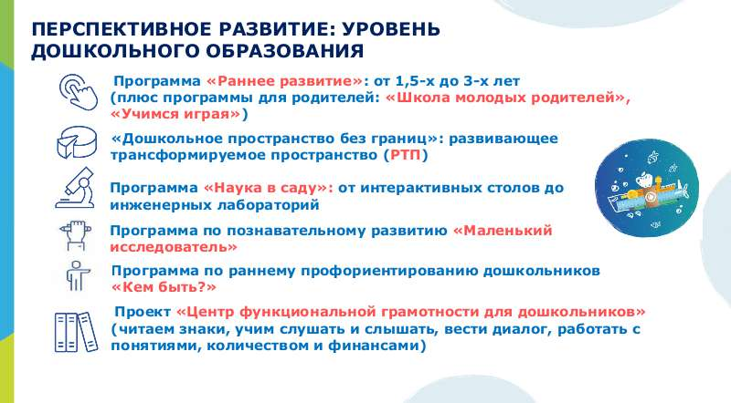
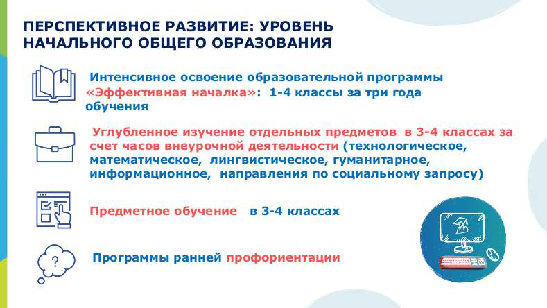
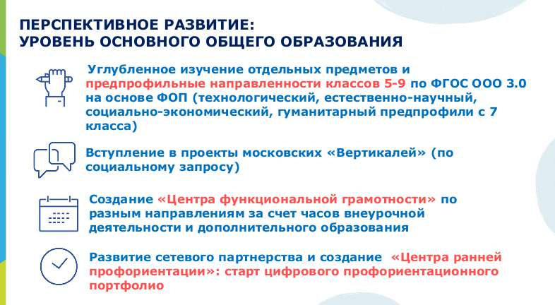
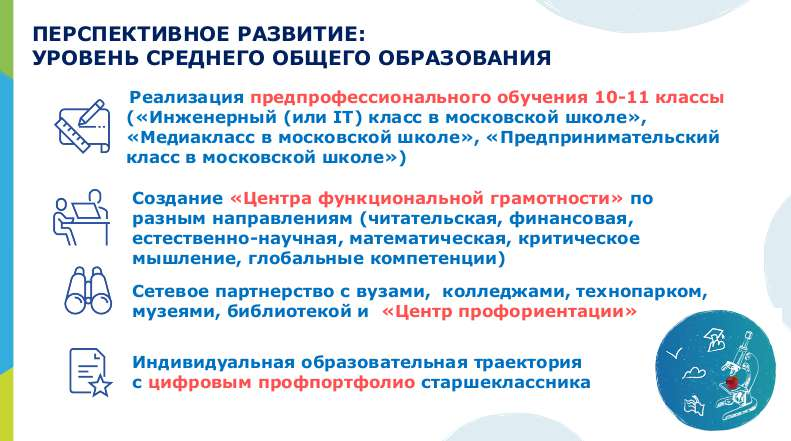

# Рабочая программа воспитания

> Основная образовательная программа начального общего образования ГБОУ Школа № 1366. ФГОС 3.0. Страницы PDF: 1677–1691.

6. Четкость выводов, обобщающих доклад

1 - выводы имеются, но они не доказаны, 2 - выводы нечеткие, 3 - выводы полностью характеризуют работу

Программа разработана с учетом: Федерального закона от 29.12.2012 № 273 ФЗ «Об образовании в Российской Федерации», Стратегии развития воспитания в Российской Федерации на период до 2025 года (Распоряжение Правительства Российской Федерации от 29.05.2015 № 996-р) и Плана мероприятий по ее реализации в 2021–2025 гг. (Распоряжение Правительства Российской Федерации от 12.11.2020 № 2945-р), Стратегии национальной безопасности Российской Федерации (Указ Президента Российской Федерации от 02.07.2021 № 400), Федеральных государственных образовательных стандартов (далее — ФГОС) начального общего образования (Приказ Министерства просвещения Российской Федерации от 18.05.2023 № 372 «Об утверждении федеральной образовательной программы начального общего образования»), основного общего образования (Приказ Министерства просвещения Российской Федерации от 18.05.2023 № 370 «Об утверждении федеральной образовательной программы основного общего образования»), среднего общего образования (Приказ Министерства просвещения Российской Федерации от 18.05.2023 № 371 «Об утверждении федеральной образовательной программы среднего общего образования»).

Программа воспитания: ● предназначена для планирования и организации системной воспитательной деятельности в образовательной организации; ● разрабатывается и утверждается с участием коллегиальных органов управления образовательной организацией, в том числе советов обучающихся, советов родителей (законных представителей);

● реализуется в единстве урочной и внеурочной деятельности, осуществляемой совместно с семьёй и другими участниками образовательных отношений, социальными институтами воспитания;

● предусматривает приобщение обучающихся к российским традиционным духовным ценностям, включая ценности своей этнической группы, правилам и нормам поведения, принятым в российском обществе на основе российских базовых конституционных норм и ценностей;

● предусматривает историческое просвещение, формирование российской культурной и гражданской идентичности обучающихся. Программа включает три раздела: целевой, содержательный, организационный. Приложение — примерный календарный план воспитательной работы.

## РАЗДЕЛ 1. ЦЕЛЕВОЙ

Участниками образовательных отношений являются педагогические и другие работники общеобразовательной организации, обучающиеся, их родители (законные представители), представители иных организаций, участвующие в реализации образовательного

процесса в соответствии с законодательством Российской Федерации, локальными актами ГБОУ Школа № 1366. Родители (законные представители) несовершеннолетних обучающихся имеют преимущественное право на воспитание своих детей.

## Содержание воспитания обучающихся в общеобразовательной организации определяется содержанием российских базовых

(гражданских, национальных) норм и ценностей, которые закреплены в Конституции Российской Федерации. Эти ценности и нормы определяют инвариантное содержание воспитания обучающихся. Вариативный компонент содержания воспитания обучающихся включает духовно-нравственные ценности культуры, традиционных религий народов России.

Воспитательная деятельность в школе планируется и осуществляется в соответствии с приоритетами государственной политики в сфере воспитания, установленными в государственной Стратегии развития воспитания в Российской Федерации на период до 2025 года (Распоряжение Правительства Российской Федерации от 29.05.2015 № 996-р), в Государственной программе города Москвы «Развитие образования города Москвы («Столичное образование»)» (в редакции постановления Правительства Москвы от 30 марта 2021 г. № 387-ПП). Приоритетной задачей Российской Федерации в сфере воспитания детей является развитие высоконравственной личности, разделяющей российские традиционные духовные ценности, обладающей актуальными знаниями и умениями, способной реализовать свой потенциал в условиях современного общества, готовой к мирному созиданию и защите Родины.

Цель и задачи воспитания обучающихся Цель воспитания обучающихся в образовательной организации: развитие личности, создание условий для самоопределения и социализации на основе социокультурных, духовно-нравственных ценностей и принятых в российском обществе правил и норм поведения в интересах человека, семьи, общества и государства;

формирование у обучающихся чувства патриотизма, гражданственности, уважения к памяти защитников Отечества и подвигам Героев Отечества, закону и правопорядку, человеку труда и старшему поколению, взаимного уважения, бережного отношения к культурному наследию и традициям многонационального народа Российской Федерации, природе и окружающей среде.

Задачи воспитания обучающихся в общеобразовательной организации:

- усвоение ими знаний норм, духовно-нравственных ценностей, традиций, которые выработало российское общество (социально

значимых знаний);

- формирование и развитие личностных отношений к этим нормам, ценностям, традициям (их освоение, принятие);
- приобретение соответствующего этим нормам, ценностям, традициям социокультурного опыта поведения, общения, межличностных

и социальных отношений, применения полученных знаний;

- достижение личностных результатов освоения общеобразовательных программ в соответствии с ФГОС. Личностные результаты освоения обучающимися общеобразовательных программ включают:
- осознание российской гражданской идентичности,
- сформированность ценностей самостоятельности и инициативы,
- готовность обучающихся к саморазвитию, самостоятельности и личностному самоопределению,
- наличие мотивации к целенаправленной социально значимой деятельности,
- сформированность внутренней позиции личности как особого ценностного отношения к себе, окружающим людям и жизни в целом.

Воспитательная деятельность в общеобразовательной организации планируется и осуществляется на основе аксиологического, антропологического, культурно-исторического, системно-деятельностного, личностно-ориентированного подходов и с учётом принципов

воспитания: гуманистической направленности воспитания, совместной деятельности детей и взрослых, следования нравственному примеру, безопасной жизнедеятельности, инклюзивности, возрастосообразности.

Направления воспитания Программа воспитания реализуется в единстве учебной и воспитательной деятельности образовательной организации по основным направлениям воспитания в соответствии с ФГОС НОО, ООО, СОО и отражает готовность обучающихся руководствоваться ценностями и приобретать первоначальный опыт деятельности на их основе, в том числе в части:

1. Гражданского воспитания, способствующего формированию российской гражданской идентичности, принадлежности к общности граждан Российской Федерации, к народу России как источнику власти в Российском государстве и субъекту тысячелетней российской государственности, уважения к правам, свободам и обязанностям гражданина России, правовой и политической культуры.

2. Патриотического воспитания, основанного на воспитании любви к родному краю, Родине, своему народу, уважения к другим народам России; историческое просвещение, формирование российского национального исторического сознания, российской культурной идентичности.

3. Духовно-нравственного воспитания на основе духовно-нравственной культуры народов России, традиционных религий народов России, формирование традиционных российских семейных ценностей; воспитание честности, доброты, милосердия, справедливости, дружелюбия и взаимопомощи, уважения к старшим, к памяти предков.

4. Эстетического воспитания, способствующего формированию эстетической культуры на основе российских традиционных духовных ценностей, приобщения к лучшим образцам отечественного и мирового искусства.

5. Физического воспитания, ориентированного на формирование культуры здорового образа жизни и эмоционального благополучия – развитие физических способностей с учётом возможностей и состояния здоровья, навыков безопасного поведения в природной и социальной среде, чрезвычайных ситуациях.

6. Трудового воспитания, основанного на воспитании уважения к труду, трудящимся, результатам труда (своего и других людей), ориентации на трудовую деятельность, получение профессии, личностное самовыражение в продуктивном, нравственно достойном труде в российском обществе, достижение выдающихся результатов в профессиональной деятельности.

7. Экологического воспитания, способствующего формированию экологической культуры, ответственного, бережного отношения к природе, окружающей среде на основе российских традиционных духовных ценностей, навыков охраны, защиты, восстановления природы, окружающей среды.

8. Ценности научного познания, ориентированного на воспитание стремления к познанию себя и других людей, природы и общества, к получению знаний, качественного образования с учётом личностных интересов и общественных потребностей.

Целевые ориентиры определены в соответствии с инвариантным содержанием воспитания обучающихся на основе российских базовых (гражданских, конституциональных) ценностей, обеспечивают единство воспитания, воспитательного пространства.

Целевые ориентиры результатов воспитания на уровне начального общего образования.

- Гражданское воспитание: знающий и любящий свою малую родину, свой край, имеющий представление о Родине — России, её территории, расположении; сознающий принадлежность к своему народу и к общности граждан России, проявляющий уважение к своему и другим народам;

понимающий свою сопричастность к прошлому, настоящему и будущему родного края, своей Родины — России, Российского государства;

понимающий значение гражданских символов (государственная символика России, своего региона), праздников, мест почитания героев и защитников Отечества, проявляющий к ним уважение;

имеющий первоначальные представления о правах и ответственности человека в обществе, гражданских правах и обязанностях; принимающий участие в жизни класса, общеобразовательной организации, в доступной по возрасту социально значимой деятельности.

- Духовно-нравственное воспитание: уважающий духовно-нравственную культуру своей семьи, своего народа, семейные ценности с учётом национальной, религиозной принадлежности;

сознающий ценность каждой человеческой жизни, признающий индивидуальность и достоинство каждого человека; доброжелательный, проявляющий сопереживание, готовность оказывать помощь, выражающий неприятие поведения, причиняющего физический и моральный вред другим людям, уважающий старших;

умеющий оценивать поступки с позиции их соответствия нравственным нормам, осознающий ответственность за свои поступки; владеющий представлениями о многообразии языкового и культурного пространства России, имеющий первоначальные навыки общения с людьми разных народов, вероисповеданий;

сознающий нравственную и эстетическую ценность литературы, родного языка, русского языка, проявляющий интерес к чтению.

- Эстетическое воспитание: способный воспринимать и чувствовать прекрасное в быту, природе, искусстве, творчестве людей; проявляющий интерес и уважение к отечественной и мировой художественной культуре; проявляющий стремление к самовыражению в разных видах художественной деятельности, искусстве.
- Физическое воспитание, формирование культуры здоровья и эмоционального благополучия: бережно относящийся к физическому здоровью, соблюдающий основные правила здорового и безопасного для себя и других людей образа жизни, в том числе в информационной среде;

владеющий основными навыками личной и общественной гигиены, безопасного поведения в быту, природе, обществе; ориентированный на физическое развитие с учётом возможностей здоровья, занятия физкультурой и спортом; сознающий и принимающий свою половую принадлежность, соответствующие ей психофизические и поведенческие особенности с учётом возраста.

- Трудовое воспитание: сознающий ценность труда в жизни человека, семьи, общества; проявляющий уважение к труду, людям труда, бережное отношение к результатам труда, ответственное потребление; проявляющий интерес к разным профессиям; участвующий в различных видах доступного по возрасту труда, трудовой деятельности.
- Экологическое воспитание понимающий ценность природы, зависимость жизни людей от природы, влияние людей на природу, окружающую среду; проявляющий любовь и бережное отношение к природе, неприятие действий, приносящих вред природе, особенно живым существам;

выражающий готовность в своей деятельности придерживаться экологических норм.

- Ценности научного познания: выражающий познавательные интересы, активность, любознательность и самостоятельность в познании, интерес и уважение к научным знаниям, науке;

обладающий первоначальными представлениями о природных и социальных объектах, многообразии объектов и явлений природы, связи живой и неживой природы, о науке, научном знании;

имеющий первоначальные навыки наблюдений, систематизации и осмысления опыта в естественно-научной и гуманитарной областях знания.

Целевые ориентиры результатов воспитания на уровне основного общего образования.

- Гражданское воспитание: знающий и принимающий свою российскую гражданскую принадлежность (идентичность) в поликультурном, многонациональном и многоконфессиональном российском обществе, в мировом сообществе;

понимающий сопричастность к прошлому, настоящему и будущему народа России, тысячелетней истории российской государственности на основе исторического просвещения, российского национального исторического сознания;

проявляющий уважение к государственным символам России, праздникам; проявляющий готовность к выполнению обязанностей гражданина России, реализации своих гражданских прав и свобод при уважении прав и свобод, законных интересов других людей;

выражающий неприятие любой дискриминации граждан, проявлений экстремизма, терроризма, коррупции в обществе; принимающий участие в жизни класса, общеобразовательной организации, в том числе самоуправлении, ориентированный на участие в социально значимой деятельности.

- Патриотическое воспитание: сознающий свою национальную, этническую принадлежность, любящий свой народ, его традиции, культуру; проявляющий уважение к историческому и культурному наследию своего и других народов России, символам, праздникам, памятникам, традициям народов, проживающих в родной стране;

проявляющий интерес к познанию родного языка, истории и культуры своего края, своего народа, других народов России; знающий и уважающий достижения нашей Родины — России в науке, искусстве, спорте, технологиях, боевые подвиги и трудовые достижения, героев и защитников Отечества в прошлом и современности; принимающий участие в мероприятиях патриотической направленности.

- Духовно-нравственное воспитание: знающий и уважающий духовно-нравственную культуру своего народа, ориентированный на духовные ценности и нравственные нормы народов России, российского общества в ситуациях нравственного выбора (с учётом национальной, религиозной принадлежности);

выражающий готовность оценивать своё поведение и поступки, поведение и поступки других людей с позиций традиционных российских духовно-нравственных ценностей и норм с учётом осознания последствий поступков;

выражающий неприятие антигуманных и асоциальных поступков, поведения, противоречащих традиционным в России духовно-нравственным нормам и ценностям;

сознающий соотношение свободы и ответственности личности в условиях индивидуального и общественного пространства, значение и ценность межнационального, межрелигиозного согласия людей, народов в России, умеющий общаться с людьми разных народов, вероисповеданий;

проявляющий уважение к старшим, к российским традиционным семейным ценностям, институту брака как союзу мужчины и женщины для создания семьи, рождения и воспитания детей;

проявляющий интерес к чтению, к родному языку, русскому языку и литературе как части духовной культуры своего народа, российского общества.

- Эстетическое воспитание: выражающий понимание ценности отечественного и мирового искусства, народных традиций и народного творчества в искусстве; проявляющий эмоционально-чувственную восприимчивость к разным видам искусства, традициям и творчеству своего и других народов, понимание их влияния на поведение людей;

сознающий роль художественной культуры как средства коммуникации и самовыражения в современном обществе, значение нравственных норм, ценностей, традиций в искусстве;

ориентированный на самовыражение в разных видах искусства, в художественном творчестве.

- Физическое воспитание, формирование культуры здоровья и эмоционального благополучия: понимающий ценность жизни, здоровья и безопасности, значение личных усилий в сохранении здоровья, знающий и соблюдающий правила безопасности, безопасного поведения, в том числе в информационной среде;

выражающий установку на здоровый образ жизни (здоровое питание, соблюдение гигиенических правил, сбалансированный режим занятий и отдыха, регулярную физическую активность);

проявляющий неприятие вредных привычек (курения, употребления алкоголя, наркотиков, игровой и иных форм зависимостей), понимание их последствий, вреда для физического и психического здоровья;

умеющий осознавать физическое и эмоциональное состояние (своё и других людей), стремящийся управлять собственным эмоциональным состоянием;

способный адаптироваться к меняющимся социальным, информационным и природным условиям, стрессовым ситуациям.

- Трудовое воспитание: уважающий труд, результаты своего труда, труда других людей; проявляющий интерес к практическому изучению профессий и труда различного рода, в том числе на основе применения предметных знаний;

сознающий важность трудолюбия, обучения труду, накопления навыков трудовой деятельности на протяжении жизни для успешной профессиональной самореализации в российском обществе;

участвующий в решении практических трудовых дел, задач (в семье, общеобразовательной организации, своей местности) технологической и социальной направленности, способный инициировать, планировать и самостоятельно выполнять такого рода деятельность;

выражающий готовность к осознанному выбору и построению индивидуальной траектории образования и жизненных планов с учётом личных и общественных интересов, потребностей.

- Экологическое воспитание: понимающий значение и глобальный характер экологических проблем, путей их решения, значение экологической культуры человека, общества;

сознающий свою ответственность как гражданина и потребителя в условиях взаимосвязи природной, технологической и социальной сред;

выражающий активное неприятие действий, приносящих вред природе; ориентированный на применение знаний естественных и социальных наук для решения задач в области охраны природы, планирования своих поступков и оценки их возможных последствий для окружающей среды;

участвующий в практической деятельности экологической, природоохранной направленности.

- Ценности научного познания: выражающий познавательные интересы в разных предметных областях с учётом индивидуальных интересов, способностей, достижений;

ориентированный в деятельности на научные знания о природе и обществе, взаимосвязях человека с природной и социальной средой; развивающий навыки использования различных средств познания, накопления знаний о мире (языковая, читательская культура, деятельность в информационной, цифровой среде);

демонстрирующий навыки наблюдений, накопления фактов, осмысления опыта в естественнонаучной и гуманитарной областях познания, исследовательской деятельности.

Целевые ориентиры результатов воспитания на уровне среднего общего образования.

- Гражданское воспитание: осознанно выражающий свою российскую гражданскую принадлежность (идентичность) в поликультурном, многонациональном и многоконфессиональном российском обществе, в мировом сообществе;

сознающий своё единство с народом России как источником власти и субъектом тысячелетней российской государственности, с Российским государством, ответственность за его развитие в настоящем и будущем на основе исторического просвещения, сформированного российского национального исторического сознания;

проявляющий готовность к защите Родины, способный аргументированно отстаивать суверенитет и достоинство народа России и Российского государства, сохранять и защищать историческую правду;

ориентированный на активное гражданское участие на основе уважения закона и правопорядка, прав и свобод сограждан; осознанно и деятельно выражающий неприятие любой дискриминации по социальным, национальным, расовым, религиозным признакам, проявлений экстремизма, терроризма, коррупции, антигосударственной деятельности;

обладающий опытом гражданской социально значимой деятельности (в ученическом самоуправлении, волонтёрском движении, экологических, военно-патриотических и другие объединениях, акциях, программах).

- Патриотическое воспитание: выражающий свою национальную, этническую принадлежность, приверженность к родной культуре, любовь к своему народу;

сознающий причастность к многонациональному народу Российской Федерации, Российскому Отечеству, российскую культурную идентичность;

проявляющий деятельное ценностное отношение к историческому и культурному наследию своего и других народов России, традициям, праздникам, памятникам народов, проживающих в родной стране – России;

проявляющий уважение к соотечественникам, проживающим за рубежом, поддерживающий их права, защиту их интересов в сохранении российской культурной идентичности.

- Духовно-нравственное воспитание: проявляющий приверженность традиционным духовно-нравственным ценностям, культуре народов России с учётом мировоззренческого, национального, конфессионального самоопределения;

действующий и оценивающий своё поведение и поступки, поведение и поступки других людей с позиций традиционных российских духовно-нравственных ценностей и норм с осознанием последствий поступков, деятельно выражающий неприятие антигуманных и асоциальных поступков, поведения, противоречащих этим ценностям;

проявляющий уважение к жизни и достоинству каждого человека, свободе мировоззренческого выбора и самоопределения, к представителям различных этнических групп, религий народов России, их национальному достоинству и религиозным чувствам с учётом соблюдения конституционных прав и свобод всех граждан;

понимающий и деятельно выражающий ценность межнационального, межрелигиозного согласия людей, народов в России, способный вести диалог с людьми разных национальностей, отношения к религии и религиозной принадлежности, находить общие цели и сотрудничать для их достижения;

ориентированный на создание устойчивой семьи на основе российских традиционных семейных ценностей, понимания брака как союза мужчины и женщины для создания семьи, рождения и воспитания в семье детей, неприятия насилия в семье, ухода от родительской ответственности;

обладающий сформированными представлениями о ценности и значении в отечественной и мировой культуре языков и литературы народов России, демонстрирующий устойчивый интерес к чтению как средству познания отечественной и мировой духовной культуры.

- Эстетическое воспитание: выражающий понимание ценности отечественного и мирового искусства, российского и мирового художественного наследия; проявляющий восприимчивость к разным видам искусства, понимание эмоционального воздействия искусства, его влияния на поведение людей, умеющий критически оценивать это влияние;

проявляющий понимание художественной культуры как средства коммуникации и самовыражения в современном обществе, значения нравственных норм, ценностей, традиций в искусстве;

ориентированный на осознанное творческое самовыражение, реализацию творческих способностей в разных видах искусства с учётом российских традиционных духовных и нравственных ценностей, на эстетическое обустройство собственного быта.

- Физическое воспитание, формирование культуры здоровья и эмоционального благополучия: понимающий и выражающий в практической деятельности ценность жизни, здоровья и безопасности, значение личных усилий в сохранении и укреплении своего здоровья и здоровья других людей;

соблюдающий правила личной и общественной безопасности, в том числе безопасного поведения в информационной среде;

выражающий на практике установку на здоровый образ жизни (здоровое питание, соблюдение гигиены, режим занятий и отдыха, регулярную физическую активность), стремление к физическому совершенствованию, соблюдающий и пропагандирующий безопасный и здоровый образ жизни;

проявляющий сознательное и обоснованное неприятие вредных привычек (курения, употребления алкоголя, наркотиков, любых форм зависимостей), деструктивного поведения в обществе и цифровой среде, понимание их вреда для физического и психического здоровья;

демонстрирующий навыки рефлексии своего состояния (физического, эмоционального, психологического), состояния других людей с точки зрения безопасности, сознательного управления своим эмоциональным состоянием;

развивающий способности адаптироваться к стрессовым ситуациям в общении, в разных коллективах, к меняющимся условиям (социальным, информационным, природным).

- Трудовое воспитание: уважающий труд, результаты труда, трудовые и профессиональные достижения своих земляков, их вклад в развитие своего поселения, края, страны, трудовые достижения российского народа;

проявляющий способность к творческому созидательному социально значимому труду в доступных по возрасту социально-трудовых ролях, в том числе предпринимательской деятельности в условиях самозанятости или наёмного труда;

участвующий в социально значимой трудовой деятельности разного вида в семье, общеобразовательной организации, своей местности, в том числе оплачиваемом труде в каникулярные периоды, с учётом соблюдения законодательства Российской Федерации;

выражающий осознанную готовность к получению профессионального образования, к непрерывному образованию в течение жизни как условию успешной профессиональной и общественной деятельности;

понимающий специфику трудовой деятельности, регулирования трудовых отношений, самообразования и профессиональной самоподготовки в информационном высокотехнологическом обществе, готовый учиться и трудиться в современном обществе;

ориентированный на осознанный выбор сферы трудовой, профессиональной деятельности в российском обществе с учётом личных жизненных планов, потребностей своей семьи, общества.

Экологическое воспитание: демонстрирующий в поведении сформированность экологической культуры на основе понимания влияния социально-экономических процессов на природу, в том числе на глобальном уровне, ответственность за действия в природной среде;

выражающий деятельное неприятие действий, приносящих вред природе; применяющий знания естественных и социальных наук для разумного, бережливого природопользования в быту, общественном пространстве;

имеющий и развивающий опыт экологически направленной, природоохранной, ресурсосберегающей деятельности, участвующий в его приобретении другими людьми.

Ценности научного познания: деятельно выражающий познавательные интересы в разных предметных областях с учётом своих интересов, способностей, достижений;

обладающий представлением о современной научной картине мира, достижениях науки и техники, аргументированно выражающий понимание значения науки в жизни российского общества, обеспечении его безопасности, гуманитарном, социально-экономическом развитии России;

демонстрирующий навыки критического мышления, определения достоверной научной информации и критики антинаучных представлений;

развивающий и применяющий навыки наблюдения, накопления и систематизации фактов, осмысления опыта в естественно-научной и гуманитарной областях познания, исследовательской деятельности.

Выделение в общей цели воспитания целевых приоритетов, связанных с возрастными особенностями воспитанников, не означает игнорирования других составляющих общей цели воспитания. Приоритет — это то, чему педагогам, работающим со школьниками конкретной возрастной категории, предстоит уделять первостепенное, но не единственное внимание.

Добросовестная работа педагогов, направленная на достижение поставленной цели, позволит ребенку получить необходимые социальные навыки, которые помогут ему лучше ориентироваться в сложном мире человеческих взаимоотношений, эффективнее налаживать коммуникацию с окружающими, увереннее себя чувствовать во взаимодействии с ними, продуктивнее сотрудничать с людьми разных возрастов и разного социального положения, смелее искать и находить выходы из трудных жизненных ситуаций, осмысленнее выбирать свой жизненный путь в сложных поисках счастья для себя и окружающих его людей.

Достижению поставленной цели воспитания школьников будет способствовать решение следующих основных задач: реализовывать воспитательные возможности общешкольных ключевых дел, поддерживать традиции их коллективного планирования, организации, проведения и анализа в школьном сообществе;

реализовывать потенциал классного руководства в воспитании школьников, поддерживать активное участие классных сообществ в жизни школы;

вовлекать школьников в кружки, секции, клубы, студии и иные объединения, работающие по школьным программам внеурочной деятельности, реализовывать их воспитательные возможности;

использовать в воспитании детей возможности школьного урока, поддерживать использование на уроках интерактивных форм занятий с учащимися;

инициировать и поддерживать ученическое самоуправление – как на уровне школы, так и на уровне классных сообществ; поддерживать деятельность функционирующих на базе школы детских общественных объединений и организаций; организовывать для школьников экскурсии, экспедиции, походы и реализовывать их воспитательный потенциал; организовывать профориентационную работу со школьниками; развивать предметно-эстетическую среду школы и реализовывать ее воспитательные возможности; - организовать работу с семьями школьников, их родителями или законными представителями, направленную на совместное решение проблем личностного развития детей.

Планомерная реализация поставленных задач позволит организовать в школе интересную и событийно насыщенную жизнь детей и педагогов, что станет эффективным способом профилактики антисоциального поведения школьников.

## РАЗДЕЛ 2. СОДЕРЖАТЕЛЬНЫЙ

Уклад общеобразовательной организации Организация воспитательной деятельности ГБОУ Школа № 1366 опирается на школьный уклад, выражающий самобытный облик образовательной организации.

ГБОУ Школа 1366 — образовательная организация, реализующая программы как общеобразовательные, так и с углубленным изучением отдельных предметов (городской проект «Математическая вертикаль», классы с углубленным изучением биологии, стратовое обучение по математике в 5-6 классах), а также дополнительные общеразвивающие программы.

Основная миссия школы - возможность приобретения каждым обучающимся компетенций для успешной жизни и карьеры в столичном мегаполисе, России и мире: построения профессиональной и личностной траектории в среде инновационного конвергентного образовательного пространства, обеспечивающего опережающее развитие школьника путем синтеза наук, технологий и личностно ориентированной практической деятельности в сетевом взаимодействии.

Уровень дошкольного образования – это единый развивающий мир, где миссия школы – сохранение уникальности и самоценности дошкольного детства как отправной точки включения и дальнейшего овладения разнообразными формами жизнедеятельности в быстро изменяющемся мире, содействие развитию различных форм активности ребенка, передача общественных норм и ценностей, способствующих позитивной социализации. Дети с особенностями развития встраиваются в существующие группы (инклюзивное образование). Интерес к наукам и технологиям развивается через исследовательскую работу и экспериментирование, участие в Московском детском чемпионате «Мастерята». Учитывается желание родителей о предоставлении возможности будущему первокласснику осваивать образовательной программы начального общего образования по ускоренному обучению.

На ступени «Начальная школа» приоритетно понимание самоценности начального общего образования как фундамента всего последующего образования. Форма организации обучения в Школе – классно-урочная система (пространственно-временная регламентация учебы, где время занятий и способ организации работы во времени задаются учителем). Содержание обучения – учебная деятельность.

Программы начального общего образования формируются различного уровня сложности и направленности с учетом образовательных потребностей и способностей обучающихся. Используется образовательная система «Школа России», углубленно изучается иностранный язык, интерес к гуманитарным и естественно-математическим наукам развивается через проектную работу и участие в Московском детском чемпионате «Мастерята». Организация обучения в 1 классе предполагает обучение в классах 4-летней начальной школы и классах ускоренного обучения в рамках реализации проекта «Эффективная начальная школа» (3 года обучения). С учетом особенностей и образовательных потребностей конкретного обучающегося в рамках ускоренного обучения для обеспечения индивидуализации содержания образовательной программы разрабатываются индивидуальные учебные планы.

Основная идея «Подростковой школы» заключается в том, чтобы создать для обучающихся условия, в которых они смогут через практику и самостоятельную работу попробовать себя в разных предметных областях, определить свои интересы, будут формировать компетенции, необходимые для жизни в динамично меняющемся мире, смогут осознанно выбрать направлении дальнейшего обучения.

Форма организации обучения в Школе – переход от чисто классно-урочной системы к лабораторно-семинарской, когда время занятий и способ организации работы во времени задаются самим содержанием дела (времени отпущено столько, сколько надо затратить для получения определенного продукта, и организовать совместную работу так, как это удобно для его получения).

## Содержание обучения – учебная деятельность продолжается как учебно-экспериментальная. Программы основного общего

образования формируются различного уровня сложности и направленности с учетом образовательных потребностей и способностей обучающихся, включая одаренных детей и детей с ограниченными возможностями здоровья. В 5–6-х классах в рамках внеурочной деятельности и дополнительного образования действуют разновозрастные группы, объединенные в лаборатории, клубы, мастерские для развития познавательного интереса. Часть учебных занятий проводится в музеях, театрах, парках и т.п.

На ступени «Школы старшеклассников», включающей уровни как основного общего (7–9 классы), так и среднего общего образования (10–11 классы), в рамках сетевого взаимодействия с вузами и СПО, учреждениями науки, представителями бизнеса, работодателями организованы профильная подготовка в 7–9 классах и предпрофессиональное профильное образование в 10–11 классах. Создается и развивается современное образовательное пространство совместной работы взрослых и детей, способствующее росту самостоятельности и осознанию персональной ответственности обучающихся за образовательные результаты, пониманию непрерывности образования и необходимости учиться на протяжении всей жизни, реализации разнообразных образовательных маршрутов школьников, их успешному личностному росту и профессиональному самоопределению.

Форма организации обучения в Школе – переход от лабораторно-семинарской к лекционно-лабораторной системе, внедрение на уровне среднего общего образования современных форматов обучения, основанных на гибких учебных планах и обучении в группах сменного состава, близких по укладу к обучению в вузе. Содержание обучения – учебно-продуктивная деятельность, где результатом должно быть авторское произведение и где, следовательно, происходит становление начал авторства.

Школа реализует инклюзивное образование и предоставляет специальные условия для получения образования обучающимися с ОВЗ на основе специально созданной образовательной среды, специальных педагогических подходов, а также наиболее подходящих для этих лиц методов и технологий организации образовательного процесса, отвечающих в полной мере их особым образовательным потребностям, и в соответствии с рекомендациями Центральной психолого-медико-педагогической комиссии (ЦПМПК) города Москвы.

Основные вехи истории ГБОУ Школа № 1366. Школа открыта 01.09. 2022 года (дошкольные группы), 01.09.2023 (запуск школьного образования). Значимые для воспитания проекты, в которых общеобразовательная организация планирует участвовать «Движение Первых» — это сотни уникальных программ воспитания и становления личности, активного и ответственного молодежного сообщества, для которого важны уважение к традициям и культурам народов России, историческая преемственность и сопричастность с судьбой страны, в которой главной ценностью была, есть и будет – семья.

Школьный спортивный клуб создается и осуществляет свою деятельность в целях вовлечения всех участников образовательного процесса, в том числе и родителей обучающихся, в регулярные занятия физической культурой и спортом, а также мероприятия, позволяющие проявить свои таланты и способности в рамках совместной работы.

В рамках федерального проекта «Социальная активность» нацпроекта «Образование» Российское движение школьников совместно с Ассоциацией волонтёрских центров в школе реализуется программа детского добровольчества «Ты решаешь!». В школе планируется открытие волонтёрских отрядов «Точка социальной ответственности» - сообщества юных лидеров волонтёрского движения, которые претворяют в жизнь социальные проекты.
