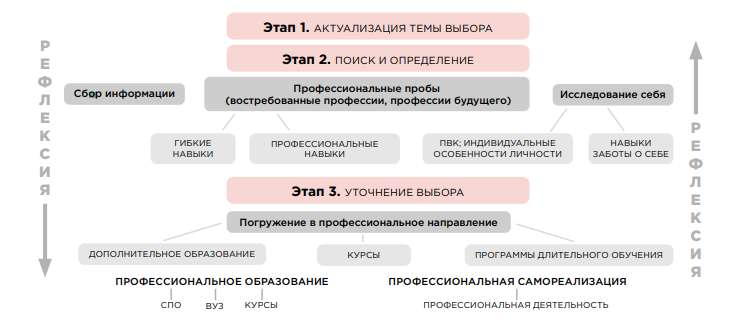
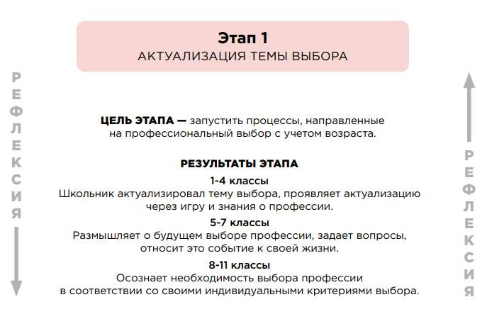
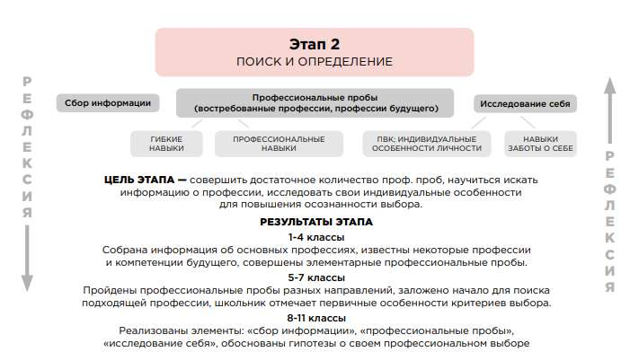
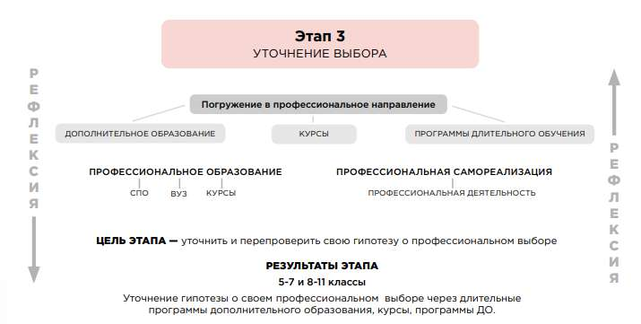

# Модуль «Профориентация»

> Основная образовательная программа начального общего образования ГБОУ Школа № 1366. ФГОС 3.0. Страницы PDF: 1714–1722.

Профессиональные образовательные учреждения

Организация и проведение массовых познавательных и досугово-развивающих мероприятий, а также участие в реализации городских образовательных и просветительских программ и проектов. Программы кружков и секций. Таким образом, социальное партнерство проявляет себя в школе в совместной реализации образовательных проектов и социальных инициатив, в обмене опытом, в совершенствовании образовательной среды школы. Такая деятельность расширяет круг общения всех участников образовательного процесса, позволяет обучающимся получить социальный опыт и способствует формированию их мировоззрения.

Реализация воспитательного потенциала социального партнёрства может предусматривать (указываются конкретные позиции, имеющиеся в образовательной организации или запланированные):

участие представителей организаций-партнёров, в том числе в соответствии с договорами о сотрудничестве, в проведении отдельных мероприятий в рамках рабочей программы воспитания и календарного плана воспитательной работы (дни открытых дверей, государственные, региональные, школьные праздники, торжественные мероприятия и другие);

участие представителей организаций-партнёров в проведении отдельных уроков, внеурочных занятий, внешкольных мероприятий соответствующей тематической направленности;

проведение на базе организаций-партнёров отдельных уроков, занятий, внешкольных мероприятий, акций воспитательной направленности;

проведение открытых дискуссионных площадок (детских, педагогических, родительских) с представителями организаций-партнёров для обсуждений актуальных проблем, касающихся жизни образовательной организации, муниципального образования, региона, страны;

реализация социальных проектов, совместно разрабатываемых обучающимися, педагогами с организациями-партнёрами благотворительной, экологической, патриотической, трудовой и другой направленности, ориентированных на воспитание обучающихся, преобразование окружающего социума, позитивное воздействие на социальное окружение.

## Модуль «Профориентация»

Совместная деятельность педагогов и обучающихся по направлению «Профориентация» включает в себя профессиональное просвещение обучающихся; диагностику и консультирование по проблемам профориентации, организацию профессиональных проб обучающихся. Задача совместной деятельности педагога и обучающегося – подготовить обучающегося к осознанному выбору своей будущей профессиональной деятельности.

Модель профориентации и профессионального самоопределения для 1–11-х классов является комплексным ориентиром для организации профориентационной работы в общеобразовательной организации, которая учитывает особенности возраста и востребованность профессий.

Основой для модели стали труды Е. А. Климова, который рассматривал профессиональное самоопределение «как важное проявление психического развития, как активный поиск возможностей развития, формирования себя как полноценного участника сообщества

профессионалов». На рисунке представлена вариативная модель профориентации и профессионального самоопределения в школе.

Данная модель подразумевает последовательное прохождение трех основных этапов, позволяющих не просто познакомиться с профессиями, а сформировать готовность к профессиональному самоопределению. Ключевым элементом модели является рефлексия. Ее развитие способствует формированию субъектности, что делает доступным осознанное профессиональное самоопределение.

Этап 1. Актуализация темы профессионального выбора. Основная цель первого этапа — запустить процессы, направленные на профессиональный выбор с учетом возраста. Основными задачами здесь являются знакомство с профессиями, знание профессиональных сфер, понимание существующих профессиональных направлений, формирование ценностного отношения к труду и позитивного отношения к выбору будущей профессии. Следовательно, актуализация темы выбора запускает первичный процесс к познавательной деятельности обучающегося.

В средней школе первый этап нацелен на проявление интереса к разным профессиональным направлениям. В старшей школе обучающимся необходимо совершить профессиональный выбор, который будет связан с их дальнейшей траекторией обучения в СПО или профильном классе с последующим поступлением в вуз. Поэтому этап актуализации направлен на профессиональный выбор. На рисунке 2 схематично представлено содержание и ожидаемые результаты данного этапа.

Этап 2. Поиск и определение. Второй этап состоит из нескольких элементов, которые в модели указаны как профессиональные пробы, сбор информации и исследование себя. Не имеет значения, с какого элемента начинать работу, важно прохождение всех элементов, однако существует их приоритетность в соответствии с возрастными особенностями. Например, ведущей деятельностью младшего школьника является учебно-познавательная, в которую также входит формирование представлений о мире профессий.

Для учащихся 1–4-х классов первым и основным элементом является сбор информации о профессии, что соответствует профориентационным задачам возраста. Следующим по приоритету элементом являются профессиональные пробы в востребованных сферах. Так как обучающиеся в начальной школе совсем нескоро выйдут на рынок труда, они должны быть готовы к переменам и понимать, что профессии, которые им интересны сейчас, будут модифицированы и представлены в другом виде или появятся новые профессии, сформированные на стыке нескольких профессий. Заключительный элемент модели — исследование себя.

Начальная школа — это период, когда ребята впервые знакомятся, понимают и формируют общее представление о мире профессий. По сути, элемент исследования себя в данном возрасте им доступен частично.

Приоритетным элементом для учащихся 5–7 классов являются профессиональные пробы. Школьники совершают пробы элементов профессий либо компетенций, тем самым формируя у себя понимание собственного интереса к профессиям через деятельность. Сбор информации для школьников этого возраста является вторым элементом модели, который позволит им расширить свои представления о разных профессиях, так как они уже ориентируются в различных сферах трудовой деятельности и имеют представление о существующих профессиях и профессиях будущего.

Элемент исследования себя реализуется в двух основных направлениях: навыки заботы о себе (self skills) — это навыки самоопределения и самоорганизации. Школьники на доступном для своего возраста уровне понимания уже могут определить, какая профессия им подходит и могут пояснить — почему.

Ключевым элементом для учащихся 8–9, 10–11 классов является исследование себя, поскольку перед школьниками в этом возрасте встает важнейшая задача — необходимо самоопределяться, выбирать, как дальше строить свою индивидуальную образовательную траекторию: в СПО или образовательной организации высшего образования. На рисунке 3 схематично представлено содержание и ожидаемые результаты данного этапа.

Этап 3. Уточнение выбора. Погружение в профессиональное направление понимается как проверка гипотезы о профессиональном выборе. Открывается и становится доступным этап уточнения выбора через элемент погружения в профессиональное направление, так как обучающиеся уже могут посещать дополнительное образование по профессиональному направлению. Этот элемент не используется в модели для начальной школы, так как в связи с возрастными особенностями недоступна рефлексия, которая позволяет развить осознанность в

отношении темы выбора и, погружаясь в профессиональное направление, объективировать гипотезу о своем профессиональном выборе. На рисунке 4 представлены ожидаемые результаты данного этапа.

Модель профориентации и профессионального самоопределения состоит из взаимосвязанных элементов, далее рассмотрим их подробно.

1. Профессиональные пробы — элемент модели, отвечающий за совершение деятельностной пробы в профессиональных и гибких навыках, востребованных в профессиях.

1.1. Гибкие навыки (soft skills) необходимы в работе каждого специалиста. Такие навыки как системное мышление, кооперация, работа с неопределенностью, креативность, творческое, системное и аналитическое мышление, являются универсальными и подходят для многих специалистов.

Однако существуют и специфичные умения, относящиеся к определенной деятельности. Например, в профессиях, требующих высокой стрессоустойчивости, будут особенно значимы навыки работы со стрессом. Данный элемент модели профессионального самоопределения и профессиональной ориентации указывает на необходимость деятельностных проб гибких навыков школьников в период с 1 по 11 классы.

1.2. Профессиональные навыки (hard skills) необходимы для реализации профессиональной деятельности. Этот элемент модели позволяет школьникам понять, интересна ли им рассматриваемая профессия, а также решает основную профориентационную задачу — знакомство с профессиями через деятельность. 14 Наиболее активный период прохождения профессиональных проб приходится на 5–7 классы. В этом возрасте школьникам особенно важно познакомиться с разными профессиональными сферами, даже такими, которые они не считают для себя подходящими. Возможно, интерес проявится в процессе деятельности, поэтому рекомендуется посещать как можно больше доступных в регионе профориентационных мероприятий. 2. Исследование себя — элемент, связанный с изучением своих индивидуальных особенностей и самоопределением. В полной мере этот элемент становится доступным в подростковом возрасте, когда сформированы

основные структуры личности, и школьники могут самостоятельно обосновать, какие профессии им нравятся, а какие нет и почему. Этот элемент формирует понимание себя. Параллельно ребенок осваивает навыки, необходимые для жизни, осознает, что выбор — это неотъемлемая часть профессиональной траектории, и определение в профессии является необходимым. Школьники начинают исследовать свои возможности, интересы, способности и другие индивидуальные особенности личности, а также соотносить со своей личностью знания о профессионально важных качествах, полученных на профессиональных пробах. В перспективе эти знания они смогут применить при совершении профессионального выбора.

2.1. Self skills, так называемые собственные навыки (навыки самообучения), — это навыки, направленные на самого себя, на самодиагностику, среди которых можно выделить три базовых навыка: самоопределение, самоорганизация и саморазвитие. Эти навыки совершенствуются в консультативной работе, беседах о профессиональном выборе. Они направлены на то, чтобы обучающиеся могли выделить собственные критерии профессионального выбора и подготовились к профессиональному самоопределению. За счет владения навыками технологий выбора, отношения к понравившейся профессии, личностного представления о профессиональной деятельности осознанный выбор профессии становится доступным.

2.2. ПВК (профессионально важные качества), индивидуальные особенности личности — темперамент, характер, способности, эмоционально-волевая сфера, установки, мотивы и смыслы.

3. Сбор информации — элемент, относящийся к аккумулированию информации по профессиональным направлениям. Поиск и работа с информацией — это определенный навык, направленный с точки зрения модели профессиональной ориентации и профессионального самоопределения на дополнение знаний 15 об интересующей профессии. Он позволяет сформировать общее представление о необходимых информационных критериях. Например, когда ребенок будет выбирать для себя профессию сварщика, он узнает, что в СПО существуют определенные условия поступления, и поэтому абитуриенту необходимо набрать необходимый средний балл аттестата. Для ряда поступающих на следующую ступень образования важным является территориальное местоположение образовательной организации. Здесь ребенок для себя формирует некий критериальный ряд. Элементы реализуются в каждой из возрастных категорий, но в разной степени. В методических рекомендациях указаны задачи профориентации и планируемые результаты с учетом возрастных особенностей.
4. Погружение в профессиональное направление — элемент, отвечающий за проверку гипотезы профессионального выбора. В силу возрастных особенностей деятельность по данному элементу доступна только для школьников 5–11 классов. Короткие программы в рамках профессиональных проб, продолжительностью до 3-х часов, обычно посещаются разово, что позволяет сформировать представление о профессиональном направлении. Возможность уточнить этот выбор, проверить устойчивость интереса к нему дает длительная программа дополнительного образования, курсы, секции. Школьник актуализирует для себя тему профессионального выбора на более глубоком уровне, тем самым через рефлексию осознавая, подходит это ему или нет.
5. Рефлексия — ключевой элемент модели, влияющий на осознанность выбора. В профессиональных пробах данный элемент проявляется в рефлексивном отношении к качеству выполняемой деятельности и мотивации к преодолению возможных сложностей при выполнении элементов профессиональных компетенций; в сборе информации — через критическое отношение к важным для выбора профессии материалам.

Самая значимая и сложная работа с личностью ведется в блоке исследования себя — там, где мы говорим о развитии навыков заботы о себе (self skills) — самоорганизации и самоопределения, которые находятся в тесной связке с рефлексией. Для того чтобы выявить свои основания выбора профессии, иметь возможность объективно размышлять о них, следует определить, что было сделано хорошо, а что требует

улучшения, вызывает ли эта деятельность интерес, появляется ли желание попробовать свои силы в этом профессиональном направлении еще раз. Отвечая на эти вопросы, школьники совершают первый шаг к тому, чтобы сформировать для себя понимание, какая деятельность им подходит, или почему эта профессиональная проба оказалась недостаточно интересна. Здесь особенно значима роль педагога, состоящая 16 в том, чтобы после прохождения профессиональной пробы помочь ребенку проанализировать полученный в ней опыт.

Применительно к модели профориентации и профессионального самоопределения, рефлексия — деятельность, направленная на осознание и осмысление пройденного опыта, выраженная оценочными показателями. Реализация модели возможна при работе с осознанностью обучающихся и фиксацией профессиональных предпочтений через рефлексивный подход к каждому из элементов модели. Рефлексивный подход — это взаимодействие с обучающимся, при котором учитываются его личностные качества и анализируется его опыт, создаются доверительные и продуктивные взаимоотношения, направленные на развитие рефлексивных навыков и умений. Рефлексивные умения — это самостоятельно выполняемые и осознаваемые интеллектуальные действия (анализ, планирование, прогнозирование, регулирование, самоконтроль), детерминирующие творческую активность при выполнении различных видов деятельности на основе усвоенных знаний и приобретенного субъектного опыта.

Уровень качества профориентационной деятельности в образовательных организациях существенно различается. Одни осуществляют деятельность по профориентации уже много лет, другие — пока только стремятся к системности. Модель профессиональной ориентации и профессионального самоопределения позволяет школам с разным уровнем вовлеченности в профориентационную деятельность эффективно решать профориентационные задачи, стоящие перед образовательной организацией. При реализации модели важно учитывать возможные риски: нехватка компетентных кадров, отсутствие целенаправленной нормативно регулируемой системы профессиональной ориентации, высокая загруженность педагогов, сложности внедрения новой технологии, региональные факторы востребованности кадров, экономическая и производственная ориентация регионов.

3. Организационно-методические условия реализации профориентационной деятельности в общеобразовательной организации. Для эффективного осуществления профориентационной деятельности в общеобразовательной организации созданы организационные и методические условия.

С целью повышения качества профориентационной работы в образовательной организации сформирована педагогическая команда, которая осуществляет организационную и содержательную деятельности в данном направлении.

Педагог-администратор занимается координацией работы на уровне школы и обеспечивает коммуникацию с органами исполнительной власти регионального и федерального уровней, а также, в случае необходимости, коммуникацию с организациями-партнерами (профессиональными образовательными организациями, образовательными организациями высшего образования, компаниями-работодателями).

Педагог-навигатор осуществляет профориентационной работы. Педагог-психолог проводит психологическую диагностику и интерпретацию результатов, а педагог-навигатор проводит профориентационные мероприятия и работу с родителями (законными представителями).

Педагог-навигатор осуществляет свою работу на основе программы профориентационных мероприятий, которую разрабатывает с учетом возрастных и индивидуальных особенностей обучающихся, входящих в учебные группы.

Целенаправленная профориентационная работа наибольшую актуальность приобретает в 6–11-х классах, когда перед обучающимися стоит задача выбора профильного класса и определения профессиональной траектории. Федеральный проект «Билет в будущее» направлен на

помощь в профориентации обучающихся данной возрастной категории, содержит необходимые материалы и является комплексным механизмом реализации вариативной модели профориентации и профессионального самоопределения в общеобразовательной организации. Специалисты проекта «Билет в будущее» разработали профориентационный минимум и методические рекомендации для общеобразовательных организаций Российской Федерации, которые позволяют комплексно подойти к организации профориентационной деятельности и создают единый подход к ней. Методические рекомендации проекта содержат конкретные разработки уроков для разных возрастных групп обучающихся, диагностические методики, рекомендованные к использованию Министерством просвещения Российской Федерации.

3.1. Единая платформа по профориентации «Билет в будущее» Проект ранней профессиональной ориентации для школьников «Билет в будущее» реализуется по поручению Президента Российской Федерации Владимира Путина в рамках федерального проекта «Успех каждого ребенка» нацпроекта «Образование». Его федеральным оператором выступает Фонд гуманитарных проектов. Целью проекта является формирование готовности к профессиональному самоопределению обучающихся 6–11-х классов образовательных организаций. Электронный адрес проекта —. Проект реализуется в течение учебного года в очном и онлайн-форматах, предполагает разные варианты профориентационной помощи подростку и его родителям. На платформе предусмотрен школьный сегмент, доступ к которому получают только участники с 6 по 11 классы от школ, зарегистрированных в проекте, и общедоступный сегмент, который открыт для всех желающих.

С помощью материалов, представленных на Платформе, педагоги смогут организовать профориентационную работу с обучающимися. Предложить обучающимся пройти профориентационные тесты, «примерить» актуальные профессии онлайн в демо-кабинете, изучить профессии будущего в каталоге (содержит более трехсот профессий), посетить профориентационные мероприятия и пообщаться с профессионалами. Материалы Платформы адаптированы и для детей с ограниченными возможностями здоровья. Кроме того, педагоги смогут организовать совместную работу с родителями. Например, предложить родителям и подросткам пройти двойные тесты, чтобы соотнести представления о будущей профессиональной траектории.

3.2. Формы и методы профориентационной работы с обучающимися Основными мероприятиями в общеобразовательной организации по профориентации являются профориентационный урок, онлайн-диагностика и групповое консультирование.

Профориентационный урок. Профориентационные уроки ориентированы на разные возрастные группы школьников: 6–11 классы, для каждого класса урок создается с учетом возрастных норм и актуальности профориентационных задач, стоящих перед обучающимися.

В 6–7 классах актуальнее представить широкий контекст профессионального выбора, рассказать о значимости труда в жизни человека, способах профессионального выбора, рассмотреть предпрофильные направления обучения, возможности дополнительного образования, темы проектных работ.

В 8–9 классах стоит обратить внимание на выбор уровня профессионального образования, содержание основных и востребованных профессий.

В 10–11 классах среди важных для рассмотрения тем: выбор направления профессионального обучения и соответствующих предметов для вступительных испытаний, особенности поступления в образовательные организации высшего образования, старт профессиональной карьеры, ценностные ориентиры обучающихся. Продолжительность урока не менее 45 мин.

В каждый урок встраиваются интерактивные элементы — вопросы по теме урока, тестирование/опрос с целью организации взаимодействия педагога-навигатора с обучающимися. Во время урока школьники имеют возможность решить в классе и/или в качестве домашнего задания профориентационные упражнения. Профориентационная онлайн-диагностика. Онлайн-диагностика проводится на Платформе по методике, позволяющей оценить интересы обучающегося, и на этой основе рекомендовать профиль обучения и профессиональные группы.

Оценка профессиональных склонностей и соответствующей профильной направленности проводится в трех возрастных группах: 6–7 классы, 8–9 классы и 10–11 классы.

При использовании других диагностических инструментов, необходимо учитывать, что методика должна соответствовать требованиям Российского стандарта и быть рекомендована к использованию с обучающимися Министерством просвещения Российской Федерации.

После получения результатов диагностики проводятся групповые консультации. Групповая консультация по результатам диагностики. Специалист, отвечающий за профориентационную работу, организует урок, в рамках которого проводится обсуждение результатов онлайн-диагностики (тестирования): информирует о принципах интерпретации результатов (что означают высокие, средние и низкие результаты), как в дальнейшем применять полученные результаты. Возможно проведение консультаций с использованием видеоматериалов, содержащих интерпретацию результатов, предоставленных разработчиком онлайн-диагностики.

3.3. Работа с родителями (законными представителями). В профориентационной работе немаловажная роль отводится взаимодействию с родителями, т. к. именно они оказывают значительное влияние на профессиональную траекторию своих детей. В вопросах профориентации родители часто испытывают сложности. Связано это с отсутствием собственного опыта совершения профессионального выбора в современных условиях. Стоит учитывать, что тенденции постоянно меняются, рынок труда как никогда подвижен, а профессиональных предложений множество. Необходимость включения родителей в профессиональный выбор детей обусловлена тем, что они являются значимыми субъектами формирования представлений подростка о самом себе; испытывают тревожность за будущее ребенка; могут выступать в качестве информационных источников о перспективных направлениях рынка труда, а также востребованных профессиях будущего при наличии необходимых компетенций; разделяют необходимость организации системы эффективного взаимодействия с образовательными организациями по вопросам профессионального выбора и важность комплексного подхода к профориентационной работе со школьниками.

В качестве основных форм просвещения родителей в области профориентации детей можно выделить следующие: ● тематические родительские собрания, на которых обсуждаются актуальные с точки зрения профориентации темы; классные часы с участием родителей как носителей определенного профессионального опыта, на которых родители знакомят школьников со своей профессией;

● индивидуальные консультации классного руководителя, педагога-психолога, специалиста по профориентации с родителями для решения конкретных профориентационных вопросов;

● анкетирование родителей обучающихся на предмет выявления их отношения к профессиональному самоопределению ребенка, степень влияния на его профессиональный выбор;

● социологический опрос («Каким я вижу своего ребенка», «Моя роль в подготовке ребенка к труду и выбору профессии»); ● участие родителей в проведении экскурсий на предприятия и в учреждения профессионального образования;
