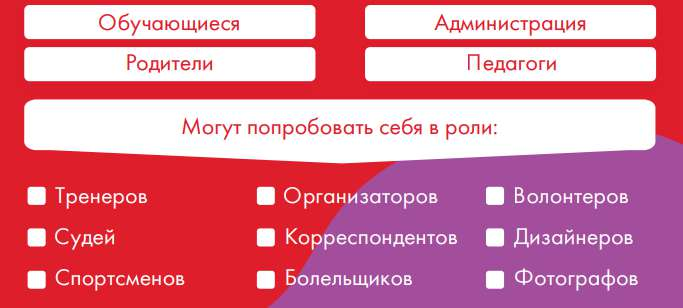

# Модуль «Детские общественные объединения»

> Основная образовательная программа начального общего образования ГБОУ Школа № 1366. ФГОС 3.0. Страницы PDF: 1723–1735.

● информирование родителей (оформление информационного стенда по профориентации, знакомство с сайтами учреждений профессионально-технического и среднего специального образования региона, актуальными профориентационными проектами федерального, регионального и муниципального уровней, онлайн-платформами, содержащими диагностические профориентационные методики и навигацию по профориентационным ресурсам)

## Модуль «Детские общественные объединения»

Программа воспитательной работы добровольного самоуправляемого общероссийского общественно государственного движения детей и молодежи (далее — Программа, Движение) разработана и реализуется на основе Конституции Российской Федерации, Федерального закона от 14.07.2022 № 261-ФЗ «О российском движении детей и молодежи» (далее — Федеральный закон), Примерной рабочей программы воспитания для общеобразовательных организаций (одобрена решением Федерального учебно-методического объединения по общему образованию, протокол от 23.06.2022 № 3/22) в соответствии со Стратегией национальной безопасности Российской Федерации (утверждена указом Президента Российской Федерации от 02.07.2021 № 400), Стратегией развития воспитания в Российской Федерации на период до 2025 года (утверждена распоряжением Правительства Российской Федерации от 29.05.2015 № 996-р). Участниками реализации Программы, в соответствии со своими правами и обязанностями, являются индивидуальные и коллективные участники Движения согласно Федеральному закону (статьи 7, 8, 9). Воспитание детей и молодежи рассматривается в Движении как стратегический общенациональный приоритет, требующий консолидации усилий различных институтов гражданского общества и органов публичной власти, ведомств на федеральном, региональном и муниципальном уровнях.

Воспитательная работа в Движении, ее цели, организация и осуществление во всех формах деятельности определяются установленными приоритетами государственной политики в области воспитания:

- создание условий для воспитания здоровой, счастливой, свободной, ориентированной на труд личности;
- формирование у детей и молодежи высокого уровня духовно-нравственного развития, чувства причастности к историко-культурной общности российского народа и судьбе России;
- поддержка единства и целостности, преемственности и непрерывности воспитания;
- поддержка общественных институтов, которые являются носителями духовных ценностей;
- формирование уважения к русскому языку как государственному языку Российской Федерации, являющемуся основой гражданской идентичности россиян и главным фактором национального самоопределения;
- обеспечение защиты прав и соблюдение законных интересов каждого ребенка, в том числе гарантий доступности ресурсов системы образования, физической культуры и спорта, культуры и воспитания;
- формирование внутренней позиции личности по отношению к окружающей социальной действительности;
- развитие на основе признания определяющей роли семьи и соблюдения прав родителей кооперации и сотрудничества субъектов системы воспитания (семьи, общества, государства, образовательных, научных, традиционных религиозных организаций, учреждений культуры и спорта, средств массовой информации, бизнес-сообществ) с целью совершенствования содержания и условий воспитания подрастающего поколения России;
- формирование уважения к родному языку и культуре родного края, малой родины.

Цели воспитательной работы в Движении:

- создание равных возможностей для всестороннего развития и самореализации детей и молодежи;
- содействие воспитанию детей, их профессиональной ориентации, организации досуга детей и молодежи;
- подготовка детей и молодежи к полноценной жизни в российском обществе, включая формирование их мировоззрения на основе традиционных российских духовных и нравственных ценностей, традиций народов Российской Федерации, достижений российской и мировой культуры, а также развитие у них общественно значимой и творческой активности, высоких нравственных качеств, любви и уважения к Отечеству, трудолюбия, правовой культуры, бережного отношения к окружающей среде, чувства личной ответственности за свою судьбу и судьбу Отечества перед нынешним и будущими поколениями, иные общественно полезные цели;
- содействие проведению государственной политики в интересах детей и молодежи; приоритетной задачей Российской Федерации в сфере воспитания детей является развитие высоконравственной личности, разделяющей российские традиционные духовные ценности, обладающей актуальными знаниями и умениями, способной реализовать свой потенциал в условиях современного общества, готовой к мирному созиданию и защите Родины. Воспитательная работа в Движении направлена на сохранение и защиту традиционных российских духовно-нравственных ценностей, культуры и исторической памяти с учетом решения следующих задач, установленных в Стратегии национальной безопасности Российской Федерации:
- укрепление гражданского единства, общероссийской гражданской идентичности, межнационального и межконфессионального согласия, сохранение самобытности многонационального народа Российской Федерации;
- защита исторической правды, сохранение исторической памяти, преемственности в развитии Российского государства и его исторически сложившегося единства, противодействие фальсификации истории;
- укрепление института семьи, сохранение традиционных семейных ценностей, преемственности поколений россиян;
- реализация государственной информационной политики, направленной на усиление в массовом сознании роли традиционных российских духовно-нравственных и культурно-исторических ценностей, неприятие гражданами навязываемых извне деструктивных идей, стереотипов и моделей поведения;
- развитие системы образования, обучения и воспитания как основы формирования развитой и социально ответственной личности, стремящейся к духовному, нравственному, интеллектуальному и физическому совершенству;
- поддержка общественных проектов, направленных на патриотическое воспитание граждан, сохранение исторической памяти и культуры народов Российской Федерации;
- укрепление культурного суверенитета Российской Федерации и сохранение ее единого культурного пространства;
- сохранение материального и нематериального культурного наследия российского народа, популяризация достижений российской науки и техники, литературы, художественной культуры, музыки и спорта, в том числе путем доработки учебных программ образовательных организаций;
- духовно-нравственное и патриотическое воспитание граждан на исторических и современных примерах, развитие коллективных начал российского общества, поддержка социально значимых инициатив, в том числе благотворительных проектов, добровольческого движения;
- поддержка религиозных организаций традиционных конфессий, обеспечение их участия в деятельности, направленной на сохранение традиционных российских духовно-нравственных ценностей, гармонизация российского общества, распространение культуры межконфессионального диалога, противодействие экстремизму;
- формирование государственного заказа на проведение научных исследований, публикацию научно-популярных материалов, создание произведений литературы и искусства, кинематографической, театральной, телевизионной, видео-и интернет-продукции, оказание услуг, направленных на сохранение традиционных российских духовно-нравственных ценностей и культуры, защиту исторической правды и сохранение исторической памяти, а также обеспечение контроля качества выполнения этого государственного заказа;
- защита и поддержка русского языка как государственного языка Российской Федерации, усиление контроля за соблюдением норм современного русского литературного языка, пресечение публичного исполнения, распространения через средства массовой информации продукции, в которой содержатся слова и выражения, не соответствующие указанным нормам (в том числе нецензурная лексика);
- защита российского общества от внешней идейно-ценностной экспансии и внешнего деструктивного информационно-психологического воздействия, недопущение распространения продукции экстремистского содержания, пропаганды насилия, расовой и религиозной нетерпимости, межнациональной розни;
- повышение роли России в мировом гуманитарном, культурном, научном и образовательном пространстве. Основные направления воспитания участников Движения в соответствии с государственной Стратегией развития воспитания в Российской Федерации:
- гражданское воспитание;
- патриотическое воспитание;
- духовно-нравственное воспитание;
- приобщение к культурному наследию;
- физическое воспитание и формирование культуры здоровья;
- трудовое воспитание и профессиональное самоопределение;
- экологическое воспитание;
- популяризация научных знаний. Принципами деятельности движения являются:
- добровольность участия в Движении;
- равенство прав участников Движения;
- учет индивидуальных особенностей участников Движения;
- преемственность деятельности Движения по отношению к участникам Движения разных возрастов;
- открытость деятельности Движения;
- общественно-полезный характер деятельности;
- самодеятельность и инициатива участников движения;
- сотрудничество детей и взрослых: наставники обоснованно поддерживают и развивают инициативу, самостоятельность, самодеятельность участников Движения. Портрет участника Российского движения детей и молодежи:
- любит Родину, уважительно относится к государственной символике Российской Федерации (гимн, флаг, герб);
- бережно относится к культурному наследию и традициям своего народа, многонационального народа Российской Федерации;
- с уважением относится к истории своего края, нашей общей Родины — России, уважает память защитников Отечества и подвиги героев Отечества;
- вежливо и с уважением общается с людьми, проявляет заботу о младших и тех, кто нуждается в помощи;
- уважительно относится к представителям разных поколений, культуре многонационального народа Российской Федерации;
- стремится овладевать знаниями, интересуется наукой, искусством, культурой;
- соблюдает установленные в российском обществе правила и нормы поведения, уважает и соблюдает законы Российской Федерации;
- ведет здоровый образ жизни, занимается спортом;
- надежный и верный друг, готов прийти на помощь;
- любит природу, соблюдает экологические правила и нормы;
- участвует в общественно полезном труде;
- не боится трудностей, несет ответственность за свои действия, поступки;
- проявляет инициативу и самостоятельность в социально значимой деятельности. Личностные качества участника Российского движения детей и молодежи: честность, принципиальность, справедливость, доброжелательность, уважительное отношение к окружающим, ответственность, аккуратность, дисциплинированность.

На уровне первичного отделения содержание, виды и формы воспитательной работы определяются решениями Совета первичного отделения — организатора повседневных дел участников Движения, который распределяет индивидуальные или групповые поручения участникам Движения и осуществляет контроль за их выполнением. Привлечением участников Движения к выполнению поручений, их мотивация и стимулирование осуществляется наставниками. содержание, виды и формы воспитательной работы в первичном отделении Содержание, виды и формы воспитательной работы в первичном отделении определяются с учетом основных направлений воспитания участников Движения.

Трудовые дела — озеленение и благоустройство школьной и пришкольной территории, охрана зеленых насаждений; забота о малышах, помощь всем, кто нуждается в помощи в классе, школе, вне школы. Помощь воспитателю в организации мероприятий в рамках работы групп продленного дня. Знакомство с трудом взрослых, с основными профессиями, характерными для этой местности. Посильная помощь в делах взрослых, семье, школе и др.

Научно-познавательные дела. Создание клубов любознательных, друзей науки и техники, изобретателей. Проведение вечеров занимательной науки, викторин, турниров, конкурсов смекалки, географических, математических, физических олимпиад, смотров работ юных техников и натуралистов. Ведение медиаресурсов научно-познавательной направленности. Знакомство с выдающимися российскими и советскими деятелями культуры и искусства, с их произведениями (вечера, сборы, беседы, викторины, лекции, посещение выставок, театров, кино, создание в школе выставок репродукций картин, стендов и т. д.) и др. Добровольческие дела, взаимопомощь. Организация взаимопомощи в учебе и другом в группе участников Движения в классе. Помощь в учебе и другом младшим участникам Движения: развитие их любознательности, ответственного отношения к учению и др. Дела эстетической направленности. Участие в работе творческих коллективов (хор, драматический коллектив, танцевальный коллектив, изостудия, оркестр), конкурсах и олимпиадах и др. Физкультура и спорт.

Организация и проведение занятий в спортивных секциях, клубах, участие в соревнованиях по различным видам спорта, в подвижных играх, выполнение нормативов ГТО и др. Экология. Участия в экологических акциях, десантах, оказание помощи бездомным животным и др.

Формы и методы воспитательной работы в первичном отделении Изучение интересов и запросов участников Движения на внеурочную деятельность и дополнительное образование; разработка предложений (инициатив) по улучшению жизни в образовательной организации; участие в работе школьных и внешкольных кружков, секций, мастерских, клубов.

Содружество участников Движения в образовательной организации: шефская и наставническая поддержка по различным вопросам: подготовка и проведение игр, творческих, спортивных «пятиминуток» для первоклассников (пятиклассников) — для адаптации в новых условиях; помощь в подготовке домашних заданий детям на продленке, испытывающим трудности в учебной деятельности, детям с особыми образовательными потребностями, в том числе ограниченными возможностями здоровья; шефство над малышами (детский сад и/или начальная школа).

Пропаганда участниками Движения здорового образа жизни, демонстрация на собственном примере здоровых и полезных привычек; проведение акций, утренних зарядок для младших школьников. Изучение участниками Движения потребностей ближайшего окружения и оказание посильной помощи индивидуально, группой участников Движения; проведение волонтерских акций: помощь одиноко проживающим пенсионерам, инвалидам, ветеранам труда и участникам военных действий и т. д.

Помощь участников Движения в организации и работе школьного музея (краеведческой, историко-патриотической направленности, традиционной народной культуры и т. д.), проведение участниками Движения обзорных и тематических экскурсий в музее для родителей учащихся, малышей, гостей и др. Помощь участников Движения педагогам в выпуске школьных и классных стенгазет, в подготовке выставок (поделок, рисунков, рассказов, стихов, фотографий и т. д.), в оформлении школьных информационных стендов.

Участие участников Движения в планировании и подготовке встреч с интересными людьми в своем классе (отряде), в школе (сбор информации о герое, ведение фото-или видеосъемки встречи, подготовка мини-фильма о встрече, подготовка памятного подарка гостю, например фотоальбома встречи). Участие участников Движения в подготовке и проведении общешкольных (межшкольных) образовательных, воспитательно значимых событий, например подготовка и проведение тематического вечера, посвященного Дню народного единства «Мы — многонациональный народ России» (знакомство учащихся с песнями, танцами, обычаями, традициями народов России)

Программа развития социальной активности обучающихся начальных классов «Орлята России» (далее – Программа, программа «Орлята России»). Внедрение программы «Орлята России» в практику общеобразовательных школ Российской Федерации позволяет решать одну из главных задач государственной политики в сфере образования – сохранение и развитие единого образовательного пространства России.

Актуальность продиктована общим контекстом изменений в образовательной политике, связанных с усилением роли воспитания в образовательных организациях (поправки в ФЗ № 273 «Об образовании в Российской Федерации»). Так, «активное участие в социально значимой деятельности» артикулируется как в текстах последнего ФГОС начального общего образования, так и в «Примерной рабочей программе воспитания», в которой указывается, что «поощрение социальной активности обучающихся» может рассматриваться в качестве «основной традиции воспитания в образовательной организации». Участие детей и педагогов в программе «Орлята России» способствует восстановлению богатого опыта воспитательной работы с подрастающим поколением и его дальнейшему развитию с учётом всех вызовов современного мира.

Воспитательная деятельность в школе, включая работу отряда Юных инспекторов движения (ЮИД), выстроена в строгом соответствии с приоритетами государственной политики в сфере воспитания, закрепленными в Основах государственной политики по сохранению и укреплению традиционных российских духовно-нравственных ценностей (Указ Президента Российской Федерации от 09.11.2022 г. № 809) и

Стратегии развития воспитания в Российской Федерации на период до 2025 года (Распоряжение Правительства РФ от 29.05.2015 № 996-р в актуальной редакции от 12.11.2022 № 3365-р).

Актуальность данного направления продиктована законодательным усилением роли воспитания, закрепленным в Федеральном законе от 29.12.2012 № 273-ФЗ «Об образовании в Российской Федерации» (в редакции 2022 года), где воспитание определяется как деятельность, направленная на развитие личности, создание условий для самоопределения и социализации обучающихся на основе социокультурных, духовно-нравственных ценностей и принятых в российском обществе правил и норм поведения.

Ключевая задача — развитие высоконравственной личности, разделяющей российские традиционные ценности, способной реализовать свой потенциал и готовой к мирному созиданию и защите Родины, — реализуется, в том числе, через активное участие обучающихся в социально значимой деятельности. Эта норма артикулирована в обновленных ФГОС начального и основного общего образования, а «Примерная рабочая программа воспитания» (одобрена решением Федерального учебно-методического объединения по общему образованию, протокол от 01.07.2021 г. № 2/21) указывает на поощрение социальной активности в качестве одной из основных традиций воспитательной работы организации.

Деятельность отряда ЮИД, открытого в школе два года назад, является практическим инструментом решения этих государственных задач. Она напрямую способствует:

Формированию законопослушного поведения и ответственного отношения к собственной безопасности и безопасности окружающих. Развитию гражданской позиции через участие в профилактической работе и пропаганде правил безопасного поведения на дорогах. Вовлечению детей в социально значимую деятельность, что является ключевым элементом обновленной воспитательной парадигмы.

## Модуль «Школьные медиа»

Цель развитие коммуникативной культуры и социальной ответственности школьников через создание качественного информационного продукта, формирование навыковSoft Skills (критическое мышление, работа в команде, проектная деятельность) и воспитание активной гражданской позиции, основанной на традиционных российских духовно-нравственных ценностях.

Задачи модуля Воспитательные: Формировать гражданскую идентичность и патриотизм через создание контента о школе, городе, стране и её героях. Воспитывать информационную культуру и критическое мышление, умение противостоять дезинформации. Прививать ценности взаимопомощи, уважения, творчества и созидательного труда. Развивать правовую грамотность (основы авторского права, кибербезопасность, этика в сети). Образовательные (Soft Skills): Развивать навыки проектной деятельности: от идеи до реализации и презентации. Обучать основам журналистики, копирайтинга, фото-и видеосъемки, монтажа, ведения социальных сетей. Совершенствовать коммуникативные навыки (работа в команде, интервью, публичные выступления). Практические: Консолидировать работу медиаактивов школы в единую систему.

Обеспечить присутствие школы в цифровом пространстве через официальные аккаунты. Создавать качественный мультиформатный контент. Воспитательный потенциал школьных медиа реализуется рамках следующих видов и форм деятельность:

1. Школьный медиацентр «Медиа_Тор» (5-11 классы):

- Задача: Не только информационно-техническая поддержка, но и создание смыслового контента.

- Новые акценты: Съемка не просто репортажей, а создание тематических видеороликов (к юбилейным датам, о традиционных ценностях, о проектах РДДМ «Движение Первых»), подкастов, прямых эфиров с интересными людьми.

2. Официальные ресурсы школы («Точка кипения»):

- Задача: Позиционирование школы как центра притяжения и открытой диалоговой площадки.

- Новые акценты: Реализация принципа «детский контент для детской аудитории». Развитие форматов, где учащиеся являются не объектами, а субъектами освещения: рубрика «Мнение» по актуальным вопросам, опросы, онлайн-челленджи, освещение участия в конкурсах (в т.ч. «Большая перемена»).

3. Участие в конкурсах медиа-направленности:

- Задача: Профессиональный рост и признание на внешнем уровне.

- Примеры: Всероссийский конкурс «Большая перемена», фестивали детского творчества, конкурсы школьных медиа.

4. Деятельность учащихся по уровням образования Уровень начального общего образования (1-4 классы):

- Формы: Создание классных стенгазет, тематических плакатов, буктрейлеров, ведение классных блогов (при поддержке родителей и педагогов).

- Воспитательный аспект: Формирование первоначальных представлений о сотрудничестве, ответственности за общее дело. Уровень основного и среднего общего образования (5-11 классы):

- Формы: Работа в пресс-центре, проведение пресс-конференций, тематических встреч, полный цикл производства медиапродукта (от съемки до монтажа).

- Воспитательный аспект: Осознанное формирование гражданской позиции, развитие лидерских качеств, профессиональная ориентация в медиасфере.

5. Ожидаемые результаты

- Личностные: Повышение социальной активности, сформированная гражданская идентичность, развитое критическое мышление.

- Метапредметные: Приобретение навыков проектной деятельности, работы в команде, эффективной коммуникации.

- Предметные (для школы): Создание позитивного имиджа, формирование единого воспитательного пространства, создание школьного медиаархива.

6. Партнеры и взаимодействие

- Внутри школы: Интеграция с уроками (литература, история, обществознание, ИКТ), сотрудничество с советником по воспитанию, классными руководителями, школьным музеем.

- Вне школы: Вузы (факультеты журналистики), городские СМИ, молодёжные пресс-центры, РДДМ «Движение Первых» (направление «Медиа и коммуникации»).

## Модуль «Добровольческая (волонтерская) деятельность»

Цель: Формирование у обучающихся ценностей служения обществу и окружающим, развитие навыков социальной проектной деятельности, гражданской идентичности и лидерского потенциала через системное вовлечение в добровольческие практики в контексте национальных приоритето, системы общественно-полезного труда..

Задачи модуля: Популяризация ценностей добровольчества среди обучающихся, родителей и педагогов. Создание условий для участия школьников в социально значимых проектах и акциях городского, федерального и международного уровней.

Формирование устойчивой системы наставничества и межпоколенческого взаимодействия в волонтерской деятельности. Интеграция направлений: объединить волонтерскую деятельность и систему общественно-полезного труда в единый воспитательный процесс.

Ценностное ориентирование: сформировать у обучающихся понимание значимости личного трудового вклада для благополучия школьного коллектива и города.

Популяризация труда: создать положительный образ физического и интеллектуального труда, волонтерства как нормы жизни успешного человека.

Организация системы: внедрить четкую и прозрачную систему дежурства по школе и других форм труда, учитывающую возрастные особенности.

Партнерство: развивать сотрудничество с городскими структурами («Мосволонтёр», МЦВП, «Движение Первых») для участия в масштабных общегородских субботниках, акциях и проектах.

Цифровизация учета: использовать Личную электронную книжку волонтера (ЛЭКВ) и иные инструменты для учета и поощрения участия в трудовых и волонтерских активностях.

Основные направления деятельности Социальное волонтерство: помощь пожилым людям, ветеранам, детям-сиротам, людям с ограниченными возможностями здоровья. Экологическое волонтерство: участие в акциях по благоустройству, озеленению, раздельному сбору отходов, просветительские мероприятия.

Патриотическое волонтерство: участие в мероприятиях, посвященных памятным датам, работа с ветеранами, проведение историко-краеведческих проектов.

Событийное волонтерство: помощь в организации и проведении мероприятий городского и школьного уровня. Медицинское волонтерство: просветительская деятельность в сфере здорового образа жизни, донорства, профилактики заболеваний. Инклюзивное волонтерство: создание доступной среды и поддержка людей с ОВЗ.

Организационная структура:

Деятельность осуществляется через: Волонтерский отряд «Точка Добра» (5-11 классы) — ядро волонтерского движения школы. Систему кураторства: советник директора по воспитанию, педагог-организатор, классные руководители. Партнерские связи: сотрудничество с «Мосволонтёром», «Движение Первых», общественными организациями. Цифровую инфраструктуру: использование ЛЭКВ (личных электронных книжек волонтера), платформы «Добро.ру», московских ресурсов учета волонтерской активности. Уровни реализации:

Общешкольный уровень: участие в городских акциях («День добрых дел», «Весенняя неделя добра», «Экодвор»), организация мероприятий, торжественное вручение волонтерских книжек.

Уровень классов: реализация классных проектов, участие в общешкольных акциях, ведение портфолио добрых дел. Индивидуальный уровень: персональное участие в волонтерских проектах, использование ЛЭКВ, участие в конкурсах и образовательных программах. Ожидаемые результаты

Рост числа обучающихся, вовлеченных в волонтерскую деятельность. Реализация социально значимых проектов и инициатив. Формирование у школьников ценностей взаимопомощи, ответственности и гражданственности. Развитие навыков проектной деятельности и лидерства. Укрепление партнерских связей с организациями города Москвы. Общественно-полезный труд и дежурство:

- Дежурство по школе и классу: Ответственное поддержание порядка и чистоты в учебных кабинетах, рекреациях, столовой. Формирование уважения к труду технического персонала и бережного отношения к школьному имуществу.

- Трудовые десанты и субботники: Организация весенних и осенних субботников по благоустройству школьной территории, участие в общегородских мероприятиях.

- Творческий и интеллектуальный труд: Участие в оформлении школьных пространств к праздникам, создание стенгазет, помощь в организации и оцифровке школьной библиотеки, шефство над младшими классами (помощь с уроками, организация игр).

- Профориентационные трудовые пробы: Участие в проектах предпрофессиональной подготовки, мастер-классах от партнеров (например, благоустройство территории совместно со специалистами комплекса городского хозяйства Москвы). Мониторинг и оценка эффективности

Регулярный учет волонтерской активности через ЛЭКВ. Проведение опросов и анкетирования среди участников. Анализ реализации проектов и инициатив. Участие в рейтингах и конкурсах волонтерских отрядов города Москвы.

## Модуль «Школьный спортивный клуб»

Цель: Создание единой физкультурно-спортивной образовательной среды, направленной на воспитание гармонично развитой личности на основе ценностей здоровья, гражданственности, трудолюбия и патриотизма, в соответствии с государственными приоритетами и задачами города Москвы.

Задачи модуля: Популяризация массового спорта: обеспечить вовлеченность обучающихся в физкультурно-оздоровительную деятельность ШСК через урочную и внеурочную деятельность.

Формирование ценностных ориентиров: аоспитывать на примерах отечественных спортивных героев патриотизм, волю к победе, уважение к сопернику и командный дух.

Развитие инфраструктуры: активно использовать ресурсы города Москвы (стадионы, бассейны, спортивные школы) в рамках сетевого взаимодействия.

Поддержка одаренных детей: создать систему выявления и сопровождения спортивно-одаренных детей для их продвижения в сборные города Москвы и России.

Стимулирование участия: внедрить систему поощрений (баллы, рейтинги, награды) для классов и учащихся, активно участвующих в деятельности ШСК.

Основные направления деятельности: Физкультурно-оздоровительная работа:

Ежедневная утренняя зарядка («Зарядка с чемпионом» – с приглашением спортсменов). Подвижные перемены и физкультминутки с использованием интерактивного оборудования. Дни здоровья и тематические недели («Неделя зимних игр», «Неделя ГТО»). Походы выходного дня в парки Москвы. Спортивно-массовые мероприятия:

Участие в городских проектах: «Президентские состязания», «Президентские спортивные игры», турниры Школьной спортивной лиги Москвы.

Внутришкольные соревнования: по футболу, баскетболу, волейболу, шахматам («Белая ладья»), легкой атлетике. Событийные мероприятия: «Кросс Победы», «Лыжня России», «День снега», «День футбола». Сдача норм ГТО: Организация подготовительных занятий и централизованная сдача на площадках Москвы. Социально-воспитательная работа:

Семейные спортивные праздники: «Мама, папа, я – спортивная семья», «Спортивная суббота». Встречи с легендами спорта и олимпийскими чемпионами. Спортивное волонтерство: подготовка учащихся к помощи на городских спортивных событиях (марафоны, фестивали). Профориентация: экскурсии в спортивные вузы (РГУФК, МГАФК), знакомство с профессиями в сфере спорта. Патриотическое воспитание:

Турниры памяти героев Отечества. Зарница и военно-спортивные игры на базе московских центров допризывной подготовки. Изучение истории отечественного спорта, вклад спортсменов в Победу в ВОВ.

План работы ШСК на 2025-2026 учебный год

Направление Мероприятие Сроки Ответственные

Физкультурно-оздоровительные Утренняя зарядка (ежедневно) В течение года Совет ШСК, физорги

Дни здоровья 1 раз в четверть Учителя физкультуры

Походы в парки Москвы (например, Парк Горького, Сокольники) Осень, весна Классные руководители

Спортивно-массовые Внутришкольная спартакиада (по ступеням) Сентябрь-май Руководитель ШСК

Направление Мероприятие Сроки Ответственные

Учителя физкультуры

Участие в «Президентских состязаниях» По графику города

Турнир по футболу «Кубок ШСК» Октябрь Совет ШСК

Сдача норм ГТО Сентябрь-май Ответственный за ГТО

Социально-воспитательные Семейный праздник «Папа, мама, я – спортивная семья» Ноябрь Родительский комитет

Встреча с олимпийским чемпионом (совместно с «Патриот.Спорт») Февраль Зам. директора по ВР

Спортивный фестиваль «Игры народов Москвы» Декабрь Сов

Ожидаемые результаты:

- Повышение доли учащихся, систематически занимающихся физической культурой и спортом (до 90%).

- Рост числа учащихся, выполнивших нормы ГТО (не менее 40% от общего количества допущенных).

- Увеличение количества призеров и победителей окружных и городских соревнований.

- Формирование устойчивых традиций ШСК и повышение уровня социальной сплоченности школьного коллектива.

- Активное использование городских спортивных ресурсов (не менее 5 выездных мероприятий в год). Мониторинг и оценка эффективности

- Анкетирование учащихся и родителей об удовлетворенности деятельностью ШСК.

- Анализ динамики заболеваемости и уровня физической подготовленности обучающихся.

- Публичная отчетность на сайте школы и в социальных сетях о достижениях ШСК.

Этот модуль отражает современные тенденции развития школьного спорта в Москве, интегрируя городские проекты и ценности государства в воспитательный процесс.
