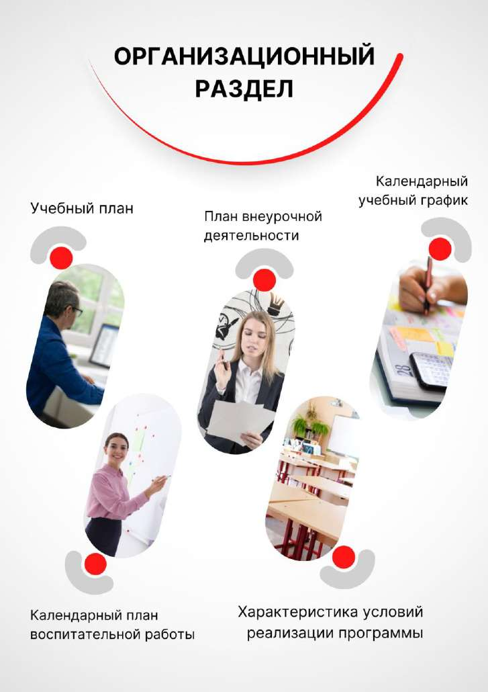

# Программа коррекционной работы

> Основная образовательная программа начального общего образования ГБОУ Школа № 1366. ФГОС 3.0. Страницы PDF: 1736–1743.

# Программа коррекционной работы (далее — программа) направлена на коррекцию нарушений развития и социальную адаптацию

обучающихся, помощь в освоении ими программы начального общего образования.

Цель программы – проектирование и реализация в ГБОУ Школа № 1366 комплексной системы психолого-педагогического сопровождения обучающихся, испытывающих трудности освоении основной образовательной программы, своём развитии и социальной адаптации, а также обучающихся с ограниченными возможностями здоровья (далее — с ОВЗ).

Задачи программы отражают разработку и реализацию содержания основных направлений работы (диагностическое, коррекционно-развивающее и психопрофилактическое, консультативное, информационно-просветительское):

- выявление индивидуальных образовательных потребностей обучающихся;
- определение оптимальных психолого-педагогических и организационных условий для получения начального общего образования обучающимися с трудностями в обучении и социализации, для развития личности обучающихся, их познавательных и коммуникативных способностей;
- осуществление комплексного индивидуально-ориентированного психолого-педагогического и социального сопровождения обучающихся в соответствии с рекомендациями психолого-педагогического консилиума ГБОУ Школа № 1366 и (или) Центральной психолого-медико-педагогической комиссии города Москвы (далее — ЦПМПК г. Москвы), с учётом их особых образовательных потребностей;
- реализацию системы мероприятий по социальной адаптации и профессиональной ориентации обучающихся;
- осуществление информационно-просветительской и консультативной работы с родителями (законными представителями) обучающихся.

Механизмом реализации программы коррекционной работы, с целью создания оптимальных условий обучения, развития, социализации и адаптации обучающихся, посредством психолого-педагогического и социального сопровождения, является психолого-педагогический консилиум.

Психолого-педагогический консилиум ГБОУ школа № 1366 (далее — ППк) является одной из форм взаимодействия педагогических работников школы для определения стратегии осуществления психолого-педагогического сопровождения:

- обучающихся, испытывающих трудности в овладении основными образовательными программами, в развитии и социальной адаптации на основе комплексной оценки особенностей их развития, возможностей, особых образовательных потребностей;
- обучающихся с ОВЗ, в том числе с инвалидностью, в соответствии с заключением ЦПМПК г. Москвы. Система комплексного психолого-педагогического сопровождения включает в себя:
- организацию и проведение комплексной психолого-педагогической оценки актуального развития обучающихся, определение особенностей развития обучающихся, имеющихся у них трудностей, препятствующих успешному освоению основных общеобразовательных программ и воспитанию;
- разработку и реализацию программ индивидуального психолого-педагогического сопровождения, индивидуальных учебных планов для обучающихся, испытывающих трудности в освоении основных образовательных программ, развитии и социальной адаптации;
- осуществление сопровождения обучающегося и родителей (законных представителей) при прохождении ими ЦПМПК г. Москвы;
- индивидуализацию содержания специальных условий для получения образования обучающимися с ОВЗ, в том числе с инвалидностью;
- организацию групповых и индивидуальных коррекционно-развивающих занятий;
- реализацию мероприятий по социальной адаптации и профориентации обучающихся;
- оказание родителям (законным представителям) обучающихся методической и консультативной по социальным, правовым и другим вопросам;
- мониторинг динамики развития обучающихся, их успешности в освоении основной образовательной программы начального общего образования.

Создание условий для обеспечения доступности и качества образования для обучающихся с особыми образовательными

потребностями, их социальной адаптации и интеграции в общество. Задачи:

1. Выявление и диагностика особых образовательных потребностей учащихся.

2. Разработка и реализация индивидуальных образовательных маршрутов (ИОМ).

3. Обеспечение психолого-педагогического сопровождения.

4. Повышение компетентности педагогов и родителей в вопросах инклюзивного образования.

5. Мониторинг эффективности коррекционной работы.

2. Целевая группа Программа предназначена для следующих категорий обучающихся:

- Дети с ограниченными возможностями здоровья (ОВЗ);

- Учащиеся с инвалидностью;

- Дети, испытывающие трудности в освоении образовательной программы;

- Учащиеся с девиантным поведением.

3. Направления коррекционной работы 3.1. Диагностическое направление

- Проведение стартовой, промежуточной и итоговой диагностики уровня развития учащихся.

- Использование инструментов: o Психолого-педагогическое тестирование; o Наблюдение; o Анкетирование родителей и педагогов; o Аналир продуктов учебной деятельности. 3.2. Коррекционно-развивающее направление

- Реализация индивидуальных и групповых коррекционных занятий: o Логопедические занятия; o Дефектологическая помощь; o Психологические тренинги; o Социально-педагогическое сопровождение.

- Использование адаптированных учебных материалов и технологий. 3.3. Консультативное направление

- Проведение консультаций для родителей и педагогов: o Информирование об особенностях развития детей; o Рекомендации по организации обучения и воспитания; o Правовое просвещение. 3.4. Информационно-просветительское направление

- Организация семинаров, вебинаров и круглых столов для педагогов и родителей;

- Размещение информационных материалов на сайте школы и стендах.

4. Механизмы реализации программы 4.1. Кадровое обеспечение

- Учителя-логопеды;

- Педагоги-психологи;

- Учителя-дефектологи;

- Социальные педагоги;

- Координатор инклюзивного образования. 4.2. Материально-техническое обеспечение

- Оборудованные кабинеты для коррекционных занятий;

- Специализированное программное обеспечение;

- Адаптированные учебные пособия;

- Технические средства реабилитации (при необходимости). 4.3. Взаимодействие с внешними организациями

- Городской психолого-педагогический центр;

- Центры социальной защиты;

- ОМСК (Отдел методического и специального коррекционного образования);

- Общественные организации, работающие с людьми с ОВЗ.

План мероприятий на 2025–2026 учебный год

| Мероприятие | Срок исполнения | Ответственные |
| --- | --- | --- |
| Диагностика учащихся | Сентябрь | Психологи, логопеды |
| Разработка ИОМ | Октябрь | Педколлектив |
| Коррекционные занятия | В течение года | Специалисты |
| Консультации для родителей | Ежемесячно | Психологи, педагоги |
| Семинар «Инклюзивное образование» | Ноябрь, март | Администрация |
| Мониторинг эффективности программы | Декабрь, май | Координатор |
| Участие в городских конференциях | Апрель | Педагоги |

6. Ожидаемые результаты

1. Повышение уровня академической успеваемости учащихся с ОВЗ.

2. Улучшение социально-психологической адаптации детей.

3. Повышение компетентности педагогов и родителей в вопросах инклюзии.

4. Создание комфортной и доступной образовательной среды.

7. Мониторинг и оценка эффективности

- Проведение регулярных диагностических срезов;

- Анкетирование участников образовательного процесса;

- Анализ динамики развития учащихся;

- Коррекция программы по результатам мониторинга. Для обучающихся с ОВЗ в ГБОУ Школа № 1366 создаются специальные условия для получения образования в соответствии со

следующим алгоритмом (таблица).

Таблица. Алгоритм создания специальных условий обучающимся

| Этапы | Ответственные | Содержание деятельности |
| --- | --- | --- |
| Шаг 1 | Психолого-педагогический Федеральная консилиум | рабочая программа \| Труд выявляет обучающегося, испытывающего трудности в освоении основных образовательных программ, имеющего недостатки в физическом и (или) психологическом развитии, препятствующие получению образования без создания специальных условий, рекомендует обращение в ЦПМПК г. Москвы для уточнения/изменения образовательного маршрута; дает рекомендацию по обращению в ЦПМПК г. Москвы для подтверждения образовательного маршрута при переходе обучающегося с одного уровня образования на другой. |
| Шаг 2 | Директор (уполномоченное директором лицо) | Информирует родителя (законного представителя) ребенка о необходимости обращения в ЦПМПК г. Москвы: для проведения психолого-педагогического обследования ребенка и получения заключения ЦПМПК г. Москвы в случае выявления специалистами ЦПМПК г. Москвы необходимости создания для обучающегося специальных условий обучения и воспитания как для обучающегося с ОВЗ / изменения образовательного маршрута обучающемуся с ОВЗ; для проведения психолого-педагогического обследования и получения заключения ЦПМПК г. Москвы обучающимся, имеющим заключение ПМПК/ЦПМПК другого субъекта Российской Федерации и прибывшим в Москву для проживания и продолжения обучения в образовательной организации г. Москвы. |
| Шаг 3 | Директор (уполномоченное им лицо) | Принимает у родителя (законного представителя) пакет документов, подтверждающих право обучающегося на создание специальных условий образования в образовательной организации г. Москвы: заключение ЦПМПК г. Москвы с рекомендациями по созданию специальных условий для получения образования; письменное заявление родителя (законного представителя) о создании специальных условий для получения образования в соответствии с заключением ЦПМПК г. Москвы; |
| | | копию справки об установлении инвалидности и ИПРА ребенка-инвалида, выдаваемые федеральными государственными учреждениями медико-социальной экспертизы (для обучающегося, имеющего инвалидность); письменное согласие родителя (законного представителя) на психолого-педагогическое сопровождение обучающегося. |
| Шаг 4 | Директор | Издает распорядительный акт об обучении ребенка по адаптированной основной общеобразовательной программе (далее – АООП) |
| Шаг 5 | Психолого-педагогический консилиум | Проводит заседание в целях определения стратегии, содержания и объема комплексного психолого-педагогического сопровождения обучающегося в рамках рекомендованной АООП. |
| Шаг 6 | Психолого-педагогический консилиум | Проектирует AOOП, включающая Программу коррекционной работы и программы курсов коррекционно-развивающей области. |
| Шаг 7 | Психолого-педагогический консилиум | Разрабатывает систему комплексного психолого-педагогического и социального сопровождения обучающегося: составляет индивидуальный образовательный маршрут (далее – ИОМ) и (или) индивидуальный учебный план (далее – ИУП) (при необходимости); согласовывает деятельность специалистов образовательной организации по реализации АООП, направлениям коррекционно-развивающей работы; определяет содержание, объем, интенсивность и продолжительность коррекционно- развивающих занятий, коррекционно-развивающих курсов; адаптирует учебные и контрольно-измерительные материалы (при необходимости); организует предоставление услуг тьютора, в том числе на период адаптации обучающегося в образовательной организации (учебную четверть, триместр, полугодие, учебный год) на постоянной основе (при необходимости); организует предоставление услуг ассистента (помощника) по оказанию технической помощи, в том числе на период адаптации обучающегося в образовательной организации (учебную четверть, триместр, полугодие, учебный год) на постоянной основе (при необходимости); |
| | | организует другие условия психолого-педагогического сопровождения в рамках компетенции образовательной организации (при необходимости). |
| Шаг 8 | Служба психолого- педагогического и социального сопровождения | Осуществляет реализацию рекомендаций в заключении ЦПМПК г. Москвы и (или) ППк (АООП, ИОМ и(или) ИУП). |
| Шаг 9 | Психолого-педагогический консилиум | Осуществляет контроль за выполнением рекомендаций ЦПМПК г. Москвы. |

