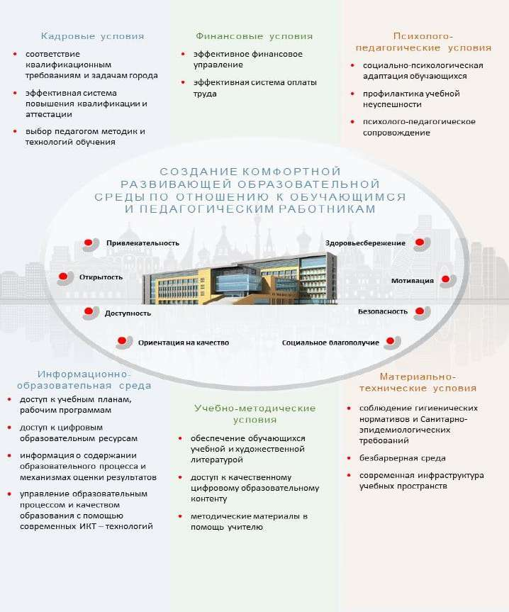
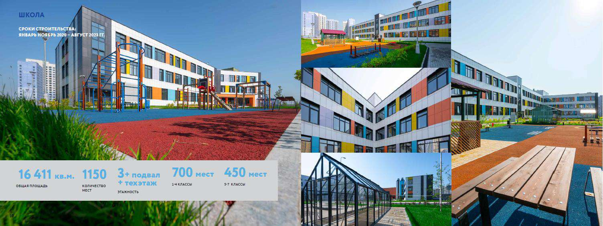
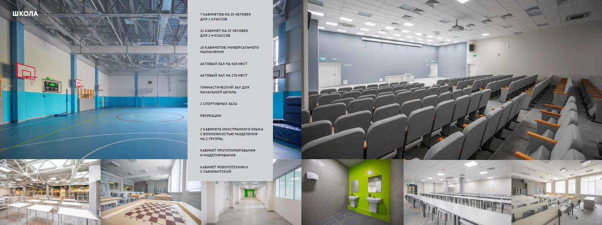

# Материально-технические условия

> Основная образовательная программа начального общего образования ГБОУ Школа № 1366. ФГОС 3.0. Страницы PDF: 1783–1788.

Материально-технические условия

Материально-технические условия реализации ООП ООО в ГБОУ Школа № 1366 обеспечивают:

- возможность достижения обучающимися результатов освоения основной образовательной программы начального общего

образования;

- безопасность и комфортность организации учебного процесса;
- соблюдение санитарно-эпидемиологических, санитарно-гигиенических правил и нормативов, пожарной и электробезопасности, требований охраны труда, современных сроков и объемов текущего и капитального ремонта зданий и сооружений, благоустройства территории;
- возможность для беспрепятственного доступа всех участников образовательного процесса, в том числе обучающихся с ОВЗ, к объектам инфраструктуры организации, осуществляющей образовательную деятельность.

- Критериальными источниками оценки материально-технических условий образовательной деятельности являются требования ФГОС НОО, лицензионные требования и условия Положения о лицензировании образовательной деятельности, утвержденного постановлением Правительства Российской Федерации 28 октября 2013 г. № 966, а также соответствующие приказы и методические рекомендации, в том числе:

- СП 2.4.3648-20 «Санитарно-эпидемиологические требования к организациям воспитания и обучения, отдыха и оздоровления детей и молодежи»;
- СанПиН 1.2.3685-21 «Гигиенические нормативы и требования к обеспечению безопасности и (или) безвредности для человека факторов среды обитания»;
- перечень начального общего образования (в соответствии с действующим Приказом Министерства просвещения РФ);
- Приказ Минпросвещения России от 23.08.2021 № 590 «Об утверждении перечня средств обучения и воспитания, соответствующих современным условиям обучения, необходимых при оснащении общеобразовательных организаций в целях реализации мероприятий, предусмотренных подпунктом «г» пункта 5 приложения № 3 к государственной программе Российской Федерации «Развитие образования» и подпунктом «б» пункта 8 приложения № 27 к государственной программе Российской Федерации «Развитие образования», критериев его формирования и требований к функциональному оснащению общеобразовательных организаций, а также определении норматива стоимости оснащения одного места обучающегося указанными средствами обучения и воспитания»;
- аналогичные перечни, утвержденные нормативными актами ДОНМ и локальными актами ГБОУ Школа № 1366, разработанные с учетом особенностей реализации основной образовательной программы в образовательной организации.

В зональную структуру образовательной организации включены:

- участки (территории) с целесообразным набором оснащенных зон;
- входная зона;
- учебные кабинеты;
- лаборантские помещения (в кабинетах по предметам, требующим использование лабораторного оборудования);
- библиотека с книгохранилищем;
- актовый зал;
- спортивные сооружения (зал, стадион, спортивная площадка);
- пищевой блок;
- административные помещения;
- гардеробы;
- санитарные узлы;
- помещения/место для хранения уборочного инвентаря. Состав и площади помещений предоставляют условия для:
- начального общего образования согласно избранным направлениям учебного плана в соответствии с ФГОС НОО;
- организации режима труда и отдыха участников образовательного процесса;
- размещения в кабинетах необходимых комплектов мебели, в том числе специализированной, и учебного оборудования, отвечающих специфике учебно-воспитательного процесса по данному предмету или циклу учебных дисциплин.

В состав учебных кабинетов входят:

- учебный кабинет начальных классов;
- учебный кабинет иностранного языка;
- учебный кабинет изобразительного искусства;
- учебный кабинет музыки;
- учебный кабинет информатики;
- учебный кабинет технологии; Учебные кабинеты включают следующие зоны:
- рабочее место учителя с пространством для размещения часто используемого оснащения;
- рабочую зону учащихся с местом для размещения личных вещей;
- пространство для размещения и хранения учебного оборудования;
- демонстрационную зону. Организация зональной структуры учебного кабинета отвечает педагогическим и эргономическим требованиям, комфортности и безопасности образовательного процесса.

Компонентами оснащения учебного кабинета являются:

- школьная мебель;
- технические средства;
- лабораторно-технологическое оборудование;
- фонд дополнительной литературы;
- учебно-наглядные пособия;
- учебно-методические материалы. В базовый комплект мебели входят:
- доска классная;
- стол учителя;
- стул учителя (приставной);
- кресло для учителя;
- столы ученические (регулируемые по высоте);
- стулья ученические (регулируемые по высоте);
- шкаф для хранения учебных пособий. Мебель, приспособления, оргтехника и иное оборудование отвечают требованиям учебного назначения, максимально приспособлены к особенностям обучения, имеют сертификаты соответствия принятой категории разработанного стандарта (регламента).

В базовый комплект технических средств входят:

- компьютер/ноутбук с периферией;
- многофункциональное устройство (МФУ) или принтер, сканер, ксерокс;
- сетевой фильтр. В учебных кабинетах информатики, технологии, изобразительного искусства, музыки, а также в помещениях для реализации программ по специальным предметам и коррекционно-развивающим курсам общеобразовательных программ начального общего образования предусматривается наличие специализированной мебели.

Спортивный зал, включая помещение для хранения спортивного инвентаря, в соответствии с рабочей программой, утвержденной школой, оснащен:

- инвентарем и оборудованием для проведения занятий по физической культуре и спортивным играм;
- стеллажами для спортивного инвентаря (инвентарные комнаты);
- комплектом скамеек; Библиотека (информационно-библиотечный центр образовательной организации) включает:
- стол библиотекаря, кресло библиотекаря, компьютер (ноутбук), МФУ (принтер);
- стеллажи библиотечные для хранения и демонстрации печатных и медиапособий, художественной литературы;
- стол для выдачи учебных изданий;
- шкаф для читательских формуляров;
- картотеку;
- столы ученические (для читального зала, в том числе модульные, компьютерные);
- стулья ученические, регулируемые по высоте; Состояние оснащения учебных кабинетов и иных учебных подразделений представлено в таблице ниже и оценивается по параметрам наличия в полном объеме, частичного наличия или необходимости дооснащения необходимым оборудованием.

