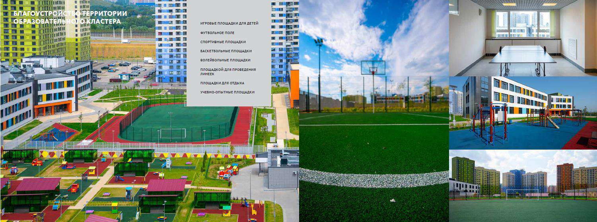

# Учебно-методические условия

> Основная образовательная программа начального общего образования ГБОУ Школа № 1366. ФГОС 3.0. Страницы PDF: 1789–1793.

ГБОУ Школа № 1366 располагает помещениями для реализации программы в соответствии с учебным планом и планом внеурочной деятельности, гигиеническими нормативами и санитарно-эпидемиологическими требованиями, безбарьерной средой.

Учебно-методические условия

Обеспечение учащихся учебной, художественной, справочной и энциклопедической литературой

ГБОУ Школа № 1366 имеет библиотеку с необходимыми фондами учебной, справочной, энциклопедической и художественной литературы в соответствии с реализуемой общеобразовательной программой. Фонд библиотеки составляет экземпляров (учебной литературы

- 28 000 экземпляров, справочной литературы – 20 экземпляров, энциклопедической литературы – 20 экземпляров, художественной литературы – 50 экземпляров).

Для реализации образовательной программы используются учебники, входящие в Федеральные перечень учебников, допущенных к использованию, представленные в таблице.

Таблица. Перечень используемых учебников для реализации образовательной программы

| Класс | Автор, наименование | Предмет | Издательство |
| --- | --- | --- | --- |
| 1 | Неменская Л.А.; под редакцией Неменского Б.М. Изобразительное искусство 1 класс | Изобразительное искусство | ПРОСВЕЩЕНИЕ |
| 1 | Климанова Л.Ф., Горецкий В.Г., Голованова М.В. и другие Литературное чтение (в 2 частях) 1 класс | Литературное чтение | ПРОСВЕЩЕНИЕ |
| 1 | Климанова Л.Ф., Горецкий В.Г., Голованова М.В. и другие Литературное чтение: 1-й класс: учебник: в 2 частях 1 класс | Литературное чтение | ПРОСВЕЩЕНИЕ |
| 1 | Моро М.И., Волкова С.И., Степанова С.В. Математика (в 2 частях) 1 класс | Математика | ПРОСВЕЩЕНИЕ |
| 1 | Моро М.И., Волкова С.И., Степанова С.В. Математика: 1-й класс: учебник: в 2 частях 1 класс | Математика | ПРОСВЕЩЕНИЕ |
| 1 | Критская Е.Д., Сергеева Г.П., Шмагина Т.С. Музыка 1 класс | Музыка | ПРОСВЕЩЕНИЕ |
| 1 | Плешаков А.А. Окружающий мир (в 2 частях) 1 класс | Окружающий мир | ПРОСВЕЩЕНИЕ |
| 1 | Александрова О.М., Вербицкая Л.А., Богданов С.И. и другие Русский родной язык: 1-й класс: учебник 1 класс | Родной язык | ПРОСВЕЩЕНИЕ |
| 1 | Канакина В.П., Горецкий В.Г. Русский язык 1 класс | Русский язык | ПРОСВЕЩЕНИЕ |
| 1 | Горецкий В.Г., Кирюшкин В.А., Виноградская Л.А. и другие Азбука (в 2 частях) 1 класс | Русский язык | ПРОСВЕЩЕНИЕ |
| 1 | Лутцева Е.А., Зуева Т.П. Технология 1 класс | Технология | ПРОСВЕЩЕНИЕ |
| 2 | Быкова Н.И., Дули Д., Поспелова М.Д. и другие Английский язык (в 2 частях) 2 класс | Английский язык | ПРОСВЕЩЕНИЕ |
| 2 | Коротеева Е.И.; под редакцией Неменского Б.М. Изобразительное искусство 2 класс | Изобразительное искусство | ПРОСВЕЩЕНИЕ |
| 2 | Рудченко Т.А., Семёнов А.Л. Информатика 2 класс | Информатика | ПРОСВЕЩЕНИЕ |
| 2 | Климанова Л.Ф., Горецкий В.Г., Голованова М.В. и другие Литературное чтение (в 2 частях) 2 класс | Литературное чтение | ПРОСВЕЩЕНИЕ |
| 2 | Кутейникова Н.Е., Синёва О.В.; под редакцией Богданова С.И. Литературное чтение на родном (русском) языке (в 2 частях) 2 класс | Литературное чтение на родном языке | Русское слово-учебник |
| 2 | Моро М.И., Бантова М.А., Бельтюкова Г.В. и другие Математика (в 2 частях) 2 класс | Математика | ПРОСВЕЩЕНИЕ |
| 2 | Гейдман Б.П., Мишарина И.Э., Зверева Е.А.; под редакцией Козлова В.В. Математика (в 2 частях) 2 класс | Математика | Русское слово-учебник |
| 2 | Критская Е.Д., Сергеева Г.П., Шмагина Т.С. Музыка 2 класс | Музыка | ПРОСВЕЩЕНИЕ |
| 2 | Плешаков А.А. Окружающий мир (в 2 частях) 2 класс | Окружающий мир | ПРОСВЕЩЕНИЕ |
| 2 | Канакина В.П., Горецкий В.Г. Русский язык (в 2 частях) 2 класс | Русский язык | ПРОСВЕЩЕНИЕ |
| 2 | Лутцева Е.А., Зуева Т.П. Технология 2 класс | Технология | ПРОСВЕЩЕНИЕ |
| 2 | Цветкова М.С., Якушина Е.В. Информационная безопасность. Правила безопасного Интернета. 2 класс | Информатика | ПРОСВЕЩЕНИЕ |
| 3 | Быкова Н.И., Дули Д., Поспелова М.Д. и другие Английский язык (в 2 частях) 3 класс | Английский язык | ПРОСВЕЩЕНИЕ |
| 3 | Горяева Н.А., Неменская Л.А., Питерских А.С. и другие; под редакцией Неменского Б.М. Изобразительное искусство 3 класс | Изобразительное искусство | ПРОСВЕЩЕНИЕ |
| 3 | Рудченко Т.А., Семёнов А.Л. Информатика 3 класс | Информатика | ПРОСВЕЩЕНИЕ |
| 3 | Климанова Л.Ф., Горецкий В.Г., Голованова М.В. и другие Литературное чтение (в 2 частях) 3 класс | Литературное чтение | ПРОСВЕЩЕНИЕ |
| 3 | Климанова Л.Ф., Виноградская Л.А., Горецкий В.Г. Литературное чтение (в 2 частях) 3 класс | Литературное чтение | ПРОСВЕЩЕНИЕ |
| 3 | Кутейникова Н.Е., Синёва О.В., Дудова Л.В.; под редакцией Богданова С.И. Литературное чтение на родном (русском) языке (в 2 частях) 3 класс | Литературное чтение на родном языке | Русское слово-учебник |
| 3 | Гейдман Б.П., Мишарина И.Э., Зверева Е.А.; под редакцией Козлова В.В. Математика (в 2 частях) 3 класс | Математика | Русское слово-учебник |
| 3 | Моро М.И., Бантова М.А., Бельтюкова Г.В. и другие Математика (в 2 частях) 3 класс | Математика | ПРОСВЕЩЕНИЕ |
| 3 | Критская Е.Д., Сергеева Г.П., Шмагина Т.С. Музыка 3 класс | Музыка | ПРОСВЕЩЕНИЕ |
| 3 | Плешаков А.А. Окружающий мир (в 2 частях) 3 класс | Окружающий мир | ПРОСВЕЩЕНИЕ |
| 3 | Канакина В.П., Горецкий В.Г. Русский язык (в 2 частях) 3 класс | Русский язык | ПРОСВЕЩЕНИЕ |
| 3 | Лутцева Е.А., Зуева Т.П. Технология 3 класс | Технология | ПРОСВЕЩЕНИЕ |
| 4 | Быкова Н.И., Дули Д., Поспелова М.Д. и другие Английский язык (в 2 частях) 4 класс | Английский язык | ПРОСВЕЩЕНИЕ |
| 4 | Неменская Л.А.; под редакцией Неменского Б.М. Изобразительное искусство 4 класс | Изобразительное искусство | ПРОСВЕЩЕНИЕ |
| 4 | Рудченко Т.А., Семёнов А.Л. Информатика 4 класс | Информатика | ПРОСВЕЩЕНИЕ |
| 4 | Климанова Л.Ф., Горецкий В.Г., Голованова М.В. и другие Литературное чтение (в 2 частях) 4 класс | Литературное чтение | ПРОСВЕЩЕНИЕ |
| 4 | Кутейникова Н.Е., Синёва О.В., Дудова Л.В.; под редакцией Богданова С.И. Литературное чтение на родном (русском) языке (в 2 частях) 4 класс | Литературное чтение на родном языке | Русское слово-учебник |
| 4 | Моро М.И., Бантова М.А., Бельтюкова Г.В. и другие Математика (в 2 частях) 4 класс | Математика | ПРОСВЕЩЕНИЕ |
| 4 | Гейдман Б.П., Мишарина И.Э., Зверева Е.А.; под редакцией Козлова В.В. Математика (в 2 частях) 4 класс | Математика | Русское слово-учебник |
| 4 | Критская Е.Д., Сергеева Г.П., Шмагина Т.С. Музыка 4 класс | Музыка | ПРОСВЕЩЕНИЕ |
| 4 | Плешаков А.А., Крючкова Е.А. Окружающий мир (в 2 частях) 4 класс | Окружающий мир | ПРОСВЕЩЕНИЕ |
| 4 | Васильева О.Ю., Кульберг А.С., Корытко О.В. и другие; под науч. ред. Васильевой О.Ю. Основы религиозных культур и светской этики. Основы православной культуры. 4 класс: учебник: в 2 частях 4 класс | Основы религиозных культур и светской этики | ПРОСВЕЩЕНИЕ |
| 4 | Беглов А.Л., Саплина Е.В., Токарева Е.С. и другие Основы религиозных культур и светской этики. Основы мировых религиозных культур 4 класс | Основы религиозных культур и светской этики | ПРОСВЕЩЕНИЕ |
| 4 | Латышина Д.И., Муртазин М.Ф. Основы религиозных культур и светской этики. Основы исламской культуры 4 класс | Основы религиозных культур и светской этики | ПРОСВЕЩЕНИЕ |
| 4 | Шемшурина А.И. Основы религиозных культур и светской этики. Основы светской этики 4 класс | Основы религиозных культур и светской этики | ПРОСВЕЩЕНИЕ |
| 4 | Канакина В.П., Горецкий В.Г. Русский язык (в 2 частях) 4 класс | Русский язык | ПРОСВЕЩЕНИЕ |

Доступ к качественному цифровому образовательному контенту

При реализации образовательной программы используются электронные (цифровые) образовательные ресурсы, размещённые в Библиотеке Московской электронной школы, свободный доступ к которым имеется у участников образовательных отношений: учеников, их родителей, педагогов, администрации школы. В поурочном планировании учителя в Московской электронной школе содержатся все планируемые к использованию на уроке и в домашнем задании цифровые образовательные ресурсы, данная информация автоматически отображается в дневнике ребёнка. Кроме того, в дневнике ребёнка к каждому уроку формируется подборка электронных ресурсов Московской электронной школы, привязанных к теме урока.
